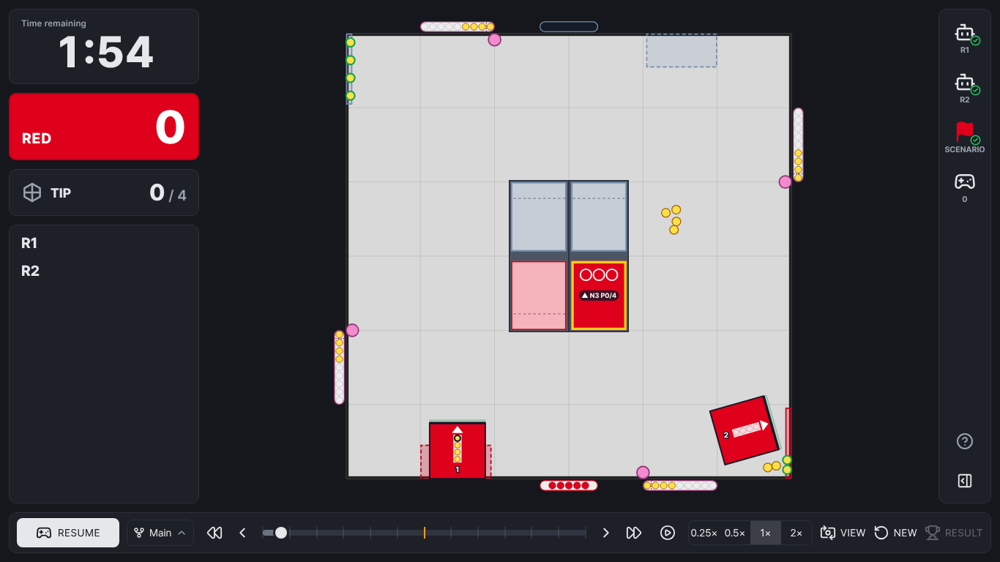
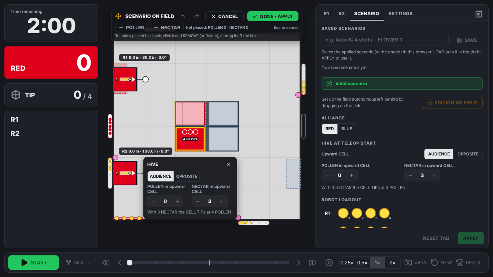

# FTC TacticSim

**English** · [한국어](#한국어)

A 2D tactic simulator for the **FTC BioBuzz TELEOP period** (2:00). Drive your two ALLIANCE robots live, review every tick, branch from any moment to try another plan, and compare the scores — all in the browser.

**▶ Open the app: https://biobuzz-tacticsim.7isx7juq.workers.dev**



- 50 Hz deterministic engine: the same setup and inputs always give the same match.
- Your robot specs: size, speed, intake zones and shooters (none / POLLEN only / shared / one per piece; launch height, angle, sweet spot). Hit maps are generated automatically and cached.
- Scenario: ALLIANCE, what autonomous left behind (HIVE, FLOWERS, GARDENS, loadouts, floor pieces, auto TIPs and moves) and start poses — set it on the field itself with **EDIT ON FIELD**.
- Review and branches: scrub, replay at 0.25–2×, branch from an earlier moment (up to 16 branches) and compare results.
- Save and share: keep robots, scenarios, setups and matches by name in your browser, or share them as small JSON files. The last match is saved automatically.

What changed in 2.0: see the [changelog](CHANGELOG.md).

> Simulation only: opponent robots and the autonomous period are not simulated, and some physics values are estimates. Use it to compare plans, not to predict exact scores.

## Quick start

1. **R1 / R2 tabs** — enter each robot's specs and shooter, then **APPLY**. The first hit map takes about 10–90 s depending on the PC.
2. **SCENARIO tab** — pick the ALLIANCE, the state after autonomous and the start poses (**EDIT ON FIELD** to place them on the field), then **APPLY**. Save each auto routine under **Saved scenarios** to pick it again later.



3. **START** — by default gamepad slot 0 drives R1, slot 1 (or the keyboard) drives R2; change this under **SETTINGS → Devices** (e.g. **SWAP R1 ↔ R2** to drive R2 with a single gamepad). Press a gamepad button once so the browser detects it.
4. After 2:00 the robots stop and the match plays on until everything comes to rest (balls already in the air still land); scoring is judged then, as in the rulebook. The result popup shows the score breakdown and RP. **SAVE MATCH** keeps the match in this browser; **EXPORT MATCH** saves a replay file to share.

The **?** button on the right edge opens the in-app help (controls, branches, files).

| Action | Gamepad | Keyboard |
|---|---|---|
| Move / turn | Left stick / right stick ←→ | W A S D / ← → |
| Intake / shoot | LT / RT | M / , |
| Lift up · down / drop into FLOWER | A / B | . / / |
| Pause · resume | — | Space |

Gamepad buttons (and left / right sticks) can be changed per slot under **SETTINGS → Devices**.

Designed for desktop browsers at 1366 × 768 or larger. The hosted app above uses HTTPS; if you host it yourself, serve it over HTTPS so hit maps can be cached.

## Run locally

Requires Node.js 22.12 or later.

```bash
npm ci
npm run dev      # development server
npm test         # tests (Vitest)
npm run test:browser  # browser tests (real Chromium; first run: npx playwright install chromium)
npm run build    # production build in dist/
```

The design specification (rules, physics model, architecture — in Korean) is [FTC TacticSim Specification.md](FTC%20TacticSim%20Specification.md).

## Bug reports

In the app: **? → Report a bug**, or email **7isx7juq@gmail.com**. Please include the steps and, if possible, a screenshot or an exported match file.

## License

Free for **non-commercial** use under the [PolyForm Noncommercial License 1.0.0](LICENSE) — you may use, copy, modify and share it for any non-commercial purpose; commercial use is not permitted. Third-party components are listed in [THIRD_PARTY_NOTICES.md](THIRD_PARTY_NOTICES.md).

---

## 한국어

**FTC BioBuzz TELEOP**(2:00)을 위한 2D 전술 시뮬레이터입니다. 같은 ALLIANCE 로봇 2대를 직접 조종하고, 모든 틱을 복기하고, 원하는 시점에서 가지를 나눠 다른 작전을 시도하며 점수를 비교할 수 있습니다. 브라우저에서 바로 동작합니다.

**▶ 앱 열기: https://biobuzz-tacticsim.7isx7juq.workers.dev**


- 50 Hz 결정론적 엔진: 같은 설정과 입력이면 항상 같은 경기가 나옵니다.
- 우리 로봇 제원: 크기, 속도, 흡입 구역, 슈터(없음 / POLLEN 전용 / 공용 1개 / 기물별 2개, 발사구 높이 · 발사각 · 스윗스팟). 명중 확률표는 자동으로 만들어지고 저장됩니다.
- 시나리오: ALLIANCE, 오토가 남긴 상태(HIVE, FLOWER, GARDEN, 적재물, 바닥 기물, 오토 TIP · 이동), 시작 자세 — **필드에서 편집**으로 필드 위에서 바로 정합니다.
- 복기와 가지: 타임라인 이동, 0.25 ~ 2배속 재생, 이전 시점에서 분기(최대 16개)와 결과 비교.
- 저장과 공유: 로봇 · 시나리오 · 전체 설정 · 경기를 브라우저에 이름 붙여 두거나 작은 JSON 파일로 공유합니다. 마지막 경기는 자동으로 저장됩니다.

2.0에서 바뀐 점은 [변경 기록](CHANGELOG.md#한국어)을 참고하세요.

> 시뮬레이션 전용입니다. 상대 로봇과 오토 구간은 시뮬레이션하지 않으며 일부 물리 값은 추정치입니다. 정확한 점수 예측보다 작전 비교에 활용하세요.

### 빠른 시작

1. **R1 / R2 탭** — 로봇 제원과 슈터를 입력하고 **적용**. 처음 명중 확률표는 PC에 따라 약 10 ~ 90초 걸립니다.
2. **시나리오 탭** — ALLIANCE, 오토 이후 상태, 시작 자세를 정하고(**필드에서 편집**으로 필드 위에 배치) **적용**. 오토 루틴마다 **저장된 시나리오**에 저장해 두면 다음에 바로 고를 수 있습니다.


3. **시작** — 기본으로 게임패드 슬롯 0은 R1, 슬롯 1(또는 키보드)은 R2를 조종합니다. **환경 및 조작 → 장치**에서 바꿀 수 있습니다 (예: 패드 1개로 R2를 조종하려면 **R1 ↔ R2 바꾸기**). 게임패드는 버튼을 한 번 눌러야 브라우저가 인식합니다.
4. 2:00이 지나면 로봇은 멈추고, 모든 것이 멈출 때까지 경기가 이어집니다 (이미 날아간 공은 끝까지 날아감). 득점은 룰북대로 그때 판정합니다. 결과 팝업에 항목별 점수와 RP가 나옵니다. **경기 저장**은 이 브라우저에 경기를 두고, **경기 내보내기**는 공유용 재생 파일을 저장합니다.

화면 오른쪽 끝의 **?** 버튼을 누르면 앱 안 도움말(조작, 가지, 파일)이 열립니다.

| 동작 | 게임패드 | 키보드 |
|---|---|---|
| 이동 / 회전 | 왼쪽 스틱 / 오른쪽 스틱 ←→ | W A S D / ← → |
| 흡입 / 발사 | LT / RT | M / , |
| 리프트 올림 · 내림 / FLOWER 투입 | A / B | . / / |
| 일시정지 · 재개 | — | Space |

게임패드 버튼(과 왼쪽 / 오른쪽 스틱)은 **환경 및 조작 → 장치**에서 슬롯별로 바꿀 수 있습니다.

1366 × 768 이상의 데스크톱 브라우저용입니다. 위 주소는 HTTPS입니다. 직접 호스팅할 때도 명중 확률표 저장을 위해 HTTPS로 제공하세요.

### 직접 실행

Node.js 22.12 이상이 필요합니다.

```bash
npm ci
npm run dev      # 개발 서버
npm test         # 테스트 (Vitest)
npm run test:browser  # 브라우저 테스트 (실제 Chromium, 처음 한 번 npx playwright install chromium)
npm run build    # 배포용 빌드 (dist/)
```

게임 규칙, 물리 모델, 구조를 정리한 설계 명세서는 [FTC TacticSim Specification.md](FTC%20TacticSim%20Specification.md)에 있습니다.

### 버그 리포트

앱에서 **? → 버그 리포트**를 누르거나 **7isx7juq@gmail.com**으로 메일을 보내 주세요. 재현 순서와, 가능하면 스크린샷이나 내보낸 경기 파일을 함께 보내 주세요.

### 라이선스

[PolyForm Noncommercial License 1.0.0](LICENSE)에 따라 **비상업적** 용도로 자유롭게 사용할 수 있습니다. 비상업적 목적이라면 사용 · 복사 · 수정 · 공유가 모두 가능하며, 상업적 사용은 허용되지 않습니다. 서드파티 구성 요소는 [THIRD_PARTY_NOTICES.md](THIRD_PARTY_NOTICES.md)를 참고하세요.
