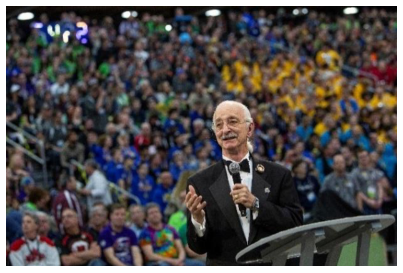
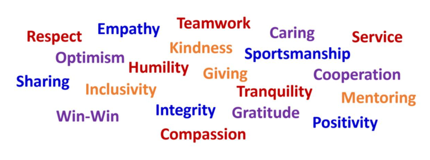
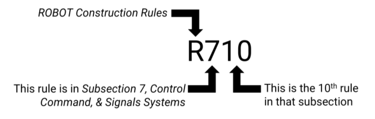

<!-- Source: FTC 2026-2027 BIOBUZZ Competition Manual TU05 (2026-10-15) - Section 1, PDF pages 5-20 -->

# 1 Introduction

## 1.1 About FIRST®

_FIRST_® (For Inspiration and Recognition of Science and Technology) was founded to inspire young people’s interest in science and technology. Since its founding, _FIRST_ has grown to be the world’s leading youth-serving nonprofit advancing STEM education and has become a worldwide movement: inspiring innovation, building confidence, and preparing young people for the future.

Our programs have a proven and lasting impact on learning, interest, and skill-building inside and outside of the classroom, and are only possible because of the _FIRST_ volunteers, educators, mentors, and sponsors who tirelessly support our students as they build their future.

Each year participants experience firsthand the inspiration that comes from joining a global community of people with the same mission, and the bonding that comes from working to solve the same shared challenge. _FIRST_ students will go on a journey of discovery that merges the rigor of STEM learning with the fun and excitement of traditional sports.

Please visit the _FIRST_ website for more information about _FIRST_ and its programs.

|**Purpose**|**Vision**|**Mission**|
|---|---|---|
|_FIRST_ exists to prepare the young people of today for the world of tomorrow.|To transform our culture by creating a world where science and technology are celebrated and where young people dream of becoming science and technology leaders.|The mission of _FIRST_ is to provide life-changing robotics programs that give young people the skills, confidence, and resilience to build a better world.|

## 1.2 FIRST® Tech Challenge

_FIRST_ provides a wide spectrum of robotics experiences designed to meet students where they’re at: engaging and exciting students at every level, whatever their circumstances. What makes _FIRST_® Tech Challenge special among the family of exceptional _FIRST_ programs?

Scale, Skill Level, Complexity, Flexibility, and Student Ownership

- **Scale.** With a classroom sized field and classroom safe robots - _FIRST_ Tech Challenge can be implemented anywhere students want to gather. The ability to succeed with smaller teams provides a social structure in which students on a team can either excel in all roles or specialize in a single role.

- **Skill Level.** _FIRST_ Tech Challenge provides challenges for students looking for championship play with advancement opportunities, and for those just now learning to play in their own classroom. It provides a scaffolded experience for growth that does not require experts to drive the experience, only caring adults to enable self-exploration.

- **Complexity.** Robots can be fully built from a basic Starter Kit, fully fabricated from custom designs, or built in a way that mixes both approaches. There are opportunities for advanced manufacturing, but non-classroom tools are optional, not required.

- **Flexibility.** With an extended season kicking off in September and running through March with capstone events held April through July, teams can adjust their season to incorporate intense peaks spread out between recovery periods or other school activities while still providing an improvement driven, iterative build experience.

- **Student Ownership.** Smaller teams competing in an extended season with classroom safe robots enable students to learn independently through self-exploration and feel ownership over more of their team’s journey.

And of course, _FIRST_ Tech Challenge provides all the opportunities for community, collaboration, outreach, and growth found across the _FIRST_ programs.

Please visit the _FIRST_ Tech Challenge webpages for more details.

## 1.3 FIRST Ethos and Core Values

### 1.3.1 Gracious Professionalism®

_Gracious Professionalism_® is part of the ethos of _FIRST_ . It's a way of doing things that encourages high-quality work, emphasizes the value of others, and respects individuals and the community.

Through _Gracious Professionalism_ , fierce competition and mutual gain coexist. Participants compete intensely while treating each other with respect and empathy. There is no trash talking, but there are also no disingenuous platitudes. Knowledge, competition, integrity, and empathy blend comfortably.

Ultimately, _Gracious Professionalism_ is part of pursuing a meaningful life. When professionals use knowledge in a gracious manner and individuals act with integrity and sensitivity, everyone wins and society benefits.

The term was coined by Dr. Woodie Flowers, (1943 - 2019) executive advisory board chair emeritus, distinguished advisor to _FIRST_ , and father of competition robotics.

_Figure 1-1: Dr. Woodie Flowers, Father of Competition Robotics, Gracious Professionalism advocate and exemplar_

_“The FIRST spirit encourages doing high-quality, well-informed work in a manner that leaves everyone feeling valued. Gracious Professionalism seems to be a good descriptor for part of the ethos of FIRST. It is part of what makes FIRST different and wonderful.”_

_- Dr. Woodie Flowers_

_Gracious Professionalism_ is a gift from Woodie, and all of us have now become its stewards. Woodie often said that it is not critical that we define _Gracious Professionalism_ , but Woodie would continue to say it is very important to talk about _Gracious Professionalism_ .

> _Gracious Professionalism_ can be difficult to understand because the pursuit of it should be different for everyone. When talking about _Gracious Professionalism_ , it is quickly evident that it has come to symbolize all that is good inside all of us and all that is good when we interact with one another and our world.

> It is an aspirational ideal to always strive towards, not a goal to be achieved, and not a method of measuring someone. For that reason, you can never say someone “is” or “is not” being Graciously Professional, but instead they might embody some of its aspects.

> Whenever something is being discussed as “not GP,” it’s more appropriate to talk about specific behaviors that need improvement. Was the person disrespectful? Impolite? Dishonest?

Being Graciously Professional is more than any of its individual attributes.

### Some possible meanings of Gracious Professionalism include:

- gracious attitudes and behaviors that are win-win,

- gracious folks respect others and let that respect show in their actions,

- professionals possess special knowledge and are trusted by society to use that knowledge responsibly, and

- gracious professionals make a valued contribution in a manner pleasing to others and to themselves.

**In the context of FIRST, this means that all teams and participants should:**

- learn to be strong competitors but also treat one another with respect and kindness in the process, and

   - avoid leaving anyone feeling as if they are excluded or unappreciated.

Successful teams spend time going over this concept and reinforcing it regularly. Team members should work together to identify real-life examples of _Gracious Professionalism_ in practice. Routinely highlight opportunities to display aspects of _Gracious Professionalism_ to each other at events and encourage every team member to suggest ways in which they can embody aspects of this quality themselves.

_Figure 1-2: Words which might apply to individuals embodying Gracious Professionalism. What words would you put in your word cloud?_

### 1.3.2 Coopertition®

_Coopertition_® is displaying unqualified kindness and respect in the face of fierce competition. It is founded on the concept and philosophy that teams can cooperate and help one another even when they’re directly competing against each other. The alliance structure of _FIRST_ Tech Challenge inherently showcases _Coopertition_® - a team’s opponent in one match may be their alliance partner in the next. In this sense, every team benefits when everyone plays their best.

### 1.3.3 Core Values

The _FIRST_ Core Values are fundamental to _FIRST_ and unique to our programs. They emphasize friendly sportsmanship, respect for the contributions of others, teamwork, learning, and community involvement. Our community expresses the _FIRST_ philosophies of _Gracious Professionalism_® and _Coopertition_® through the _FIRST_ Core Values.

- **Discovery** : We explore new skills and ideas.

- **Innovation** : We use creativity and persistence to solve problems.

- **Impact** : We apply what we learn to improve our world.

- **Inclusion** : We respect each other and embrace our differences.

   - **Teamwork** : We are stronger when we work together.

- **Fun** : We enjoy and celebrate what we do!

### 1.3.4 Why Embrace the FIRST Ethos and Gracious Professionalism?

Some people new to _FIRST_ and our values may think: _“This doesn’t apply to me. I don’t see this in the world around me. Why do I need to act this way?”_

_To build a better world, pursue a more meaningful life, and celebrate all that makes us uniquely_

_human._

### Build a Better World

Our mission is to “give young people the skills, confidence, and resilience to build a better world.” What kind of world do we want that to be? What kind of culture do we want to be a part of?

We at _FIRST_ believe that a world where everyone strives to embody the _FIRST_ values and demonstrate _Gracious Professionalism_ in their actions would be a pretty great world to live in.

### Pursue a Meaningful Life

And, these actions make people feel good! We know, being an effective contributor is a huge part of feeling good about yourself. These behaviors will have a positive impact in all areas of your life.

Working hard can be fun and profoundly satisfying, and achieving this rational self-esteem is a big part of longterm happiness. You may start these behaviors because you’re trying to build a better world, but you’ll also find yourself building a more meaningful life.

### Still skeptical? Try it in FIRST.

In many ways, _FIRST_ is practice for the real world; we have the chance to shape the _FIRST_ community however we want. We’re giving students the opportunity to make Graciously Professional choices when it’s easy - so they’ll see how it feels, learn how it works, and be prepared to do the same when it’s _not_ as easy.

We get what we celebrate: so, let’s celebrate hard work, integrity, fair play, sportsmanship, empathy, and all the things which make us uniquely human.

## 1.4 The Spirit of the Competition

### 1.4.1 A Note from the FIRST Staff

Welcome to BIOBUZZ presented by RTX! We are excited to begin the 2026-2027 _FIRST_ Tech Challenge Season. We’d like to describe some changes that are happening, some things we hope will never change, and some challenges we’re facing due to the success and growth of the program. _FIRST_ Tech Challenge serves participants with a wide variety of backgrounds, ages, and skill levels. Our program is both a capstone experience and a foundational experience. The highest skilled competitors in _FIRST_ Tech Challenge are creating robots with technical achievements that impress even industry experts and perform tasks most people don’t think are possible. At the same time, _FIRST_ Tech Challenge provides an on-ramp for students and teams who are experiencing a robotics-sport for their first time. Our games are played at levels which would rival the excitement and spectacle of any sporting event, but they are also played in classrooms, garages, and in school libraries.

As veterans know and rookies will soon learn:

_“There are no perfect solutions, only tradeoffs. Only compromise. We must choose the tradeoffs we believe provide the best balance of outcomes.”_

Our commitment is that students and teams from across this entire spectrum find a welcoming home in _FIRST_ Tech Challenge. We will ensure every team can “play robots” in a way where they can meaningfully contribute to their alliance, iterate as they grow in experience, and feel the thrill that comes from competing in a true _sport of the mind_ ™.

### Season Challenges: Championship Play vs. Learning to Play.

Whether you’re the defending world champion or you’re building your first StarterBot, we will provide engaging games with challenges that enable student learning and skill growth. These challenges will include familiar themes from the past to encourage building on the skills from prior seasons, while also including new dynamics which shift the ‘meta,’ encouraging the community to continuously learn and experiment.

_FIRST_ Tech Challenge will always provide high-integrity Championship level experiences where our top teams can showcase their capabilities and find creative, exceptional solutions to the season’s challenges. That is not changing. However, we also want more kids around the world to be able to participate in _FIRST_ Tech Challenge, even if they don’t have any prior STEM experience and don’t have access to a Championship level event. To do that, we need to make the program more accessible to students, coaches, volunteers, and local leaders.

### Competition Integrity at all Levels.

The _FIRST_ Staff and all _FIRST_ volunteers want every match of every competition to be perfect. Even if they can’t be perfect, we want to protect the integrity of the competition and ensure fair play for all our teams. As our sport has matured, teams have made us very proud as they have _dramatically_ improved in performance. With their success has come additional challenges, and now maintaining the integrity of the competition is becoming increasingly difficult. Recent years have placed more burden on our game design, our field designs, and our volunteers. Many of our efforts to enable the highest levels of

play only make it more difficult to enable introductory play experiences. We feel we need to change something to be successful at enabling both.

### Changes for 2026-2027 (and beyond).

The 2026-2027 Season includes a deliberate change in how we designed BIOBUZZ and wrote its Competition Manual. This change is something we plan to continue for future games and future seasons. The manuals from prior seasons focused on covering exact circumstances and details, removing flexibility in favor of attempting to cover all scenarios.

The BIOBUZZ manual emphasizes the "spirit of the rule" and empowers event volunteers to make goodfaith judgement calls. BIOBUZZ rules are written to emphasize "intended gameplay" and make it simpler for participants and volunteers to understand the spirit and intent of the rule. The rules are designed to allow volunteers to watch for larger behaviors and strategies that run counter to the spirit of the competition, rather than be required to watch for and record every action or incident that occurs (e.g., strategically blocking an opponent from access to their gate vs. going into an opponent’s gate zone). This will make it easier to volunteer, allow volunteers to focus more on supporting teams in line with the spirit of _FIRST_ Volunteering, and result in a more consistent competition experience for everyone.

### This change can only be possible if we all commit ourselves to the ethical standards described by

**the FIRST Ethos and FIRST Core Values.** We still want teams to compete to win. We want that to be done in a manner that is gracious and respectful to both their fellow competitors and the event volunteers enforcing the rules. To enable this culture, we’re emphasizing a Framework of Behaviors all _FIRST_ participants should follow, and a Competition Integrity Contract. When all our participants and volunteers are aligned with this framework it will allow us to simplify many of our regulations, remove some burden from everyone in the program, and make it easier for all of us to be successful!

Thank you, and we look forward to everything to come this season!

- **FIRST Tech Challenge Staff**

### 1.4.2 Framework of Behaviors

The culture of _FIRST_ Tech Challenge is shaped by the habits and behaviors of our global community. To ensure our sport remains a positive space for our teams, we rely on all our participants, mentors, educators, supporters, alumni, and volunteers to follow a framework of ethical behaviors. These range from aspirational philosophies to firm rules and regulations.

- **Gracious Professionalism & FIRST Core Values**

_Gracious Professionalism_ remains the guiding star for all our behaviors, and we should always strive to act in a way that aligns with its philosophy. Celebrating the _FIRST_ Core Values and ensuring they remain central to our behavior is how we embody _Gracious Professionalism_ and preserve the unique _FIRST_ culture.

- **FIRST Code of Conduct**

Adults (and parents of minors) in _FIRST_ each certify adherence to the _FIRST_ Code of Conduct which provides behavior and youth protection requirements to ensure the safety of all _FIRST_ participants.

- **Competition Integrity Contract**

Every team in _FIRST_ Tech Challenge must follow the Competition Integrity Contract (CIC) in Section 1.5 Competition Integrity Contract (CIC) below. The CIC outlines team behaviors which protect the integrity of the competition and long-term health of The Sport.

- **Competition Rules: The Competition Manual, Team Updates, and Q&A**

Each season’s game is defined by the rules and regulations in its Competition Manual. While these rules change each year, they describe the criteria all teams must meet to be eligible for competition, and the specific behaviors all teams must follow while competing.

### 1.4.3 The Role of Mentors

The _FIRST_ mission is to create programs that give young people skills, confidence, and resilience to build a better world, and mentors are a key component to that in _FIRST_ Tech Challenge. Adult mentorship is a proven part of what makes _FIRST_ so effective:

**Working with a mentor or coach is a critical part of the learning process.** _FIRST programs provide mentoring of students which may lead to a better understanding of STEM careers as well as increased confidence, self-esteem and satisfaction of the student._

This naturally leads to the question: _“How much involvement in building the robot should the mentors have?”_ The answer continues to be: _“However much is needed to inspire the youth on the team.”_

**Each team’s robot should be representative of their journey and experience, and every team’s journey is unique** .

The level of involvement of mentors on a team will vary team-by-team and often season-by-season. For example, a team may have a student or group of students with enough CAD skills to largely create the CAD model of their robot with limited mentor guidance and oversight. The same mentor may need to take a more hands-on approach the next season if those students graduate, and no other students have those skills yet.

_FIRST_ does not provide a prescriptive process for running a team; each team should be structured to meet students where they’re at. Success should always be based on individual student outcomes. This is reinforced

through mentor training resources and the sharing of best practices, so all teams may continuously improve as they find what works best for their students.

### 1.4.4 The Spirit of FIRST Volunteers

_FIRST_ volunteers are there to help every team succeed and should actively help the competitors avoid breaking rules whenever possible. One of the things which makes _FIRST_ special is the culture in which volunteers have the opportunity to serve as mentors to all _FIRST_ students.

It is easy for volunteers to default to a culture of enforcement and for teams to default to adversarial behaviors. _FIRST_ teams and volunteers need to remember during all their interactions, they should be working together, not fighting each other.

It is often said:

_"Through Gracious Professionalism, fierce competition and mutual gain coexist. Participants compete intensely while treating each other with respect and empathy."_

In this way, fierce and intense competition can be a direct part of embodying _Gracious Professionalism_ . Everyone should remember that _FIRST_ teams, students, and mentors are deeply passionate about our sport. They will, as they should, compete very hard as they pursue excellence and “success on the field.”

_FIRST_ prepares volunteers to likewise respond with respect and empathy in the face of this competitive intensity. To be successful, volunteers must take advantage of the resources and training _FIRST_ provides each season. This means they must fully understand not only the rules, but also the published guidelines on how _FIRST_ intends them to be enforced. This will ensure that each competition is conducted as fairly and consistently as possible.

For many _FIRST_ students, their competition experience will be defined by a few interactions with a handful of adult volunteers. This is why it is so important that all _FIRST_ volunteers behave in a friendly, supportive, fair, and team-focused manner at all times. **This is another reason why FIRST volunteers are so special; they are charged with maintaining the integrity of the competition but doing so by reinforcing the FIRST Core Values and always doing their best to act with Gracious Professionalism.**

There are two phrases which drive and motivate the individuals that volunteer their time with _FIRST_ : “Giving Back” and “Paying It Forward.” Each year, you have the extraordinary opportunity to help create the best-ever experience for our students, mentors, and fellow volunteers by becoming a _FIRST_ volunteer.

Please consider volunteering at local events near you, but know that not all applicants can be placed in all roles at any given event. Please work with your volunteer coordinator and local Program Delivery Partner (PDP) to help identify the most meaningful way you can help in your region. A complete set of all role-specific volunteer materials can be found on our Volunteer Resources Page.

## 1.5 Competition Integrity Contract (CIC)

As an actionable part of the Framework of Behaviors described in Section 1.4.2 Framework of Behaviors, the Competition Integrity Contract (CIC) defines ways that every team in _FIRST_ Tech Challenge should behave, both at and outside events.

The CIC is divided up into two categories: Sporting Ethics Code, which all teams must follow to protect the integrity of the competition, and Behavior Guidelines, which help teams act in a way that embodies _Gracious Professionalism_ and ensures that every team can: Have Fun, Make Friends, and Chase Excellence.

### 1.5.1 Sporting Ethics Code

### Our Team Certifies:

### We Don’t Cheat.

Our team will never intentionally violate the spirit of a rule. We won’t circumvent the systems _FIRST_ uses to keep the competitions running. We would be ashamed to win a student competition by cheating. The only true wins come when everyone is playing by the same rules: with honor, fair play, and integrity.

### We Always Behave with Integrity.

We take pride in behaving with honor, even when “no one is watching.” We appreciate the spirit of _FIRST_ Volunteering, and we want the volunteers to focus on supporting teams rather than simply enforcing rules. We understand that teams need to abide by _all_ the regulations, even the ones that are not checked. **Our actions are based on what is right, not what we think we can get away with.**

### We Play the Game as Intended.

We understand The Sport is designed to be: “Red Alliance vs. Blue Alliance,” it is not supposed to be “Teams vs. Volunteers.” We understand the rules aren’t designed to list every possible situation that can occur. Our team will not try to gain an advantage using any “loopholes” in the rules. If there is ever ambiguity in the specific wording of a rule, we will look to the intent of the rule and spirit of the competition to guide our behavior.

### We Know Our Team Doesn’t Enforce the Rules.

Our team values fair play and good sportsmanship. If we see something which we know is inappropriate, we will politely bring it to the attention of competition staff. We understand it is the responsibility of the event staff and _FIRST_ Headquarters to handle any escalation and mitigation. We understand it is not appropriate for us to accuse, investigate, publicly call-out, or persecute _anyone_ for a perceived infraction, especially in a disrespectful or confrontational manner.

### 1.5.2 Behavior Guidelines

### Our Team Certifies:

### We Focus on Journey, Before Destination.

Our team will try hard to win. We will chase excellence in everything we do. We will not define our success based on the competition results, but on the lessons we learn and friends we make. _FIRST_ competitions are opportunities to measure our progress, and alongside other teams, celebrate the journey we’ve all taken together!

**We Behave with Respect and Good Sportsmanship.**

We will always strive to treat others with respect. Regardless of the outcomes, we will always strive to act professionally and behave in a way that we will be proud to remember (even when the competition gets intense and emotions are running high). Long after the competition is over, we know we won’t remember if things didn’t go exactly the way we wanted, but we will remember how we acted during those tough moments.

_We support our teammates. We praise our partners. We celebrate our opponents._

### We Help Each Other.

We do our best work when we’re helping others and treating them with respect and kindness. We want to succeed, but we don’t want it to happen because someone else failed. We want to help everyone to play at their best, even when we’re playing against each other. Then, we're going to celebrate with each other regardless of the outcome. _(...but we’re hopefully going to win.)_

### We ‘Take the High Road.’

We’re all still growing, no one is perfect. Being respectful means being understanding, empathetic, and sometimes being forgiving when someone else’s behavior doesn’t meet our expectations. If someone acts in a way which doesn’t seem right, we will try not to let it affect how we behave. Everyone is on their own journey; everyone is struggling in ways we don’t always see. We will remain focused on our own growth. We will be respectful to everyone, even those who are disrespectful to us.

**We Respect Property and Facilities.**

Our team will always work to leave things in a better state than we find them. We will behave in a way that prevents foreseeable damage to equipment, facilities or the property of others. We will clean up any messes we make. Accidents happen, and we will report any accidental damage to the appropriate individuals.

### We Build a Positive Culture of Safety.

We will never knowingly jeopardize our own safety, or the safety of those around us. Our team will enable the safety of everyone we meet. Instead of a culture of safety enforcement, we emphasize teaching safe decision making and understanding safety best practices. In doing so, we help our members learn how they can be safe even in unfamiliar situations.

### We Make Healthy Choices.

The competition is exciting and sometimes there is a risk of it becoming all-consuming of our time and attention. We understand that to succeed in _FIRST_ Tech Challenge, and in life, it’s important to prioritize our mental and physical health. Even when things get “very busy,” we will ensure everyone on our team is: staying hydrated, eating well, staying active, getting enough sleep, and taking regular breaks.

We also understand that in any creative process a measured (and sometimes relaxed) schedule which leaves time for recuperation will often result in a better outcome than “grinding” for long hours. We know our team is most successful when every member is at their best, both at competitions and outside them.

**We’re All on the Same Team.**

This is a global community of great people with unique backgrounds who all have experiences to share. On the field, teams are supposed to compete fiercely against each other. Off the field, we’re all on the same team. Students, Mentors, Volunteers, Event Organizers… Everyone is here for the same reasons. We’re going to have fun, play robots, share stories, build something awesome, learn from everyone we meet, celebrate cool stuff, and more than anything: we'll be excellent to each other!

### 1.5.3 Infractions, Mitigations, & Escalation

Violations of the CIC may require escalation and/or mitigation depending on the circumstances of the infraction. These infractions may occur at an event and/or outside of events.

Escalations for violations related to specific competition regulations are outlined in the Escalation Guidelines. Some situations may require escalation to competition volunteers such as a Lead Robot Inspector (LRI), Head Referee, or _FIRST_ Technical Advisor (FTA) for mitigation.

More serious violations, especially violations of the Sporting Ethics Code, will be escalated to the Event Director, and/or to _FIRST_ Headquarters. At the discretion of _FIRST_ Headquarters, these violations may result in the team being sanctioned, and/or disqualified from current and/or future events. Following an investigation, at the discretion of _FIRST_ Headquarters, serious violations could result in a team or individuals being suspended or permanently removed from the _FIRST_ Tech Challenge program.

_FIRST_ has an open door policy; concerns from an event may be brought to the attention of _FIRST_ Headquarters by emailing customerservice@firstinspires.org or contacting support.

## 1.6 Accessibility and Inclusion

_FIRST_ is committed to _STEM for Everyone™_ and as such, _FIRST_ makes reasonable accommodations for persons with disabilities who need and request accommodations. If a participant needs accommodation for an event, please contact your local leadership before the event so they can help ensure the accommodation is provided. Local leadership may make exceptions to rules to allow for reasonable accommodation given the exceptions do not create an undue hardship or cause safety concerns.

## 1.7 Understanding & Using the Competition Manual

### 1.7.1 This Document & Its Conventions

The 2026-2027 Competition Manual is a resource for all _FIRST_ Tech Challenge teams for information specific to the 2026-2027 season and the BIOBUZZTM presented by RTX game. Its audience will find the following details:

- a general overview of the BIOBUZZ game,

- detail about the BIOBUZZ playing FIELD,

- a description of how to play the BIOBUZZ game,

- rules (related to safety, conduct, gameplay, inspection, event, etc.),

- ROBOT construction rules, and

- a description of how teams advance throughout the season.

The Competition Manual is intended to be the “source of truth” and while the intent is for supporting documents to be consistent with information some inconsistencies may exist. In cases of discrepancy, the Competition Manual takes precedence.

Specific methods are used throughout this manual to highlight warnings, cautions, key words, and phrases. These conventions are used to alert the reader to important information and are intended to help teams in constructing a ROBOT that complies with the rules in a safe manner.

Links to other section headings and rule references within this manual appear in blue underlined text with a grey background. Links to external resources appear blue underlined text.

For linked references not included in a preview release of this document, the links will appear with the section letter and ### for the rules number within square brackets. For example, a cross link to a game rule before a game rule is released will appear as [G###] and will be replaced with the current linked rule when that section of the manual is released.

Key words that have a particular meaning within the context of _FIRST_ Tech Challenge and BIOBUZZ are defined in Section 16 Glossary and indicated in ALL CAPS throughout this document.

The rule numbering method indicates the section, subsection, and position of the rule within that subsection. The letter indicates the section in which the rule is published.

> − I for Section  3 Competition Eligibility and Inspection (I)
> − E for Section  5 Event Rules (E)
> − A for Section  6 Awards (A)
> − G for Section  11 Game Rules (G)
> − R for Section  12 ROBOT Construction Rules (R)
> − T for Section  13 Tournament (T)
> − L for Section  14 League Play Tournaments (L)
> − C for Section  15 FIRST Championship (C)
>

The following digit(s) represents the subsection in which the rule can be found. The final digits indicate the rule’s position within that subsection.

_Figure 1-3 Rule numbering method_

> Warnings, cautions, and notes appear in orange boxes. Pay close attention to their contents as they’re intended to provide insight into the reasoning behind a

> rule, helpful information on understanding or interpreting a rule, and/or possible “best practices” for use when implementing systems affected by a rule. While orange boxes are part of the manual, they do not carry the weight of the actual rule (if there is an inadvertent conflict between a rule and its orange box, the rule supersedes the language in the orange box).

Imperial dimensions are followed by comparable metric dimensions in parentheses to provide metric users with the approximate size, mass, etc. Metric conversions (e.g., dimensions) round to the nearest 0.05 cm, e.g., "17.5 in. (~44.45 cm).” The metric conversions are offered for convenient reference only and do not overrule or take the place of the imperial dimensions presented in this manual and the official drawings (i.e., dimensions and rules will always defer to measurements using imperial units).

Rules include colloquial language, also called headlines, in an effort to convey an abbreviated version of the rule or rule set. There are two versions of headline formatting. Evergreen rules, rules which are expected to be present each season with only their specific details changing from season to season, are indicated with their headline presented in ***bold green text** with a leading asterisk. This means that the overall subject and presence of the rule from season to season is constant, but game specific details and terms may be updated as needed (e.g., changing game specific terms, or changing the specific details around ROBOT expansion within an Evergreen rule about expansion limits, or changing the quantity of allowed motors within an Evergreen actuator rule). These rules also start their respective section, so their rule number is less likely to change from season to season. All other rule headlines use **bold orange text** .

Any disagreement between the specific language used in the rules and the colloquial language is an error, and the specific rule language is the ultimate authority. If you discover a disparity, please let us know at customerservice@firstinspires.org.

Team resources that are not generally season specific (for example, what to expect at an event, communication resources, team organization recommendations) can be found on the _FIRST_ Tech Challenge Resources Page.

### 1.7.2 Translations & Other Versions

The _FIRST_ Tech Challenge Competition Manual is originally and officially written in English and is occasionally translated into other languages for the benefit of _FIRST_ Tech Challenge teams whose native language may not be English. These assets are posted on the Game and Season Materials page.

A text-based English version can be provided only for use with assistive devices and not for redistribution. For more information, please contact _FIRST_ Tech Challenge at customerservice@firstinspires.org.

Additional resources such as a _FIRST_ Tech Challenge AI Chatbot are provided as a helpful tool, but the Competition Manual is the final authority. In the event that a rule or description is modified in an alternate version of this manual, the latest English PDF version as published on the Game and Season Materials page is the authoritative version.

### 1.7.3 Team Updates

Team Updates are used to notify the _FIRST_ Tech Challenge community of revisions to the official season documentation (e.g., the manual, drawings) or important season news. Team Update posts are scheduled as follows on the Game and Season Materials page:

- Every Thursday beginning on Kickoff day and ending two weeks prior to _FIRST_ Championship.

Team Updates are indicated using the following formatting:

> - Additions are highlighted in yellow. This is an example.

- Deletions are indicated with a strikethrough. ~~This is an example.~~

Team Updates that are published after the driver’s meeting at an event will not apply to that event.

### 1.7.4 Question & Answer System

The Question and Answer System (Q&A) is a resource for teams to ask questions about gameplay, competition rules, judging and advancement, ROBOT build rules, and FIELD setup. Teams can search for previously asked questions and responses or pose new questions. Questions can include examples for clarity or reference multiple rules to understand the relationships and differences between them.

The Q&A opens on September 28, 2026, 12:00p.m. ET. Access to the Game Q&A system is through the Lead Coach 1 or Lead Coach 2’s account on the _FIRST_ dashboard.

The Q&A may result in revisions to the text in the official manuals (which are communicated using the process described in Section 1.7.3 Team Updates ).

Moderators will answer team questions beginning each Monday and close on Thursday at 5:00p.m. ET. The responses in the Q&A do not supersede the text in the manual, although every effort will be made to eliminate inconsistencies between the two. While responses provided in the Q&A may be used to aid discussion at each event, REFEREES and INSPECTORS are the ultimate authority on rules. If you have concerns about enforcement trends by volunteer authorities, please notify _FIRST_ .

The Q&A is not a resource for firm predictions on how a situation will play out at an event. Questions about the following may not be addressed:

- rulings on vague situations

   - challenging decisions made or  at past events

   - design reviews of a ROBOT system for legality

- questions that are overly broad, vague, and/or include no rule references

- questions about how a REFEREE should have ruled when specific gameplay happened at a past event

- duplicate questions

   - questions clearly defined/addressed in this manual

Good questions ask generically about features of parts or designs, gameplay scenarios, or rules, and often reference one or more relevant rules within the question. Some examples of questions that will likely be answered in the Q&A are:

- A device we are considering using on the ROBOT comes with purple AWG 40 wire, does this comply with R?? and R??

- We’re not sure how to interpret Rule G?? applies if blue ROBOT A does X and red ROBOT B does Y, can you please clarify?

- If a ROBOT does this specific action, is it doing what this defined term is describing?
