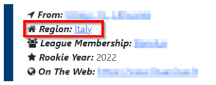
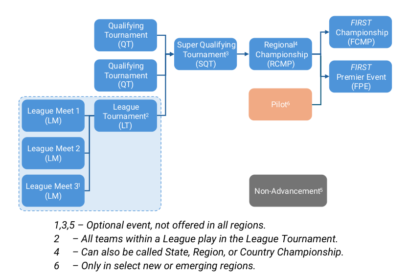
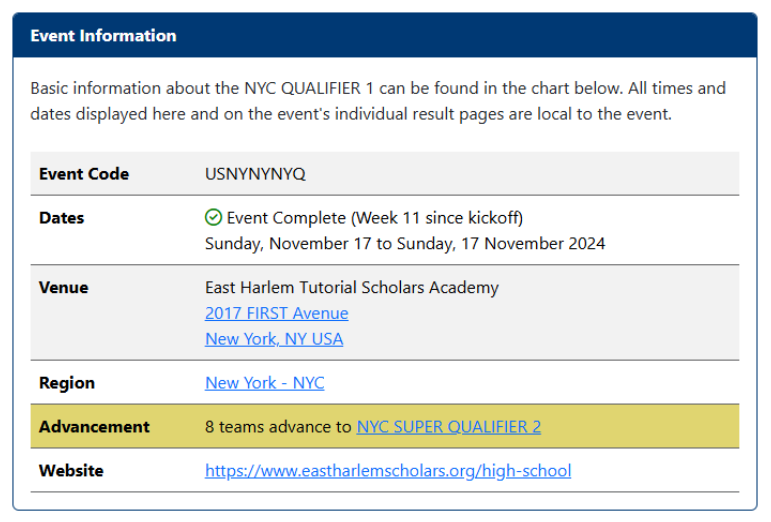

<!-- Source: FTC 2026-2027 BIOBUZZ Competition Manual TU05 (2026-10-15) - Section 4, PDF pages 27-32 -->

# 4 Advancement

Teams are only eligible to advance from events within their HOME REGION. Teams may be invited to compete at tournaments outside of their HOME REGION; however, they are not advancement eligible from these out-ofregion events.

Teams can check what HOME REGION they are assigned to on the FTC-Events page by looking up their team number. Teams in regions that do not have a local Program Delivery Partner, or who are geographically isolated within their HOME REGION can work with _FIRST_ by emailing customerservice@firstinspires.org to get reassigned to another more accessible region once per season for advancement.

_Figure 4-1: Region assignment display on FTC-Events page_

_FIRST_ Tech Challenge tournament progression is shown in Figure 4-2. Teams can advance from any of their first three entry-level events: Qualifying Tournaments (QT) and League Tournaments (LT). Teams may only participate in one League per season. See Section 14 League Play Tournaments (L) for more details on League Tournaments. Teams may participate in more than three entry-level events but are eligible to advance from the first three chronological events.

_Figure 4-2: Tournament Advancement Structure_

- _1,3,5 – Optional event, not offered in all regions. 2     – All teams within a League play in the League Tournament. 4     – Can also be called State, Region, or Country Championship. 6     – Only in select new or emerging regions._

Teams may advance from their region’s Qualifying Tournaments or League Tournament to either a Super Qualifying Tournament (SQT) or directly to a Regional Championship (RCMP). Super Qualifying Tournaments (SQT) are an optional advancement level often used in large regions which need more levels of competition. A team may only participate in one Super Qualifying Tournament (SQT).

Teams in a few specific geographical regions may advance from a Pilot event - the highest tier of competition within a new or emerging region - to _FIRST_ Championship and/or a _FIRST_ Premier Event.

The local Program Delivery Partner determines the advancement numbers from each tournament in their region, up to a Regional Championship. _FIRST_ Staff determine the advancement from each Regional Championship to _FIRST_ Championship and _FIRST_ Premier Events.

## 4.1 Advancement Points Calculation

For each advancing event, teams will be ranked based on the advancement points they earn through their overall performance at that individual event. The top ranked teams not already advanced will qualify for the next level of play, up to the total allocated advancement spots for that event. Advancement points are awarded to teams based on Table 4-1 below.

_Table 4-1: Advancement Point Assignment_

|**Category**|**Advancement Points Earned**|
|---|---|
|**Qualification Phase** **Performance**|Normal distribution of points from 16 to 2 across the highest ranked team to the lowest based on the equation in Section 4.1.1 Qualification Phase Performance. (This will result in a minimum of 2 points and a maximum of 16points beingawarded forQualificationphaseperformance.)|
|**ALLIANCE lead**|Equal to 21 minus the ALLIANCE lead number (e.g., 18 points for ALLIANCE #3 lead)|
|**Draft Order Acceptance**|Equal to 21 minus the Draft Order Acceptance number (e.g., 18 points for the team which accepts the third draft position)|
|**Playoff Advancement**|40 points for 1st Place (Winners) 20 points for 2nd Place (Finalists) 10 points for 3rd Place 5 points for 4th Place (See Section13.8 Dual Division Eventsfor modifications to this section)|
|**Team Judged Awards**|60 points for Inspire Award 1st Place 30 points for Inspire Award 2nd Place 15 points for Inspire Award 3rd Place 12 points for all other 1st Place Awards 6 points for all other 2nd Place Awards 3 points for all other 3rd Place Awards (See A211 for a list of points-eligible awards)|

If there is a tie in the point totals between teams, the higher ranked team will be determined using the following additional sorting criteria in Table 4-2.

_Table 4-2 Advancement Sorting Criteria Including Tiebreakers_

|**Order Sort**|**Criteria**|
|---|---|
|**1****st**|Total Advancement Points (as calculated in Table 4-1)|
|**2****nd**|Judged Team Award Points|
|**3****rd**|Playoff Advancement Points|
|**4****th**|ALLIANCE Selection Results Points (ALLIANCE Lead or Draft Order Acceptance)|
|**5****th**|Qualification Phase Performance Points|
|**6****th**|Average Qualification MATCH Points (excluding FOULS)|
|**7****th**|Average Qualification AUTO Points|
|**8****th**|Highest individual Qualification MATCH Points (excluding FOULS)|
|**9****th**|Second Highest individual Qualification MATCH Points (excluding FOULS)|
|**10****th**|Random Selection by Event Management System|

### 4.1.1 Qualification Phase Performance

The calculation of Qualification Phase Performance points is done using the equation below. This equation is an inverse error function which utilizes the following variables:

- **R** – the qualification rank of the team at the event at the conclusion of Qualification MATCHES (as reported by the Event Management Software and defined in Section 13.6.3 Qualification Ranking)

- **N** – the number of _FIRST_ Tech Challenge teams participating in the Qualification rounds at the event

- **Alpha (α)** – a static value (1.07) used to standardize the distribution of points at events

This formula generates an approximately normal distribution of Qualification Phase Performance points at an event, based on rank, with most teams getting a moderate number of points, and fewer teams getting the highest or lowest numbers of points available.

Table 4-3 displays sample Qualification Phase Performance points for variously ranked teams at a 28-team event. The system will automatically generate the appropriate points for each team based on their rank and the number of teams at the event.

_Table 4-3 Sample Qualification Round Point Assignments_

|**Rank**|1|2|3|4|…|12|13|14|…|25|26|27|28|
|---|---|---|---|---|---|---|---|---|---|---|---|---|---|
|**Points**|16|15|14|14|…|10|10|10|…|6|5|5|4|

### 4.1.2 ALLIANCE Selection Results

This attribute measures both individual team Qualification round seeding performance and recognition by peers.

ALLIANCE Leads are recognized based on their Qualification phase seeding rank. This rank is a result of the rules of the game, which typically incorporate several team performance attributes. ALLIANCE partners are rewarded based on peer recognition. To be invited to join an ALLIANCE, a team’s peers have decided that the team has attributes that are desirable.

Note also that ALLIANCE leads are given the same number of points as the team drafted in the same sequence. For example, the team who accepts the pick from the 3rd ALLIANCE lead receives the same number of points as the 3rd ALLIANCE lead. Numerical analysis supports the idea that ALLIANCE leads are about as strong in ROBOT performance as equivalently drafted teams.

### 4.1.3 Playoff Performance

This attribute measures team performance as part of an ALLIANCE.

Teams earn points based on how far they progress into the Playoffs. Points are given to all teams within the ALLIANCE as described in Table 4-1.

See Section 13.7.2 Playoff MATCH Bracket for more details on the number of ALLIANCES that are formed for the Playoffs and an example of the Playoff MATCH bracket.

### 4.1.4 Team Judged Awards

This attribute measures team performance with respect to team awards judged at the event.

_The points earned for team awards in this system are not intended to capture the full value of the award to the team winning the award or to represent the full value of the award to FIRST._

Points are being assigned to awards in this system only to help teams recognize that _FIRST_ continues to be “ _More than Robots_® ,” and to assist in elevating award-winning teams above non-award-winning teams in the ranking system.

Teams only get points for team awards judged at the event and are limited to win only a specific number of awards per A215. If an award is not judged, is not for a team (e.g., the _FIRST_ Leadership Award), or is not judged at the event (e.g., Safety Animation Award), no points are earned. Points for awards not given at the event are not assigned to any team. See A211 for the list of points-eligible awards.

## 4.2 Advancement Distribution by Region

Advancement within a region is determined by the Program Delivery Partner and minimum advancement numbers should be made publicly accessible to participating teams as early as possible before the event, and no later than when ALLIANCE selection begins. Advancement information may be published on the FTC-Events page as shown in Figure 4-3.

_Figure 4-3 Event Advancement Information as shown on the ftc-events.firstinspires.org/page_

Advancement to _FIRST_ Championship and _FIRST_ Premier Events is determined by _FIRST_ Headquarters based on a number of factors including:

- Global and regional representation

- New developing regions with a Program Delivery Partner

- Number of teams registered within the region before the cutoff date (November 17th , 2026 for the BIOBUZZ season)

   - Regions who meet minimum registration requirements

   - Total number of teams within the region

Regional allocations of advancement slots information will be published on the FTC-Events page starting in early December. Regionally allocated slots which are not secured by the event deadline will be returned to _FIRST_ HQ or Premier Event Host for reallocation which may include reallocation to a new region or waitlist team invitation.
