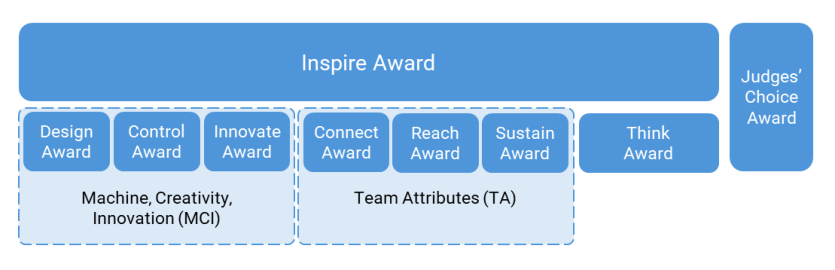
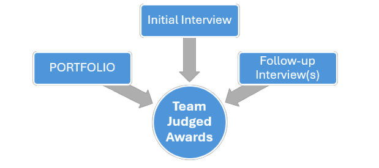
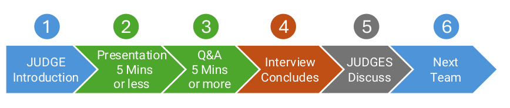
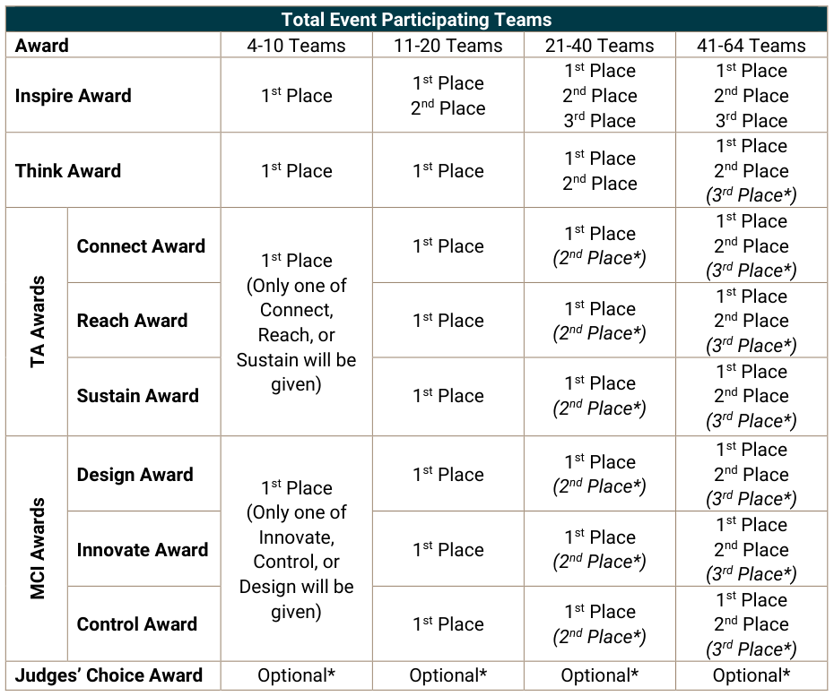

<!-- Source: FTC 2026-2027 BIOBUZZ Competition Manual TU05 (2026-10-15) - Section 6, PDF pages 43-60 -->

# 6 Awards (A)

This section includes a high-level description of each of the components of judging and ROBOT game specific awards in _FIRST_ Tech Challenge.

_FIRST_ Tech Challenge celebrates the excitement of competition both on and off the field. Through the following awards, we celebrate the _FIRST_ Core Values which makes us so much “ _More than Robots_® ”. Please note that different event types (e.g., League Tournaments, Regional Championship, _FIRST_ Championship) or event sizes may offer different sets of awards. Not every award is presented at every _FIRST_ Tech Challenge event. No awards are presented at League Meets - see Section 14 League Play Tournaments (L); additional details by event type are available in the sections below.

Team judged awards are determined by volunteers from the community who prepare for the event with thorough training and certification. There are two key judging volunteer roles:

- **JUDGES** – meet with teams to learn about and celebrate the unique journey and accomplishments of each team and evaluate these against award requirements. JUDGES interact with STUDENTS in the pits and sometimes in dedicated judging spaces. As a group, JUDGES determine the teams that receive awards at events with the guidance of the JUDGE Advisor.

- **JUDGE Advisor (JA)** – trains, directs, and supervises JUDGES throughout the event. JUDGE Advisors oversee the judging processes and procedures to make sure they are in accordance with _FIRST_ Tech Challenge judging guidelines but they do not select who wins the awards.

_FIRST_ Tech Challenge judging is delivered in one of two ways. Most events will have in-person (“traditional”) judging along with the standard in-person gameplay. The second option is hybrid format which has in-person gameplay, but some or all judging is done remotely for all teams before in-person gameplay. This manual will primarily describe the traditional in-person judging process. The remote judging process follows the same overall judging standards and requirements, but some or all interviews are conducted online, and in-person meetings may not occur.

Teams may also read the Judge and Judge Advisor Manuals to gain more insight into the complete judging process. Teams are also encouraged to review the Outreach Terms and Definitions Document to ensure all teams can clearly communicate with JUDGES and our community the great things they do to grow _FIRST_ .

## 6.1 Team Judged Awards Overview and Schedule

_FIRST_ Tech Challenge team judged awards fall into three categories, which have one or more awards each: Machine, Creativity, and Innovation (MCI), Team Attributes (TA), and Documentation. In addition, the Judges’ Choice Award is given to a stand-out team which was not recognized in one of the other categories. The most prestigious, all-around award is Inspire Award (Figure 6-1).

The local Program Delivery Partner may elect to give additional awards to celebrate local sponsors or initiatives, but these awards are not considered Team Judged Awards for the purposes of advancement calculations as described in Section 4 Advancement .

_Figure 6-1: Award hierarchy_

- The **Inspire Award** recognizes teams who excel in MCI, TA, and Documentation accomplishments. This team is an all-around inspiration for others.

- **MCI awards** recognize the technical accomplishments of teams in the brainstorming, design, construction, operation, and control of their ROBOTS.

- **TA awards** recognize teams who have expanded their skillset, created a plan to sustain their program and team, and spread the message of _FIRST_ throughout their outreach.

- The **Think Award** recognizes teams who masterfully document their team’s process and ROBOT using their PORTFOLIO.

- **Judges’ Choice Award** recognizes a team whose unique efforts, performance, or dynamics merit recognition, but does not fit into any of the other award categories.

The JUDGES will gather information from the teams through several different pathways (Figure 6-2). All teams will have the opportunity to submit a team PORTFOLIO which should document aspects of their team which directly support the team judged award criteria or information which they would like the JUDGES to consider.

> All award winners chosen by the JUDGES are recognized as being positive examples of the award criteria, not necessarily the “best” team. JUDGES will only consider the published award criteria in Section 6.3 Team Judged Award Descriptions.

Teams may participate in judging regardless of the inspection status of their ROBOT and are eligible for awards even if they are attending the event without a ROBOT.

### 6.1.1 Sources of Information Considered for Awards

JUDGES will use the Initial Interview, any follow-up interview, and the PORTFOLIO (where applicable) as sources of information for each award consideration.

_Figure 6-2: Sources of Information for Team Judged Awards._

In addition to the specific information sources JUDGES use to evaluate teams, there are also sources of information which are specifically disallowed. JUDGES are strictly instructed to only consider information from the current event and the current season.

For the purposes of judging, the current season begins on January 1, 2026. JUDGES cannot consider information from outside of what they have seen or heard at the current event.

> Per A201.E, progress, challenges, and accomplishments which have taken place since January 1, 2026 can be documented in the team PORTFOLIO and will be considered as part of the current season.

Examples of information that cannot be considered during the judging process include, but are not limited to:

- Past performance (good or bad) of a team,

- Personal knowledge of a team,

   - External sources such as websites and/or social media,

- A ROBOT’s performance (e.g., how many points scored in a MATCH) unless it is specifically listed as an award criteria,

   - ROBOT penalties during gameplay, or

   - A team’s ranking in the tournament.

The awards are a method _FIRST_ uses to inspire STUDENTS and open their eyes to building a better future together. The judging process should foster a positive STUDENT interaction with JUDGES who are independent caring adults and can recognize their achievements and encourage them to continue learning.

### 6.1.2 Initial Interview

All teams are encouraged to prepare for an Initial Interview session where the team may present a prepared oral presentation to a small panel of JUDGES, followed by an open Q&A session.

The Initial Interview may be conducted in one of three formats:

- **Scheduled in-person:** A planned meeting with JUDGES, at a specific time, in a dedicated judging space.

- **Unscheduled in-person:** The interview is not scheduled for a specific time. JUDGES meet teams in their pit area at the event or in a dedicated judging space.

- **Remote:** A meeting with the JUDGES held online on a video conferencing platform.

All three types of Initial Interviews have the same rules and allow teams to share information with the JUDGES.

_Figure 6-3: Initial Interview Timeline_

1. JUDGES introduce themselves to the team and ask if the team has a prepared presentation they would like to start with.

2. Teams may present to the JUDGES uninterrupted for up to about 5 minutes, per A205.

3. JUDGES will ask open ended questions and interact with the team for the remaining interview time.

4. The interview is concluded by the JUDGES.

5. JUDGES privately discuss the details of the interview and complete the feedback form.

6. JUDGES identify the next team to be interviewed and repeat the process.

The Event Director, in coordination with the JUDGE Advisor and the regional planning committee, is responsible for determining the format for the Initial Interview and communicating this information to the teams prior to the event. All teams, regardless of the option chosen, are expected to be interviewed using the same format at their event.

> Teams participating at events where the Initial Interview is conducted in the pits
> should be mindful that the pit area is an active and often noisy environment.
> While JUDGES will provide teams with an uninterrupted opportunity to present
> information and answer questions, external distractions (such as pit
> announcements and general background noise) may occur during the interview
> and could create communication challenges.
> For interviews that take place in the pits, JUDGES will work with MATCH queuers
> and technical volunteers to ensure teams are able to attend MATCHES and work
> on their ROBOTS.
>

Teams are encouraged to review the Judge Interview Question Bank prior to their judging interviews to understand the type of questions that may be asked by the JUDGES. At each event, the JUDGE

Advisor will select two questions from the question bank that all teams will be asked at the start of the Initial Interview’s question and answer session. One question will be focused on the MCI award category, and one question will be focused on the TA award category. After the first two questions are asked and answered, JUDGES may ask additional questions to help evaluate the team’s performance against the award criteria.

> Additional questions asked during interviews may come from the question bank but teams should be prepared to answer questions that are not listed within the document.

### 6.1.3 Pit Interview(s)

After all the judging panels have finished the Initial Interviews, the JUDGES compare notes and may elect to follow up with the teams in the pit area during the competition and conduct informal pit interviews. During this round of pit interviews, teams have the opportunity to expand upon materials presented in the Initial Interview and share additional content with the JUDGES (e.g., ROBOT prototypes, design artifacts, and photos or letters from outreach events). A team does not need to prepare another presentation for this pit interview but should be ready to answer questions from the JUDGES.

> JUDGES may read additional information during pit interviews but will not bring back additional content to be referenced as part of the JUDGE deliberations.

### 6.1.4 Sustained Outreach and Demonstrating Impact by Numbers

In general, JUDGES will consider ongoing, sustained outreach to be of higher quality than occasional or one-off outreach. JUDGES will seek to understand what is the impact of the outreach to the individuals being reached by the activity.

> Teams are encouraged to review the Outreach Terms and Definitions Document to understand the requirements behind specific terms (starting a _FIRST_ team, running an event, reaching x number of people). JUDGES may ask specific questions when a specific term listed in this document is mentioned in a team’s PORTFOLIO or during an interview.

## 6.2 Team Judged Award Rules

- **A201 *Team PORTFOLIOS have limits.** Teams have the opportunity to submit a team PORTFOLIO to be used as part of the judging process. Other printed or digital content outside this document will not be collected by the JUDGES for consideration during deliberations. Team PORTFOLIOS must meet the following requirements:

   - A. must consist of 1 cover page including the team number and optionally: team name, PORTFOLIO table of contents, team organizations, sponsors, logo, motto, and picture of the ROBOT and/or team,

   - B. no more than 15 pages of content,

   - C. use only US Letter (8.5” x 11”) or A4 (210 x 297 mm) size pages,

   - D. if submitted digitally, the complete submission must be less than 15MB in size, and

   - E. must only include progress, challenges, and accomplishments which have taken place since January 1, 2026.

> None of the content of the cover page will be used by JUDGES to evaluate any awards criteria. Any content beyond the allowed 15 pages will not be reviewed by the JUDGES.

> Teams must strictly minimize Personally Identifying Information (PII) in the PORTFOLIO. For student privacy, use only first names and last initials. While student photographs are permitted, full names must not be disclosed.

> The JUDGES use the cover page to identify the team associated with the PORTFOLIO. Teams who forget to include a cover page may be disqualified from judging if the JUDGES cannot determine what team the PORTFOLIO is associated with.

> Design your PORTFOLIO for readability. Avoid fonts under 10 pt and low-contrast text on images—JUDGES cannot evaluate what they cannot read. Use free tools like the WebAIM Contrast Checker to ensure your font size, color, and design choices are clear.

> JUDGES will not click on links, websites, or videos in a PORTFOLIO. They also cannot take extra printed papers from an interview back to their judging room. Teams should put everything they want JUDGES to see directly in their PORTFOLIO.

> Teams may use AI and research aids to compose their PORTFOLIOS, provided they respect intellectual property rights and include a footnote or endnote credit. Example Credit: “Portfolio created by Team XXXXX and ChatGPT”

A team may reference previous seasons (for example, in a team or organizational plan) to demonstrate growth, but the emphasis must be on the current season.

**A202 *PORTFOLIOS must be submitted on time and as requested.** Teams must submit their PORTFOLIO as instructed by the Event Director and by the stated deadline if they wish to have it considered during the judging process. If no other instructions are provided, teams should submit 1 printed copy of their PORTFOLIO during the Initial Interview.

> Instructions about when and how teams should submit their PORTFOLIOS should be communicated by the Event Director before the event.

> If circumstances prevent a team from following the PORTFOLIO submission instructions, the Event Director should work with the JUDGE Advisor to make reasonable accommodations to accept all team PORTFOLIOS unless doing so poses an undue burden to the judging process.

> Teams are encouraged to have an additional copy (digital or physical) of their PORTFOLIO available in their pit to assist with interviews they have with the JUDGES.

- **A203 *Teams must participate in an Initial Interview session.** To be considered for any judged awards the team must participate in an Initial Interview session.

> If scheduled, teams should be informed of their assigned time by the Event Director or local Program Delivery Partner in advance of the event.

> If there is a schedule conflict or the team misses their Initial Interview slot due to unforeseen circumstances the team should work with the Event Director or local Program Delivery Partner to make reasonable alternate accommodations for an Initial Interview at the event if possible.

- **A204 * Have the right resources available for your Initial Interview.** Teams should be prepared for their Initial Interview by having:

   - A. no fewer than 2 STUDENT representatives for teams of 2 STUDENTS and larger,

   - B. a copy of their team PORTFOLIO for reference during the interview,

   - C. “show and tell” demonstration items which may include the team’s ROBOT (encouraged, but optional),

   - D. 1 silent observer per A208 (optional), and

   - E. 1 support person to fill accommodation needs per A209 (optional, as needed).

> Teams are encouraged to have as many STUDENTS as possible involved in the Initial Interview process.

> A team does not have to have a ROBOT to participate in judging or be eligible for judged awards.

> Teams may power on and demonstrate their ROBOT functions during the Initial Interview but may not cause significant delays during the interview.

- **A205 *Everyone gets equal Initial Interview time** . All teams will be scheduled for the same length Initial Interview of at least 10 minutes.

- **A206 *The Initial Interview timer starts when the team starts.** The timer starts after the JUDGES have introduced themselves and either, the team begins their presentation, or the Q&A portion of the interview begins. Teams who take an extended amount of time to begin will be warned by the JUDGES to begin promptly and then the Initial Interview timer will be started regardless of the readiness of the presenting team.

- **A207 *Prepared initial presentation time should not be interrupted.** The first 5 minutes of the Initial Interview are reserved for the team to present a prepared oral presentation uninterrupted, if they choose. The uninterrupted presentation time may be ended early by the team. Any remaining time should be a question and answer conversation with the STUDENTS and led by the JUDGES.

- **A208 *One adult silent observer is welcome.** One adult may attend the judging session and be present for any interaction between the JUDGES and the STUDENT team members. Adult coach(es) may be present for any interactions between the JUDGES and the STUDENT team members outside of the Initial Interview. The adult observer and coach(es) may not interact or actively coach during any interaction between the JUDGES and the STUDENT team members.

> The purpose of the adult silent observer is to provide silent confidence to the STUDENT team members presenting in an unknown environment with new people.

- **A209 *Translator and/or Sign Language Interpreter accommodations will be made for teams who need it.** Teams who need to use a translator to communicate with the JUDGES may provide one if the team’s native language does not match that of the JUDGES. This includes sign language or other adaptive technology. Teams who intend to interview with the assistance of a translator must work with the Event Director in advance to request additional interview time of between 2 and 5 minutes, if needed. The translator may be an adult and can be in addition to the silent observer in A208.

> In most cases the translator will need to be provided by the team. If other accommodation is needed, the team should contact your local leadership to discuss options.

- **A210 *No Photos, Video or Audio recording during Initial Interview.** In addition to the restrictions of E116, no recording of video or audio, or photos may be taken during the Initial Interview.

**A211 *The number of awards given scales with event size.** The total number of awards given is based on the number of teams checked in at the event. Not all awards are given at every competition. Only the awards specified in Table 6-1, based on the event size are, points-eligible for advancement.

_Table 6-1: Total judged awards available based on all event participating teams_

> Table structure (merged cells) is too complex for markdown; see the image.

_*Discretionary awards_

> See Section 13.8 Dual Division Events for the modified dual division version of this rule.

**A212 *Judging feedback is provided to all teams.** All teams will receive feedback from their Initial Interview session. The JUDGES complete a form immediately following the Initial Interview based on their initial impression of the team. This feedback form is not used during deliberations and does not include any updated feedback based on later interactions by the JUDGES with the team.

> The feedback form will either be returned with the PORTFOLIO for in-person judging, near the end of the event, or the Lead Coach 1 will receive access to a digital version in FTC-Scoring following the event.

**A213 *Teams are only eligible to win the Inspire Award in their own region.** Teams are only eligible to be considered for the Inspire Award (1st , 2nd , or 3rd place) when competing at a tournament within their HOME REGION.

> _FIRST_ Championship and _FIRST_ Premier Events are an exception to this rule. At these events, all teams may be considered for the Inspire Award.

**A214 *Teams cannot win the Inspire Award at multiple Qualifying or League Tournaments.** Teams are only eligible to win 1st place Inspire Award once per season from any Qualifying or League Tournament.

> Teams who have won 1st Place Inspire are eligible to win 2nd or 3rd place Inspire Award at subsequent Qualifying or League Tournaments.

> Teams who have won 1st Place Inspire at a Qualifying or League Tournament are eligible to win it at their Regional Super Qualifying Tournament (where applicable) and Regional Championship.

- **A215 *Teams can only get one judged award.** Teams are only eligible to win or be a runner-up for a single team judged award at the event.

> This rule does not prevent a team from winning additional awards listed in Section 6.4 Tournament ALLIANCE Awards and Section 6.5 Individual Awards.

## 6.3 Team Judged Award Descriptions

### 6.3.1 Inspire Award

The Inspire Award recognizes a team that is a strong role model for all _FIRST_ programs. This team is a top contender for many judged awards and competes with a positive, respectful attitude.

The Inspire Award winner inspires other teams both on and off the playing field. Their actions reflect the _FIRST_ Core Values and embody _Gracious Professionalism._ They regularly share their experiences, enthusiasm, and knowledge with other teams, sponsors, their community, and the JUDGES. Working as a unit, this team will have shown success in performing the task of designing and building a ROBOT.

_Table 6-2: Inspire Award Criteria_

|||**Inspire Award Criteria**|
|---|---|---|
|**Required**|1|Team must submit a PORTFOLIO.|
|**Required**|2|The Inspire Award celebrates the strongest qualities of all the judged awards. A team must be a strong contender for**at least one award in each** of the following judged award categories: A. Machine, Creativity, and Innovation Awards, B. Team Attributes Awards, and C. Think Award.|
|**Required**|3|Team must be positive and inclusive, and each team member contribute to the success of the team.|
|**Required**|4|Team is able to share their experiences and knowledge to the JUDGES.|

### 6.3.2 Think Award

The Think Award recognizes a team for their excellent PORTFOLIO. The PORTFOLIO is a clear and organized record of the team's engineering journey and growth this season. JUDGES look at this document to find the most deserving recipient. Teams may also share extra details about their building, design, or programming process in their PORTFOLIO to help JUDGES understand their choices.

_Table 6-3: Think Award Criteria_

|||**Think Award Criteria**|
|---|---|---|
|**Required**|1|Team must submit a PORTFOLIO. The PORTFOLIO must include**at least one** of these engineering topics: A. evidence of use of the engineering process, B. lessons learned and applied relating to the design of their ROBOT, C. comparing choices: Show how you looked at different ideas and explain why you chose one over the other, and/or D. math choices: Show how you used math to make decisions about your ROBOT or programming design.|
|**Encouraged**|2|Information in the PORTFOLIO should be easy to read and easy to find.|

### 6.3.3 Connect Award

The Connect Award recognizes a team that builds meaningful partnerships with members of the science, technology, engineering, and mathematics (STEM) community. Through these partnerships, the team develops new knowledge, skills, and resources that support its long-term growth. The team has a clear plan with defined actions to achieve its goals. A PORTFOLIO is not required for this award.

_Table 6-4: Connect Award Criteria_

|||**Connect Award Criteria**|
|---|---|---|
|**Required**|1|Team demonstrates professional development competency by explaining its plan for developing team member skills, including**both**: A. the team’s goals for learning, and B. the steps the team has taken or will take to reach those goals.|
|**Encouraged**|2|Team demonstrates networking competency by building and maintaining meaningful in- person or virtual relationships with professionals in STEM.|
|**Encouraged**|3|Team demonstrates collaboration competency by actively working with members of the engineering community through mentoring, knowledge sharing, technical guidance, or collaborative activities.|

### 6.3.4 Reach Award

The Reach Award recognizes a team that has introduced and recruited new people into _FIRST_ . Through their outreach efforts, they have inspired and motivated others to join the _FIRST_ community and actively participate in its programs. A PORTFOLIO is not required for this award.

_Table 6-5 Reach Award Criteria_

|||**Reach Award Criteria**|
|---|---|---|
|**Required**|1|Team demonstrates outreach planning competency by clearly explaining**all of** the following: A. its outreach objectives, B. the strategy behind its outreach activities, and C. how these activities support the growth of the _FIRST_ community.|
|**Required**|2|Team demonstrates successful recruitment of new teams, coaches, mentors, or volunteers who have not previously participated in the _FIRST_ community|
|**Encouraged**|3|Team demonstrates strong communication competencies by serving as an ambassador for _FIRST_ and increasing public awareness of _FIRST_ programs through effective outreach and communication.|
|**Encouraged**|4|Demonstrates media and promotion competencies by developing creative, continuously improving outreach materials that effectively introduce both the team and _FIRST_ to the public.|

### 6.3.5 Sustain Award

The Sustain Award recognizes a team that has established the leadership, resources, and organizational practices needed to ensure that its team or program can continue and grow in future seasons. A PORTFOLIO is not required for this award.

_Table 6-6 Sustain Award Criteria_

|||**Sustain Award Criteria**|
|---|---|---|
|**Required**|1|Team demonstrates organizational sustainability competency by explaining its plans for long-term success, including**one or more** of the following: A. financial sustainability, B. season planning, and/or C. long-term team sustainabilityobjectives.|
|**Required**|2|Team demonstrates project management competency by explaining how it measures, reviews, and tracks progress toward its sustainability plans and objectives.|
|**Encouraged**|3|Team demonstrates leadership development competency through clearly defined team roles and an intentional process for preparing future student leaders.|
|**Encouraged**|4|Team demonstrates risk management competency by identifying organizational constraints, implementing mitigation strategies, and adapting plans when challenges arise.|

### 6.3.6 Innovate Award sponsored by RTX

The Innovate Award recognizes a team that designs creative solutions to game challenges. JUDGES give this award to a team with a creative and original design for one or more parts of their ROBOT. JUDGES look at the design itself, how well it works, and the creative thinking behind it. The award can recognize the design of the whole ROBOT or one MECHANISM on the ROBOT. The design should work well during most MATCHES, but it does not need to work every time. A PORTFOLIO is not required for this award.

_Table 6-7: Innovate Award Criteria_

|||**Innovate Award Criteria**|
|---|---|---|
|**Required**|1|The team demonstrates their engineering competency by showing examples of their engineeringwork that explain how the team developed their design.|
|**Required**|2|The design of the ROBOT or ROBOT MECHANISM is creative, unique, or both.|
|**Required**|3|The creative design must be stable and reliable. It must help the team reach its game goals most of the time.|
|**Encouraged**|4|Designs often involve risks. The team should explain how they reduced those risks.|

### 6.3.7 Control Award

The Control Award recognizes a team that uses sensors and software to solve game challenges in a creative way. Examples include autonomous operation, smarter mechanical systems, or sensors that improve results. The solution should work well during most MATCHES, but it does not need to work every time. Teams may use their solution during the AUTO period, the TELEOP period, or both. The team's PORTFOLIO must include a summary of the software, sensors, and mechanical control system. The PORTFOLIO does not need to include the full code itself.

_Table 6-8: Control Award Criteria_

|||**Control Award Criteria**|
|---|---|---|
|**Required**|1|Team must submit a PORTFOLIO. The PORTFOLIO must include**all of** the following: A. hardware or software control COMPONENTS on the ROBOT, B. the challenges each COMPONENT or system solves, and C. the function of each COMPONENT or system.|
|**Required**|2|The team must use one or more hardware or software solutions that use external feedback to control the ROBOT and improve how it performs.|
|**Encouraged**|3|The control solution (s) should work consistently during most MATCHES.|
|**Encouraged**|4|The team can explain how reliable their solution is. They can show this by demonstrating that it works, or by explaining how it could be improved.|
|**Encouraged**|5|The team should describe what they learned while using the engineering process to develop their control solutions (sensors, hardware, algorithms, or a combination).|

### 6.3.8 Design Award

The Design Award recognizes a team that understands the principles of industrial design. This means balancing form, function, and appearance while meeting the needs of this season's game. The team's design process should result in a ROBOT that is efficient and that solves the game's challenges well. A PORTFOLIO is not required for this award.

_Table 6-9: Design Award Criteria_

|||**Design Award Criteria**|
|---|---|---|
|**Required**|1|Team must describe or demonstrate that their ROBOT is elegant, efficient (simple to build and operate),and/orpractical to maintain.|
|**Required**|2|The design of the entire ROBOT, or the detailed process used to create it, must be considered – not just one COMPONENT.|
|**Encouraged**|3|The ROBOT stands out from other ROBOTS because of its appearance and how well it functions.|
|**Encouraged**|4|The team has clearly thought through the reasons behind their design choices, such as inspiration or function.|
|**Encouraged**|5|The design works consistently and aligns with the team's game plan or strategy.|

### 6.3.9 Judges’ Choice Award

The Judges’ Choice Award is optional and not given at all _FIRST_ Tech Challenge events.

During the competition, the judging panel may meet a team whose unique efforts, performance, or dynamics merit recognition, but does not fit into any of the other award categories. To recognize these unique teams, _FIRST_ offers a Judges’ Choice Award.

## 6.4 Tournament ALLIANCE Awards

### 6.4.1 Winning Alliance Award

This award will be given to the winning ALLIANCE represented in the final MATCH of the Playoffs of a singledivision Tournament or Championship event. If the event is a dual-division or multi-division event, there will be Winning Alliance Awards awarded to both the division playoff winners and the event finals playoff winners.

### 6.4.2 Finalist Alliance Award

This award will be given to the finalist ALLIANCE represented in the final MATCH of the Playoffs of a singledivision Tournament or Championship event. If the event is a dual-division or multi-division event this will be awarded to the division playoff finalists and the event finals playoff finalists.

## 6.5 Individual Awards

### 6.5.1 FIRST Leadership Award

_FIRST_ Leadership Award semi-finalists, finalists, and winners exemplify student leadership. These individuals actively promote the _FIRST_ mission, champion Core Values like Inclusion, Teamwork, and Impact, and embody _Gracious Professionalism_ . _FIRST_ aims to support these students as they continue to serve as lifelong leaders, alumni, and advocates.

Please visit the _FIRST_ Leadership Award webpage to see complete award submission details and to see past _FIRST_ Tech Challenge winners.

### 6.5.2 Compass Award

This is an optional award offered at the Regional Championship tournament level of competition. All teams attending _FIRST_ Championship will have an opportunity to submit for this award at _FIRST_ Championship.

The Compass Award recognizes an adult coach or mentor who has given outstanding guidance and support to a team throughout the year and demonstrates to the team what it means to be a Gracious Professional. The winner of the Compass Award will be chosen from candidates nominated by _FIRST_ Tech Challenge STUDENT team members, via a 40-60 second video submission. The video must highlight how their mentor has helped them become an inspirational team. The video should emphasize what sets the mentor apart.

_Table 6-10: Compass Award Criteria_

|||**Compass Award Criteria**|
|---|---|---|
|**Required**|1|Team must be able to clearly articulate this mentor’s contribution to the team and explain what sets this mentor apart.|
|**Required**|2|Submission must be in video format and meet the following requirements: A. submitted by the deadline established by the Event Director or local Program Delivery Partner, B. be in one of the following formats: .mp4, .mov, .avi, or .wmv (no links to streaming services will be accepted), C. one video submission per team per event (videos can be updated or changed between events), D. all music must be used with permission from the copyright owners and be indicated in the video credits, and E. videos cannot be longer than 60 seconds, including credits.|
|||Teams are encouraged to review the _FIRST_ Branding and Style Guidelines before creating their video.|

## 6.6 Project-Based Global Awards

Project-based global awards are awards that are only judged and awarded once per season and are open to all registered _FIRST_ Tech Challenge teams. Each award has its own independent requirements and deadlines. These awards do not contribute towards team advancement.

### 6.6.1 Digital Animation Award Sponsored by Worcester Polytechnic Institute (WPI)

This award, sponsored by WPI, celebrates STEAM (Science, Technology, Engineering, Art, and Mathematics) and emphasizes the ability to tell a story through animation that integrates technological, social, and humanistic concepts.

The 2027 Digital Animation Award is offered to help encourage students to cultivate skills in design and creation of animation while telling a story about the impact of technology on society. This award is open to all _FIRST_ Robotics Competition teams and _FIRST_ Tech Challenge teams and **is optional**. More information can be found on the Digital Animation Award webpage.
