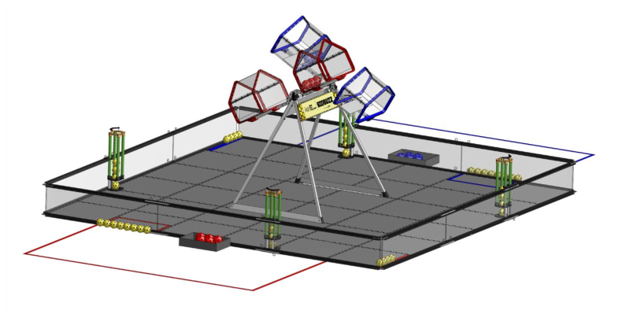

<!-- Source: FTC 2026-2027 BIOBUZZ Competition Manual TU05 (2026-10-15) - Section 8, PDF pages 62-62 -->

# 8 Game Overview

In BIOBUZZ™ presented by RTX, 2 competing ALLIANCES of 2 teams each collect POLLEN and NECTAR, LAUNCHING them into their HIVE and placing them into FLOWERS.

During the first 30 seconds of the MATCH, the ROBOTS operate autonomously. ROBOTS can use sensors to collect POLLEN from FLOWERS and navigate to LAUNCH into the CELLS of their HIVE. When enough SCORING ELEMENTS are LAUNCHED into the CELL, the HIVE will tip. Each time a HIVE is TIPPED, points are earned, and additional NECTAR is unlocked.

During the remaining 2 minutes of the MATCH, human DRIVERS take control of their ROBOTS. ROBOTS continue to collect and score POLLEN and NECTAR, tipping their HIVE to earn points and unlocking more NECTAR.

As time runs out, ALLIANCES work to fill FLOWERS with POLLEN and NECTAR. ALLIANCES earn points by placing their ALLIANCE’S NECTAR in each FLOWER before their opponent. ALLIANCES also earn points for owning a FLOWER if their NECTAR is the top-most placed in a FLOWER.

The ALLIANCE that earns the most points wins the MATCH and additional RANKING POINTS can be earned by completing other scoring achievements.
