<!-- Source: FTC 2026-2027 BIOBUZZ Competition Manual TU05 (2026-10-15) - Section 9, PDF pages 63-80 -->

# 9 ARENA

The ARENA includes all elements of the game infrastructure that are required to play BIOBUZZ: the FIELD, SCORING ELEMENTS, queue area, team media area, and all equipment needed for event management.

_Figure 9-1 BIOBUZZ (queue area, FIELD display, and optional media area not pictured)_

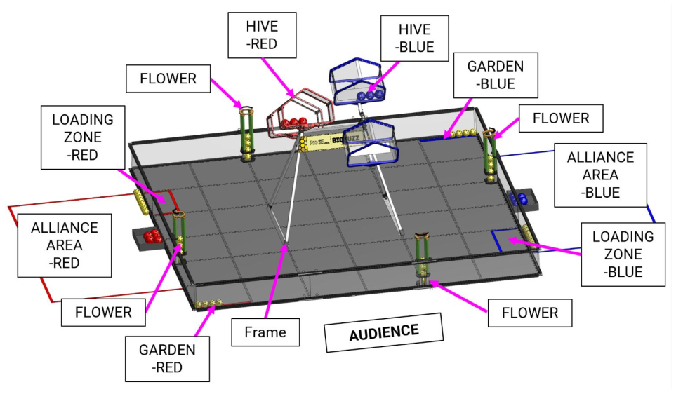

## 9.1 Dimensions and Accuracy

The specifications for the BIOBUZZ FIELD can be retrieved from a few locations:

- The 3D CAD model is the official representation of the BIOBUZZ FIELD and how it is constructed. Measurements may be taken from this model with a general tolerance of +/- 1 in. (+/- 2.5 cm).

- The Event Field Setup Guide includes instructions on how to build the FIELD and details about its construction which may influence the FIELD tolerances; it also includes many of the key dimensions for the FIELD.

- The Field Acceptance Checklist includes the controlled dimensions (with relevant tolerances), functional tests, and inspection criteria which will be regularly performed by event staff.

- The Field Mitigation Guide provides FIELD STAFF recommended mitigation measures to ensure the FIELD remains within spec during the event.

- Illustrations included in the Competition Manual are for a general visual understanding of the BIOBUZZ ARENA, and any dimensions included are nominal. Unless specifically noted, all these dimensions carry a tolerance of +/- 1 in. (+/- 2.5 cm).

The complete list of BIOBUZZ FIELD resources is posted on the Playing Field Resources page on the _FIRST_ website.

> The ARENA is modular and is assembled, used, disassembled, and transported many times during the competition season. It undergoes wear and tear. Every effort is made to ensure that ARENAS are consistent from event to event. However, ARENAS are assembled in different venues by different event staff and volunteers, with some regions facing unique challenges resulting in some small variations. The ARENA specifications are designed to accurately reflect the variations which may be present in official play, while still ensuring consistency of critical items. Contact your local support to request more information. Successful teams will design ROBOTS that are insensitive to these variations.

## 9.2 FIELD

Each FIELD for BIOBUZZ is an approximately 144 in. by 144 in. (365.75 cm by 365.75 cm) area bounded by the inside surface of the walls of the FIELD perimeter. The flooring surface of the FIELD is made of 36 interlocking soft foam TILES which are each approximately 24 in. by 24 in. by 0.59 in. (60.95 cm by 60.95 cm by 1.50 cm) nominally sized.

The FIELD is populated with and surrounded by the following FIELD elements:

- 1 HIVE Structure, consisting of 1 Frame with 2 mounted HIVES (1 HIVE per ALLIANCE)

- 4 FLOWERS

Official events use the full BIOBUZZ FIELD manufactured and sold by AndyMark (am-5850_Full) or officially licensed equivalent.

The soft foam TILE surface of the FIELD is _FIRST_ Tech Challenge Field Soft Tiles (am-2499) or equivalent.

The primary version of the FIELD perimeter is the _FIRST_ Tech Challenge Perimeter Kit (am-0481) sold by AndyMark. All illustrations in this manual show the am-0481 version of the FIELD design. Other versions of the FIELD perimeter of similar functionality may also be used in competitions.

Some events, including the _FIRST_ Championship (see Section 15.2 Game Modification ), will place the FIELDS on platforms or risers such that the FIELD is raised while the ALLIANCE AREAS remain at ground level.

The Event Field Setup Guide allows events to optionally anchor the FIELD perimeter in place. Events using the AndyMark Perimeter Kit that choose to anchor their FIELD in place do not need to install the Perimeter Straps that are part of the AndyMark Perimeter.

The FIELD variant used at an event will be determined by the local Program Delivery Partner, and all competition FIELDS at the same event must comply with Section 9.1 Dimensions and Accuracy and be consistent with each other per T404.

## 9.3 Areas, Zones, & Markings

FIELD areas, zones, and markings of consequence are described below.

- The term “zone” is used to identify spaces within the FIELD.

- The term “area” is used to describe spaces outside of the FIELD.

Unless otherwise specified, the tape used to mark lines and zones throughout the FIELD can be either 1 in. (2.50 cm) wide or 2 in. (5.10 cm) wide ProGaff® Premium Professional Grade Gaffer Tape, or comparable gaffers tape in red, and electric blue. Areas outside the FIELD may be marked with other types or widths of tape, depending on the event.

The tape used to mark lines and zones throughout the FIELD is shown as continuous strips in all official specifications. While in some games the tape lines are permitted to be applied in non-continuous segments, this is not necessary this season. On the BIOBUZZ FIELD, none of the tape lines span across TILE seams. Events are encouraged to apply the tape lines continuously as shown in the specifications.

_Figure 9-2: BIOBUZZ ZONES and AREAS_

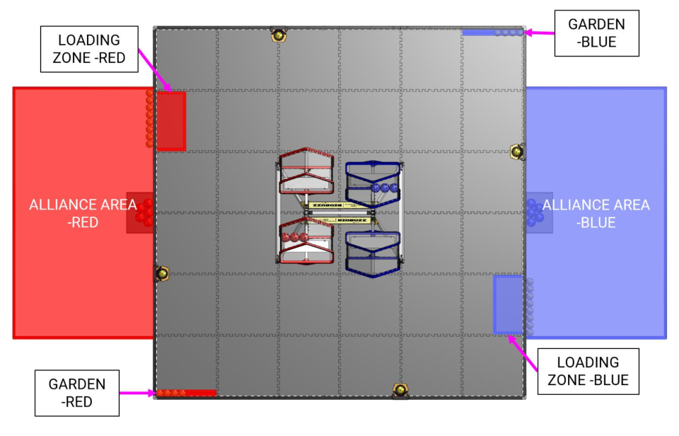

- **ALLIANCE AREA:** an approximately 97 in. (246.40 cm) wide by 54 in. (137.15 cm) deep by infinitely tall volume formed by placing ALLIANCE colored tape onto the flooring surface outside of the FIELD. The ALLIANCE AREA includes the taped lines (Figure 9-2).

- **LOADING ZONE:** an approximately 23 in. (58.40 cm) wide by 11 in. (27.95 cm) deep infinitely tall volume bounded by red or blue tape and the adjoining FIELD perimeters. The LOADING ZONE

includes the tape lines (Figure 9-3). The LOADING ZONE is an ALLIANCE specific zone belonging to the ALLIANCE with the adjacent ALLIANCE AREA.

- **GARDEN:** an approximately 23 in. (58.40 cm) by 2 in. (5.10 cm) wide and infinitely tall volume defined by the outside edge of blue or red tape in opposite corners of the FIELD, as shown in Figure 9-2.

_Figure 9-3: LOADING ZONE and GARDEN (shown with POLLEN hidden)_

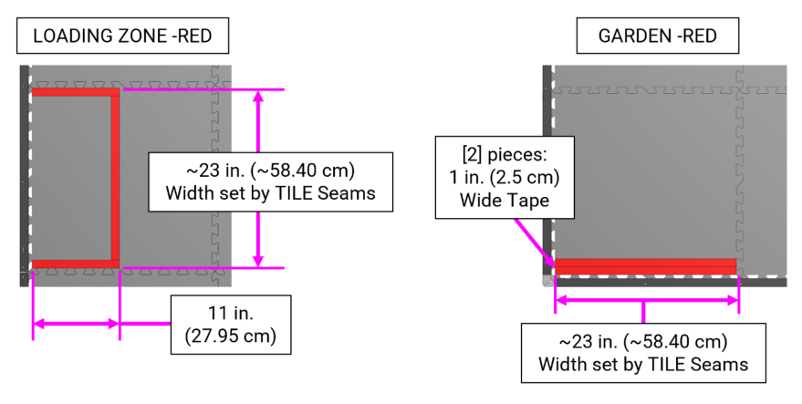

## 9.4 TILE Coordinates

TILE coordinates are used to assist with FIELD setup. Figure 9-4 defines the intersections of each of the TILES on the FIELD where the TILE tabs interlock. Figure 9-5 defines the grid coordinate system for each of the TILES.

_Figure 9-4: TILE seam/tab-line locations_

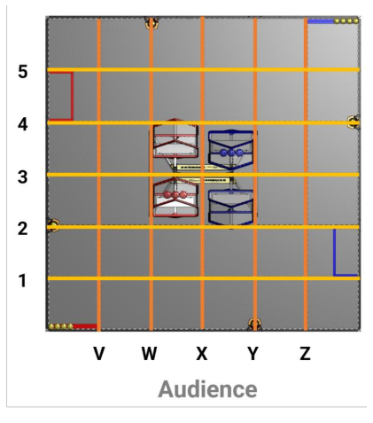

_Figure 9-5: TILE locations_

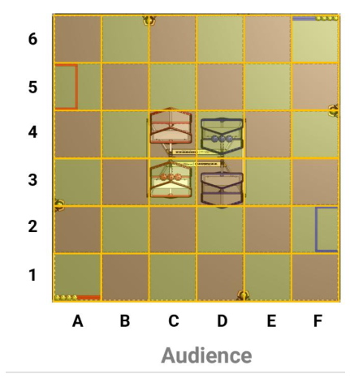

## 9.5 ALLIANCE AREA

An ALLIANCE AREA is the designated red or blue ALLIANCE AREA adjacent to the FIELD where the DRIVE TEAMS stage themselves during a MATCH.

The FIELD is oriented such that the red ALLIANCE AREA is located on the left from the primary audience viewing direction.

Short tables, stands, or stools may be provided for teams to place their OPERATOR CONSOLES by the event which will sit near the FIELD perimeter inside the ALLIANCE AREA. If provided by the event, these tables may not be removed or rearranged by the teams without permission from the Head REFEREE, FIELD Supervisor, or FTA.

_Figure 9-6: ALLIANCE AREA_

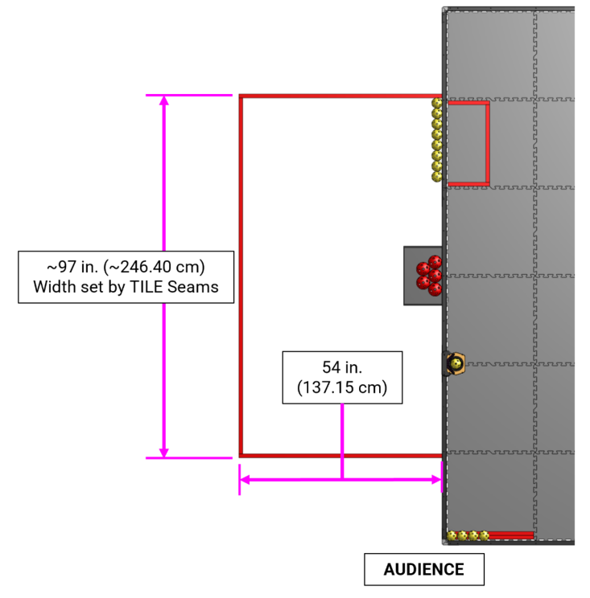

## 9.6 HIVE Structure

_Figure 9-7: HIVE Structure_

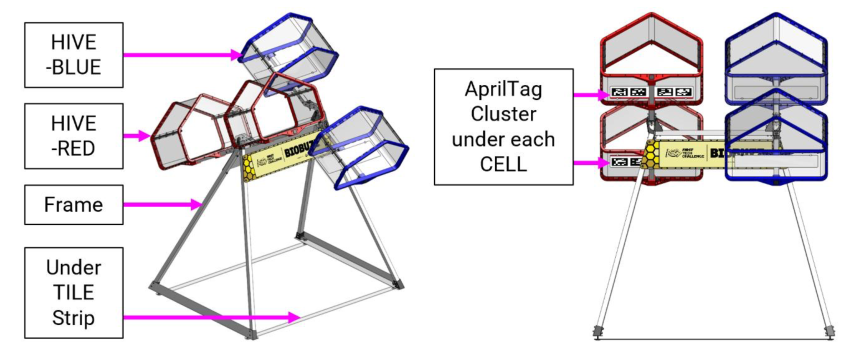

The HIVE Structure is located in the center of the FIELD. A frame holds a red HIVE and a blue HIVE. Each HIVE consists of 2 CELLS, one on either end of each HIVE. Each CELL is a three-dimensional structure that can hold NECTAR and POLLEN.

Each HIVE is on a pivot and can tip so that one of the CELLS is facing upwards at any given time. Each HIVE is bi-stable and will hold its position until enough POLLEN or NECTAR are LAUNCHED into the upwards-facing CELL. On the bottom face of each CELL is a unique AprilTag Cluster containing 4 distinct AprilTags.

### 9.6.1 Frame

The frame is made up of two triangular metal structures that attach to mounting strips under the TILES which are connected at their apex by a crossbar. The frame is 49.46 in. (125.65 cm) wide, and 38.95 in. (98.95 cm) deep at its base, which is also its widest point. The Frame supports 2 pivots with their axis 43.95 in. (111.65 cm) above the TILES. The frame dimensions are shown in Figure 9-8.

A panel is attached to each side of the frame with the BIOBUZZ logo. This graphic may not be present at all events.

_Figure 9-8: Frame_

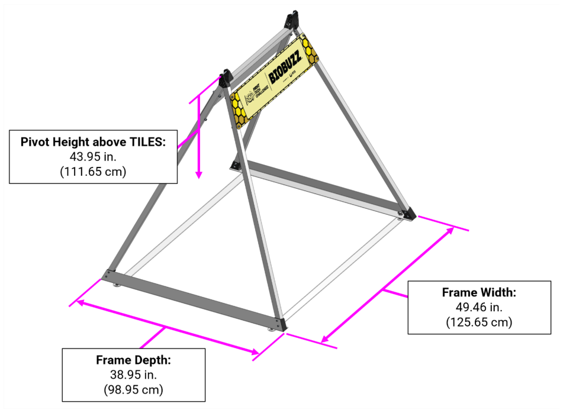

### 9.6.2 HIVE and CELL

Each HIVE is a bi-stable structure made up of two CELLS and a connecting assembly that rotates on a pivot. Each HIVE includes two CELLS (either both red or both blue) approximately 18.8 in. (47.8 cm) apart as shown in Figure 9-9. Each HIVE rotates around a pivot located at the top of the frame and has two stable positions: each one with one CELL facing upwards.

The opening of the CELL is approximately 20 in. (50.8 cm) wide by 14 in (35.6 cm) tall and 12 in. (30.5 cm) deep as shown in Figure 9-11.

_Figure 9-9: HIVE Details_

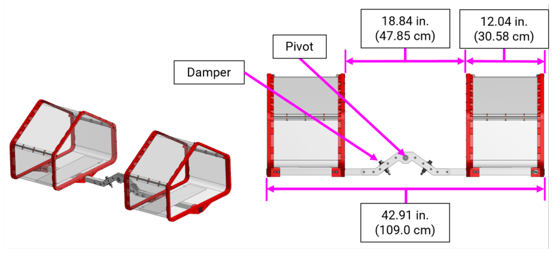

_Figure 9-10: HIVE and CELL Key Details_

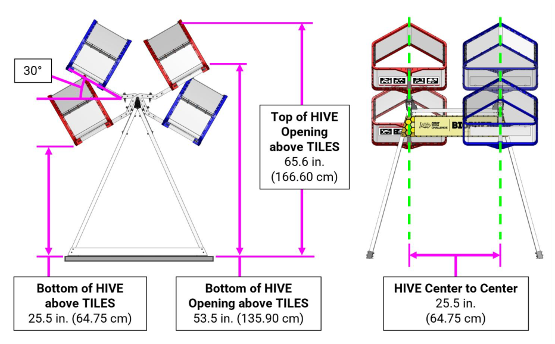

_Figure 9-11: CELL_

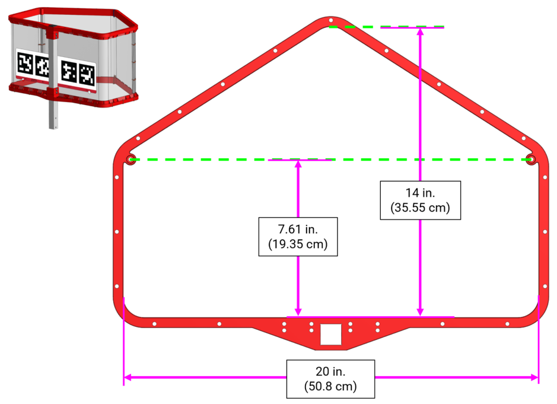

## 9.7 FLOWER

The FLOWER is a structure on the FIELD in which POLLEN and NECTAR can be placed into the top, and POLLEN can be removed from the bottom. There are four FLOWERS on the FIELD attached to the perimeter wall. Each FLOWER has the following key features:

- The opening on the top of each FLOWER is approximately 4 in. (10.15 cm) in diameter and is approximately 21.5 in. (54.6 cm) above the TILES.

- There is a backstop on top of each FLOWER to help guide POLLEN and NECTAR into the FLOWER. This backstop is 1.25 in. (3.15 cm) tall, with dimensions shown in Figure 9-12.

   - There is a Retrieval Opening at the bottom of the FLOWER for ROBOTS to remove SCORING ELEMENTS which is approximately 3.55 in. (9.0 cm) tall and 3.57 in. (9.1 cm) deep.

- There is a lower ring that sits on the TILE floor and is approximately 0.4 in. (1.0 cm) tall with an hole for POLLEN to sit in that is approximately 2.79 in. (7.1 cm) diameter.

The upper and middle rings are connected with four HIPS pipes, and the middle and lower rings are connected on the perimeter wall side with square extrusion.

_Figure 9-12: FLOWER details_

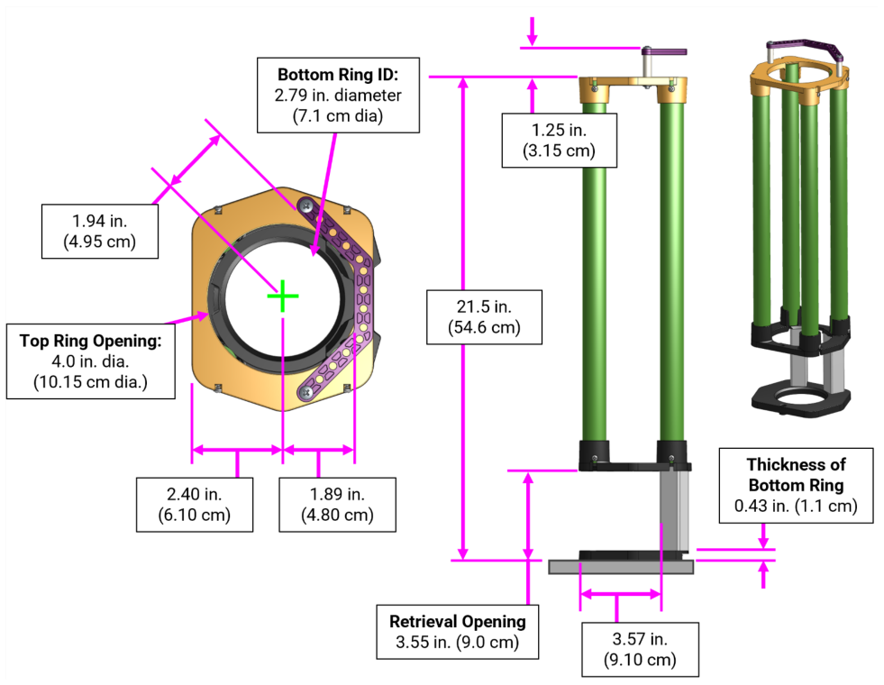

## 9.8 SCORING ELEMENTS

SCORING ELEMENTS for BIOBUZZ are POLLEN and NECTAR.

- POLLEN are approximately 2.8 in. (7.1 cm) Gopher ResisDent™ polyethylene balls in yellow (am- 5851_yellow).

- NECTAR are approximately 3.6 in. (9.1 cm) Gopher ResisDent™ polyethylene balls in red (am- 5852_red) and blue (am-5852_blue).

There are 40 POLLEN, 8 red NECTAR, and 8 blue NECTAR total in a BIOBUZZ MATCH.

POLLEN and NECTAR are not perfectly spherical and may vary in size. Teams should plan for this variation when designing their ROBOTS.

_Figure 9-13: SCORING ELEMENTS: POLLEN_

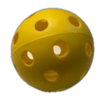

_Figure 9-14: SCORING ELEMENTS: NECTAR_

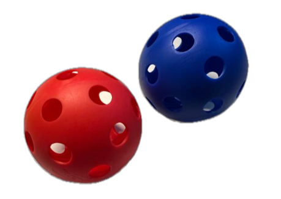

## 9.9 AprilTags

AprilTags for BIOBUZZ are 3.25 in. (8.25 cm) square targets from the 36h11 tag family (Figure 9-17) which are used to aid in ROBOT navigation and targeting.

AprilTags are arranged in AprilTag Clusters, consisting of four AprilTags laid out on a single sticker. Each individual AprilTag has an identifying “ID” text label. The AprilTag Clusters are applied to the CELLS as part of a single sticker, that is aligned using Reference Holes. These Reference Holes can be used to measure the location of the AprilTag Cluster relative to the rest of the FIELD. AprilTag dimensions are shown in Figure 9-15.

_Figure 9-15: AprilTag Cluster and Reference Hole layout_

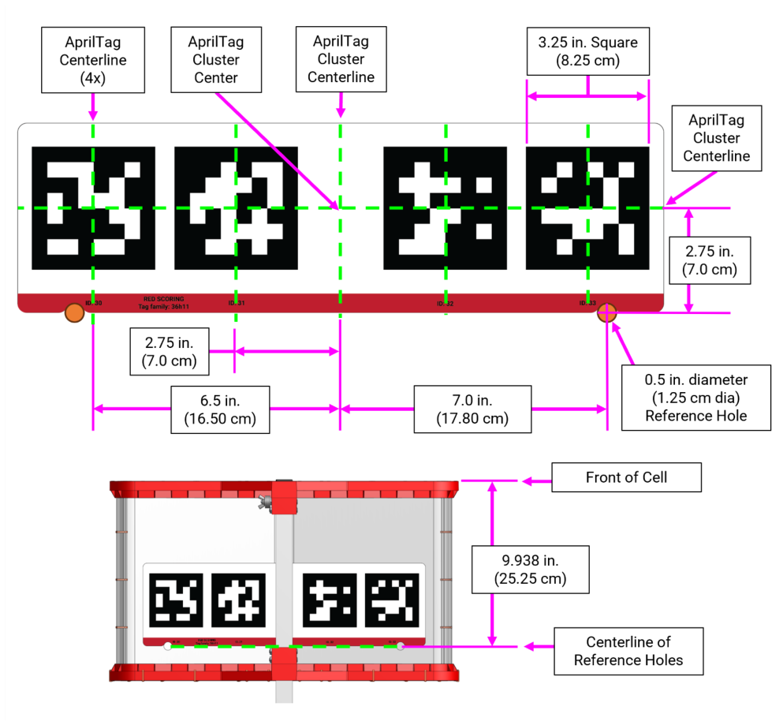

> Images from this manual are examples and not to scale and not intended to be printed for practice purposes. Please refer to the Playing Field Resources page for printable versions of these images.

Each AprilTag Cluster is placed on the bottom of a CELL facing downward towards the TILES with its bottom edge oriented towards the center of the FIELD (Figure 9-16).

_Figure 9-16: AprilTag Cluster on CELL_

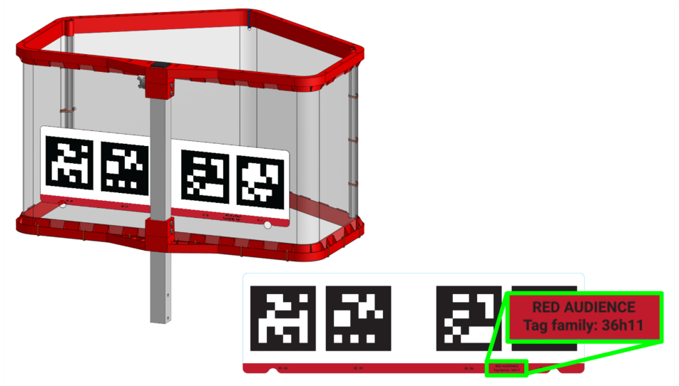

The AprilTags are located in the following locations on the FIELD, and in the order indicated in Figure 9-17:

- AprilTag ID’s 30, 31, 32, 33 on the red CELL on the side of the FIELD opposite of the audience.

   - AprilTag ID’s 34, 35, 36, 37 on the red CELL on the audience side.

   - AprilTag ID’s 38, 39, 40, 41 on the blue CELL on the audience side.

   - AprilTag ID’s 42, 43, 44, 45 on the blue CELL on the side of the FIELD opposite of the audience.

_Figure 9-17: AprilTag Locations on the BIOBUZZ FIELD_

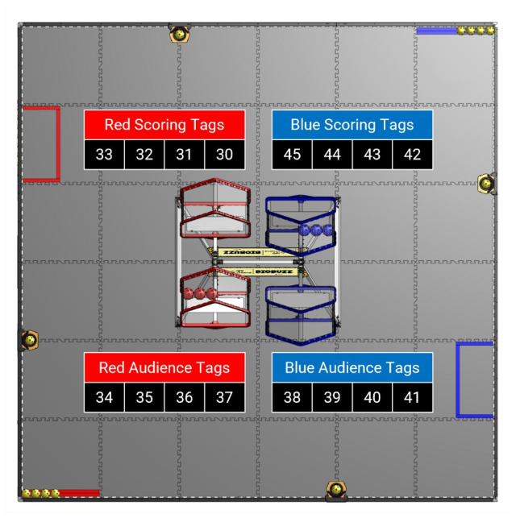

## 9.10 FIELD STAFF

FIELD STAFF are volunteers present in and around the ARENA that are responsible for making sure the MATCHES are cycled through efficiently, fairly, safely, and with a spirit of cooperation, _Gracious Professionalism__®_ , and generosity of spirit.

FIELD STAFF roles are filled by volunteers from the community who prepare for the event with thorough training and certification. There are 3 FIELD-side key volunteer roles with whom teams should be familiar with and are encouraged to use as resources to make their event experience valuable.

- **Head REFEREE** – trains, directs, and supervises REFEREES and Official Scorers. They oversee all scoring processes and procedures in collaboration with other FIELD STAFF. They interact with STUDENTS, volunteers, and event staff. The Head REFEREE has final authority for decisions regarding MATCH scores, FOULS, and YELLOW and RED CARD assignments.

- **FIRST Technical Advisor (FTA)** - ensures events run smoothly, safely, and in accordance with _FIRST_ requirements. The FTA collaborates with _FIRST_ staff, event staff, and other event volunteers in many different areas at events. The FTA focuses on all technical things related to the FIELD, ROBOTS, and game, and acts as a team advocate for all teams competing at the event.

- **FIELD Supervisor** - (may be the same as the FTA or Head REFEREE at smaller events) directs activity on the FIELD to ensure efficient execution of the MATCHES, pacing of the event, and smooth flow of MATCH play. FIELD Supervisors are responsible for ensuring the FIELD is intact and lead FIELD reset teams, who are responsible for resetting the FIELD after each MATCH in preparation for the subsequent MATCH.

> For additional details about each of these roles, as well as other _FIRST_ Tech Challenge volunteer roles, please refer to the volunteer resources.

## 9.11 Event Management System

The _FIRST_ event management system is the software responsible for managing the MATCH scores and other event inputs. The system encompasses all FIELD electronics, including computers, displays, REFEREE, and other volunteer electronic devices, wireless access point, ethernet cables, etc.

The _FIRST_ event management system alerts participants to milestones in the MATCH using audio cues detailed in Table 9-1. Please note that audio cues are intended as a courtesy to participants and not intended as official MATCH markers. If there is a discrepancy between an audio cue and the visual FIELD timers, the visual FIELD timers are the authority.

_Table 9-1 Audio cues_

|**Event**|**Timer** **Value**|**Audio Cue**|
|---|---|---|
|**MATCH start**|2:30|“This MATCH  begins in 3, 2, 1, GO” (optional) “Cavalry Charge”|
|**AUTO ends**|2:00|“Buzzer x 3”|
|**AUTO to TELEOP Transition**|0:08 to 0:01|“Drivers, pick up your controllers, 3-2-1”|
|**TELEOP begins**|2:00|“3 Bells”|
|**FLOWER Ownership Unlocked**|1:00|“Chime”|
|**Final 20 seconds**|0:20|“Train Whistle”|
|**MATCH end**|0:00|“3-second Buzzer”|
|**MATCH stopped**|N/A|“Foghorn”|
