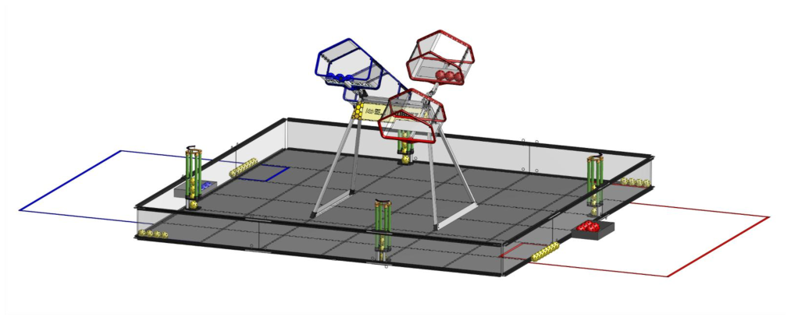
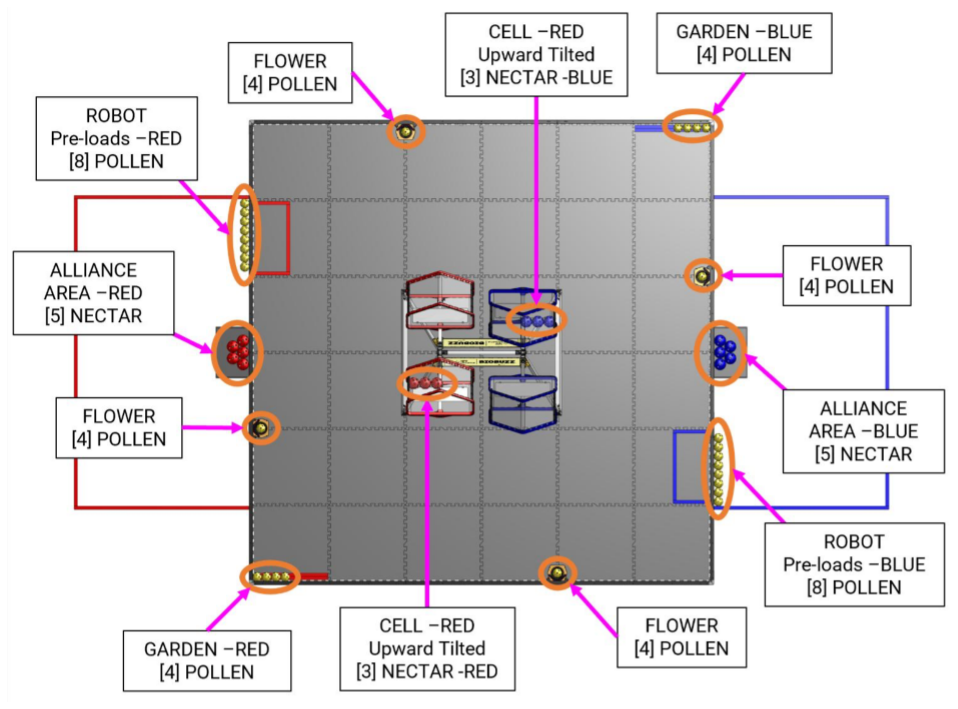
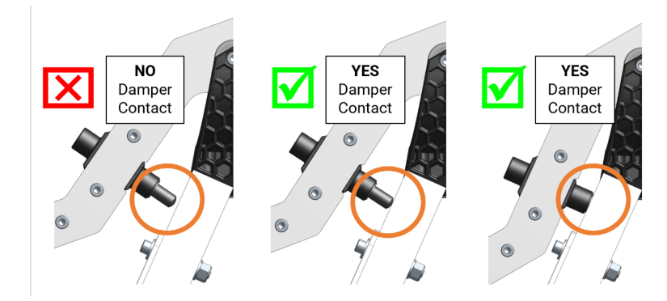
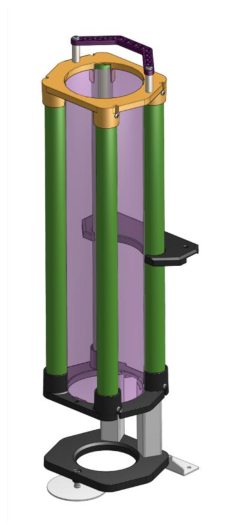
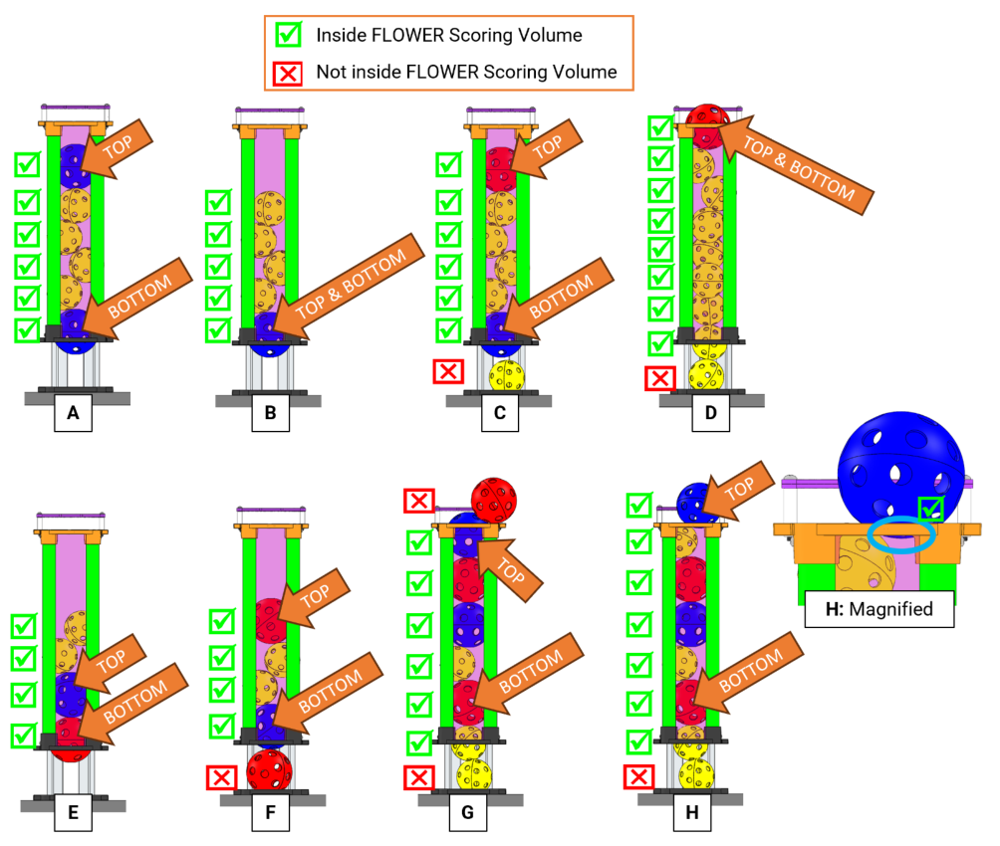
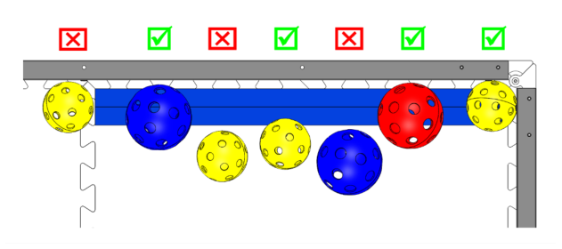
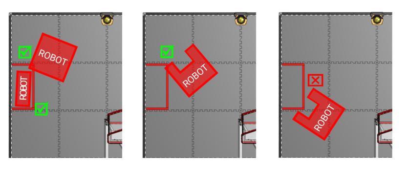
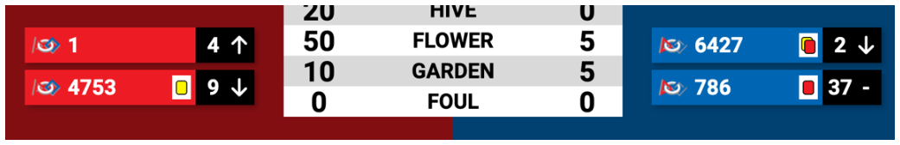
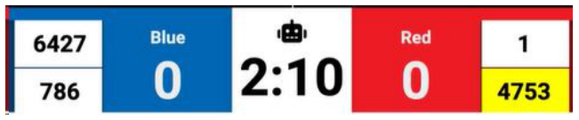

<!-- Source: FTC 2026-2027 BIOBUZZ Competition Manual TU05 (2026-10-15) - Section 10, PDF pages 81-98 -->

# 10 Game Details

_Figure 10-1: FIELD for BIOBUZZ_

In BIOBUZZ, 2 ALLIANCES (an ALLIANCE is a cooperative of 2 _FIRST_ Tech Challenge teams) play MATCHES, set up and implemented per the details described below.

## 10.1 MATCH Overview

MATCHES consist of pre-MATCH setup, a 30-second AUTO period, an 8-second transition period between AUTO and TELEOP, and a 2-minute TELEOP period, followed by the post-MATCH reset.

During the MATCH, ROBOTS collect POLLEN and NECTAR to move them to their GARDEN, to place into the FLOWERS, and to LAUNCH them into their CELLS to cause a HIVE TIP – all to earn points.

Each time a HIVE is TIPPED, an ALLIANCE is allowed to enter one of five NECTAR initially staged in the ALLIANCE AREA. With 60 seconds left in the MATCH, ALLIANCES can enter all remaining NECTAR.

ROBOTS conclude the MATCH by claiming ownership of the FLOWERS by placing NECTAR and returning to their LOADING ZONE.

## 10.2 DRIVE TEAM

A DRIVE TEAM is a set of up to 4 people from the same _FIRST_ Tech Challenge team responsible for team performance for a specific MATCH. There are 3 specific roles on a DRIVE TEAM which ALLIANCES can use to assist ROBOTS, and only 1 member of the DRIVE TEAM is allowed to be a non-STUDENT.

> The intent of the definition of DRIVE TEAM and DRIVE TEAM related rules is that, barring extenuating circumstances, the DRIVE TEAM consists of people who arrived at the event affiliated with that team and are responsible for their team’s and ROBOT’S performance at the event (this means a person may be affiliated with more than 1 team).

> The intent is not to allow teams to “adopt” members of other teams for STRATEGIC advantage for the loaning team, borrowing team, and/or their ALLIANCE (e.g., an ALLIANCE Lead believes 1 of their DRIVERS has more experience than a DRIVER of their ALLIANCE partner, and the teams agree the partner team will “adopt” that DRIVER and make them a member of their DRIVE TEAM for Playoffs).

> The definition is not stricter for 2 main reasons. First, to avoid additional bureaucratic burden on teams and event volunteers (e.g., requiring that teams submit official rosters that Queuing must check before allowing a DRIVE TEAM into the ARENA). Second, to provide space for exceptional circumstances that give teams the opportunity to display _Gracious Professionalism_ (e.g., a bus is delayed, a DRIVE COACH has no DRIVERS, and their pit neighbors agree to help by loaning DRIVERS as temporary members of the team until their bus arrives).

_Table 10-1: DRIVE TEAM roles_

|**Role**|**Description**|**Max./ DRIVE TEAM**|**Criteria**|
|---|---|---|---|
|**DRIVE COACH**|a guide or advisor|1|any team member and may be an adult, must wear “DRIVE COACH” badge|
|**DRIVER**|an operator and controller of the ROBOT|3 *(merged cell: DRIVERS + HUMAN PLAYERS combined)*|STUDENT, must wear a “DRIVE TEAM” badge *(merged cell)*|
|**HUMAN PLAYER**|a SCORING ELEMENT manager|↑ (shared with DRIVER)|↑ (same as DRIVER)|

A STUDENT is a person who has not completed high-school, secondary school, or the comparable level in their HOME REGION as of September 1st of the current season.

## 10.3 Setup

Before each MATCH begins, FIELD STAFF stage SCORING ELEMENTS as described in Section 10.3.1 SCORING ELEMENTS. DRIVE TEAMS stage their ROBOTS (as described in Section 10.3.4 ROBOTS ) and OPERATOR CONSOLES (as described in Section 10.3.3 OPERATOR CONSOLES). Then, DRIVE TEAMS take their places as described in Section 10.3.2 DRIVE TEAMS .

### 10.3.1 SCORING ELEMENTS

_Figure 10-2: SCORING ELEMENT staging positions_

Each HIVE is tilted such that one CELL is pointed down, and the other CELL is pointed up, as shown. (An easy way to remember this is the CELL which “points at” a FLOWER should be the one tilted down.) SCORING ELEMENTS are staged on the FIELD as follows (Figure 10-2):

- A. 40 POLLEN are staged on the FIELD as follows:

   - i. 4 POLLEN in each of the 4 FLOWERS (16)

   - ii. 4 POLLEN in the red GARDEN (4)

iii. 4 POLLEN in the blue GARDEN (4)

iv. 4 POLLEN pre-loaded in each ROBOT (16) (Section 10.3.4 ROBOTS )

> Pre-loaded POLLEN start the MATCH located in or on the ROBOT, or on the TILES contacting the ROBOT. ROBOTS that are not present for their MATCH will have their pre-load POLLEN placed in approximately the center of the LOADING ZONE against the perimeter wall.

> POLLEN in the GARDEN is placed in a line starting in the corner closest to the ALLIANCE AREA and contacting the audience or rear perimeter wall. Some minor variance in placement may occur.

- B. 8 red and 8 blue NECTAR are staged on the FIELD as follows:

   - i. 3 NECTAR in each upward-facing CELL of corresponding color (6)

   - ii. 5 NECTAR are in each ALLIANCE AREA of corresponding color (10)

> NECTAR in the CELL is placed contacting the back wall of the CELL and in a line against the side closest to the ALLIANCE AREA of corresponding color. There may be some variation in where these NECTAR are placed by volunteers, but they will be generally placed as shown.

As described in 15.2 Game Modification : the number, type, and distribution of SCORING ELEMENTS may be adjusted for the _FIRST_ Championship and _FIRST_ Premier Events. For the _FIRST_ Championship, any game modifications will be published on or before the last regularly scheduled Team Update as described in Section 1.7.3 Team Updates. For _FIRST_ Premier Events, game modifications will be posted by the event organizers prior to the event.

### 10.3.2 DRIVE TEAMS

DRIVE TEAMS prepare for a MATCH by staging in the ALLIANCE AREA after the DRIVE TEAM from the previous MATCH has left. DRIVE TEAM starting conditions are listed below, and a DRIVE TEAM obstructing or delaying any of the conditions is at risk of violating G301.

- A. Only DRIVE TEAM members assigned to the upcoming MATCH are present.

- B. Only DRIVE TEAM members whose ROBOTS have passed initial, complete inspection are present.

- C. DRIVE TEAM members are staged in their designated ALLIANCE AREA. If members of the ALLIANCE cannot agree where their DRIVE TEAM members will be staged, the team listed on the MATCH schedule as “Red 1” or “Blue 1” will stage closest to the audience.

- D. DRIVE TEAM members clearly display their designated DRIVE TEAM badges above their waists.

- E. If a Playoff MATCH, the ALLIANCE CAPTAIN clearly displays their designated ALLIANCE CAPTAIN identifier (e.g., hat, armband).

### 10.3.3 OPERATOR CONSOLES

DRIVE TEAMS set up their OPERATOR CONSOLES as soon as they are staged in their ALLIANCE AREA. OPERATOR CONSOLES must be compliant with all relevant rules, specifically those in Section 12.9 OPERATOR CONSOLE. A DRIVE TEAM obstructing or delaying OPERATOR CONSOLE set up is at risk of violating G301.

- A. DRIVE TEAMS intending to run an OpMode during AUTO must select an OpMode within their DRIVER STATION app with the 30 second timer enabled.

- B. Otherwise, DRIVE TEAMS must select a TELEOP OpMode within the DRIVER STATION app.

- C. The selected OpMode must be initialized by pressing the “INIT” button on the DRIVER STATION app.

### 10.3.4 ROBOTS

DRIVE TEAMS stage their ROBOT in accordance with G304. A DRIVE TEAM obstructing or delaying ROBOT setup requirements is at risk of violating G301.

ROBOTS must start the MATCH contacting 4 pre-loaded POLLEN. POLLEN may be held in or on a ROBOT or placed on the TILES fully contained on its own ALLIANCE side of the FIELD contacting the ROBOT in its starting location.

If a ROBOT is DISABLED prior to the start of a MATCH, it can be removed from the FIELD in coordination with FIELD STAFF. A team whose ROBOT is DISABLED or not present is eligible to receive Qualification MATCH Points or Playoff MATCH points provided that its ROBOT has passed inspection per Section 3.3.1 Inspection, and as long as at least one STUDENT DRIVE TEAM member is present in the ALLIANCE AREA

If order of placement matters to either or both ALLIANCES, the ALLIANCE notifies the Head REFEREE or their designee before setting up for that MATCH, and the Head REFEREE instructs ALLIANCES to alternate placement of ROBOTS. REFEREE instructions are that ROBOTS are placed in the following order:

1. first red ROBOT

2. first blue ROBOT

3. second red ROBOT

4. second blue ROBOT

In Qualification MATCHES, the ROBOT assigned to Red 1 or Blue 1 places first within their ALLIANCE. In Playoff MATCHES, the ALLIANCE lead decides which ROBOT places first within their ALLIANCE.

## 10.4 MATCH Periods

The first period of each MATCH is 30 seconds (0:30) long and called the Autonomous Period (AUTO). During AUTO, ROBOTS operate without any DRIVER control or input.

There is an 8-second transition period between AUTO and TELEOP for scoring purposes as described in Section 10.5 Scoring.

The third period of each MATCH is 2 minutes (2:00) long and called the teleoperated period (TELEOP). During TELEOP, DRIVERS remotely operate ROBOTS to score points. See Table 9-1 for detailed MATCH timing.

## 10.5 Scoring

ALLIANCES are rewarded for accomplishing various actions throughout a MATCH as shown in Table 10-2.

ALLIANCES are rewarded for their performance during MATCHES via MATCH points and RANKING POINTS (RP), which increase the measure used to rank teams per Section 13.6.3 Qualification Ranking .

All achievements are updated throughout the MATCH. Scoring achievements are assessed as follows:

- A. Assessment of HIVE TIPS occurs throughout the MATCH and continues until all SCORING ELEMENTS and ROBOTS have come to rest at the conclusion of the MATCH.

- B. HIVE TIPS that are complete prior to the start of TELEOP are assessed as part of AUTO.

- C. Assessment of POLLEN and NECTAR remaining in the CELL will occur after all SCORING ELEMENTS and ROBOTS have come to rest at the conclusion of the MATCH.

- D. Assessment of SCORING ELEMENTS scored in a FLOWER will occur throughout the MATCH with final assessment taking place at the end of TELEOP after all SCORING ELEMENTS and ROBOTS have come to rest at the conclusion of the MATCH.

- E. Assessment of GARDEN scoring occurs at the end of TELEOP when all ROBOTS and SCORING ELEMENTS have come to rest at the conclusion of the MATCH.

- F. Assessment of LEAVE and AUTO PARK occurs at the end of AUTO.

- G. Assessment of TELEOP PARK occurs at the end of the MATCH.

> Scoring is evaluated and scored by human volunteers. Delays or errors in the live score are not considered an ARENA FAULT (see Section 13.2 MATCH Replays). Teams are encouraged to make sure that it is obvious and unambiguous that the criteria are met. Achievements scored before the MATCH starts, during the AUTO-to-TELEOP transition period, and after the MATCH ends at 0:00 may be subject to penalties.

### 10.5.1 HIVE Scoring Criteria

### HIVE TIP

The HIVE is considered TIPPED when:

- A. it moves from one stable state to the other stable state with the downwards-facing CELL becoming the upwards-facing CELL, and

- B. subsequently, the damper on the HIVE that was previously not contacting the frame begins to contact the frame.

_Figure 10-3: HIVE damper and frame_

> The HIVES are designed to be bi-stable, and it should be obvious in most circumstances that a HIVE has moved from one stable state to the other. While the specific HIVE TIP criteria has been provided, volunteers are not expected to watch for the specific instant the damper contacts the frame.

> Teams should be aware that LAUNCHING at the downward-facing CELL while a HIVE is tipping may disrupt its movement and may result in the TIP not being achieved. While this is unlikely to occur during normal gameplay, teams in this situation may need to pause their LAUNCHING to make sure it is obvious and unambiguous to volunteers that a TIP has been achieved. LAUNCHING into the upward-facing CELL is the only allowed way to earn a HIVE TIP. ROBOTS must follow G417 and cannot disrupt or cause a HIVE TIP in other ways.

### POLLEN and NECTAR remaining in CELL

At the end of the MATCH, any POLLEN and/or NECTAR left in an upward-facing CELL will earn points for that ALLIANCE.

### 10.5.2 FLOWER Scoring Criteria

NECTAR and POLLEN score when they are at least partially within the FLOWER scoring volume: between the top ring and the middle ring as highlighted purple and included in CAD Reference 10-4.

_CAD Reference 10-4: FLOWER scoring volume_ ([interactive CAD](https://ftc-resources.firstinspires.org/ftc/archive/2027/field/scoring-volume))

> FLOWER scoring cannot begin until there is one minute remaining in the MATCH per G410. Achievements scored prior to one minute remaining are still scored, but subject to penalties. Placing SCORING ELEMENTS into the top of the FLOWER is the only allowable way to score. ROBOTS must follow G418 while interacting with the FLOWER.

### Bottom NECTAR Bonus

The ALLIANCE that has the bottom-most NECTAR of its color that meets the criteria for scoring in a FLOWER earns points.

### FLOWER Owner

The ALLIANCE that has the top-most NECTAR of its color that meets the criteria for scoring in a FLOWER owns that FLOWER and will earn points for every POLLEN and NECTAR that meet the scoring criteria for that FLOWER, regardless of which ALLIANCE placed the POLLEN and/or NECTAR in the FLOWER.

_Figure 10-5: FLOWER Ownership_

### 10.5.3 GARDEN Scoring Criteria

To qualify for GARDEN points, POLLEN or NECTAR must be at least partially in the GARDEN zone.

- GARDENS are ALLIANCE SPECIFIC and earn points for the ALLIANCE of corresponding color regardless of which ALLIANCE placed the POLLEN or NECTAR in the GARDEN.

- GARDENS are not protected zones, and either ALLIANCE can remove SCORING ELEMENTS from either GARDEN during the MATCH.

- NECTAR belonging to either ALLIANCE and POLLEN scores in the GARDEN for the ALLIANCE that corresponds with the color of the GARDEN.

_Figure 10-6: GARDEN Scoring_

### 10.5.4 ROBOT Scoring Criteria

### LEAVE

To qualify for LEAVE points, a ROBOT must move so that it is no longer contacting the perimeter wall.

### PARK

To qualify for PARK points, a ROBOT must move so that it is at least partially in the LOADING ZONE. (Figure 10-7)

_Figure 10-7: LOADING ZONE PARK Examples_

### 10.5.5 Point Values

_Table 10-2: BIOBUZZ Point Values_

|**Category**|**Action**|**MATCH points: AUTO**|**MATCH points: TELEOP**|**RANKING POINTS**|
|---|---|---|---|---|
|**LEAVE**||3||-|
|**PARK**||5|5|-|
|**HIVE**|HIVE TIP|20|20|-|
|**HIVE**|POLLEN and/or NECTAR remaining in CELL|-|2|-|
|**HIVE**|Bottom NECTAR Bonus|-|5|-|
|**FLOWER**|POLLEN and/or NECTAR in an owned FLOWER|-|2|-|
|**GARDEN**|POLLEN and/or NECTAR in GARDEN|-|1|-|
|**SWARM RP**|Combined LEAVE + PARK points earned at or above threshold|||1|
|**POLLINATOR 1 RP**|The number of TIPS at or above threshold|||1|
|**POLLINATOR 2 RP**|The number of TIPS at or above threshold|||1|
|**WIN**|Completing a MATCH with more MATCH points than your opponent|||3|
|**TIE**|Completing a MATCH with the same MATCH points as your opponent|||1|

_Table 10-3: BIOBUZZ RP thresholds_

|**RP Type**|**FIRST** **Championship**|**Regional** **Championships**|**All Other** **Events***|
|---|---|---|---|
|**SWARM RP**|TBA|TBA|16 Points|
|**POLLINATOR 1 RP**|TBA|TBA|4 TIPS|
|**POLLINATOR 2 RP**|TBA|TBA|7 TIPS|

> RP thresholds for Regional Championships and _FIRST_ Championship will be announced in Team Updates. *Premier Events will be able to set their own thresholds to best reflect the experience they want to provide teams.

## 10.6 Violations

_FIRST_ Tech Challenge uses 3 words in the context of how durations and actions are assessed with regards to evaluation of rules and assignment of violations. These words provide general guidance to describe benchmarks. It is not the intent for REFEREES to provide a count during the time periods.

- MOMENTARY describes durations that are fewer than approximately 3 seconds.

- CONTINUOUS describes durations that are more than approximately 10 seconds.

- REPEATED describes actions that happen more than once within a MATCH.

_FIRST_ Tech Challenge uses the word STRATEGIC to describe specific types of violations that are not in the spirit of the competition, as outlined in Section 1.5 Competition Integrity Contract (CIC):

− STRATEGIC describes actions done with the aim of gaining a competitive advantage.

Some rules prohibit specific actions if they are perceived to be STRATEGIC or provide an increased violation for actions perceived to be STRATEGIC (e.g., impeding or enabling scoring actions). This includes actions that are deliberate or reckless with foreseeable consequences. Accidental/unforeseeable occurrences cannot be STRATEGIC.

> - In general, a team may face additional scrutiny from REFEREES who will determine if there is a STRATEGIC violation when either: A. multiple warnings are given during an individual MATCH for the same violation that individually can be perceived to be accidental or unforeseeable, or

> - B. multiple VERBAL WARNINGS are issued to a team over multiple MATCHES for the same violation that individually can be perceived to be accidental or unforeseeable.

> - Accidental situations that are then deliberately used to a team’s advantage will be viewed as STRATEGIC.

Unless otherwise noted, all penalties are assigned for each instance of a rule violation, and a single action may violate multiple rules. A description of the penalties is listed in Table 10-4. All rules throughout the Game Rules section are called as perceived by a REFEREE.

_Table 10-4: Rule violations_

|**Penalty**|**Description**|
|---|---|
|**VERBAL WARNING**|a warning issued by event staff or the Head REFEREE|
|**MINOR FOUL**|a credit of 5 points towards the opponent’s MATCH point total|
|**MAJOR FOUL**|a credit of 20 points towards the opponent’s MATCH point total|
|**YELLOW CARD**|a warning issued by the Head REFEREE for egregious ROBOT or team member behavior or rule violations. A subsequent YELLOW CARD within the same tournament phase results in a RED CARD|
|**RED CARD**|a penalty issued by the Head REFEREE for egregious ROBOT or team member behavior or rule violations which results in a team being DISQUALIFIED for the MATCH.|
|**DISABLED**|The REFEREE instructs the team to stop the ROBOT which will deactivate all outputs, rendering the ROBOT inoperable for the remainder of the MATCH.|
|**DISQUALIFIED**|the state of a team in which they receive 0 MATCH points and 0 RANKING POINTS in a Qualification MATCH or causes their ALLIANCE to receive 0 MATCH points in a Playoff MATCH.|

### 10.6.1 YELLOW and RED CARDS

In addition to rule violations explicitly listed throughout this document, YELLOW CARDS and RED CARDS are used in _FIRST_ Tech Challenge to address team and ROBOT behavior that violates behavioral and ethical guidelines as described in Section 1.5 Competition Integrity Contract (CIC).

The Head REFEREE may assign

   - a YELLOW CARD as a warning, or

- a RED CARD for behaviors that violate the CIC as outlined by the Escalation Guidelines.

A RED CARD results in MATCH DISQUALIFICATION. A team that has received either a YELLOW or a RED CARD carries a YELLOW CARD into subsequent MATCHES, except as noted below.

If an action resulting in the assignment of a YELLOW or RED CARD is determined to be the result of an ARENA FAULT, per Section 13.2 MATCH Replays , the CARD will be rescinded.

YELLOW CARDS are additive, meaning that a second YELLOW CARD is automatically converted to a RED CARD. A team is issued a RED CARD for any subsequent incident in which they receive an additional YELLOW CARD, including earning a second YELLOW CARD during a single MATCH. A team that has received either a YELLOW CARD or a RED CARD carries a YELLOW CARD into subsequent MATCHES, except as noted below.

A YELLOW CARD, a second YELLOW CARD, or RED CARD is indicated on the audience display MATCH results screen (Figure 10-8). A YELLOW CARD is displayed as a yellow rectangle, a second YELLOW CARD is displayed as a red rectangle over a yellow rectangle, and a RED CARD is displayed as a red rectangle.

_Figure 10-8: Example MATCH results graphic showing YELLOW and RED CARD indicators_

In the event that MATCHES are played out-of-order, a subsequent MATCH is any chronologically later MATCH play, regardless of the originally scheduled time or the numbering of the MATCH.

Once a team receives a YELLOW or RED CARD, its team number is presented with a yellow background on the audience display screen during all subsequent MATCHES, including any replays, as a reminder to the team, the REFEREES, and the audience that they carry a YELLOW CARD.

_Figure 10-9: Example in-MATCH audience screen graphic showing YELLOW CARD indicators_

All YELLOW CARDS and G301 VERBAL WARNINGS are cleared at the conclusion of Practice, Qualification, and division Playoff MATCHES. Other VERBAL WARNINGS issued by the Head REFEREE are cleared after Practice MATCHES and persist from Qualification MATCHES through subsequent tournament phases, except when stated otherwise.

### 10.6.2 YELLOW and RED CARD application

YELLOW and RED CARDS are applied based on the following:

_Table 10-5: YELLOW and RED CARD application_

|**Time YELLOW or RED CARDS earned:**|**MATCH to which CARD is applied:**|
|---|---|
|**Prior to Qualification MATCHES**|REFEREES may or may not be present at the FIELD before the start of Qualification MATCHES. With input from event staff, the Head REFEREE may opt to perpetuate a VERBAL WARNING or YELLOW CARD earned prior to Qualification MATCHES to the first Qualification MATCH for particularly egregious behavior.|
|**during the Qualification MATCHES**|team’s current (or just completed) MATCH in which they are not a SURROGATE. For SURROGATE MATCHES the card is applied to the team’s previous Qualification MATCH.|
|**between the end of Qualification** **MATCHES and the start of Playoff** **MATCHES**|ALLIANCE’S first Playoff MATCH|
|**during the Playoff MATCHES**|ALLIANCE’S current (or just completed) MATCH|

> A MATCH is no longer the current MATCH once the results of the MATCH have been posted or the Head REFEREE or their designee has indicated that teams can collect their ROBOTS, whichever is later. Please see examples of the application of YELLOW and RED CARDS as shown in Section 10.6.4 Violation Details.

### 10.6.3 YELLOW and RED CARDS during Playoff MATCHES

During Playoff MATCHES, YELLOW and RED CARDS are assigned to the violating team’s entire ALLIANCE instead of to only the violating team. If an ALLIANCE receives 2 YELLOW CARDS, the entire ALLIANCE is issued a RED CARD which results in DISQUALIFICATION for the associated MATCH.

### 10.6.4 Violation Details

There are several styles of violation wording used in this manual. Below are some example violations and a clarification of the way the violation would be assessed. The examples shown do not represent all possible violations, but rather a representative set of combinations.

_Table 10-6: Violation examples_

|**Example Violation**|**Expanded Interpretation**|
|---|---|
|**MINOR FOUL**|Upon instance of violation, a MINOR FOUL is assessed against the violating ALLIANCE.|
|**MINOR FOUL per** **SCORING ELEMENT.**|Upon instance of violation, a MINOR FOUL is assessed against the violating ALLIANCE equal to the number of SCORING ELEMENTS used in violation of the rule.|
|**MAJOR FOUL per** **instance. MAJOR** **FOUL per instance** **and YELLOW CARD** **per MATCH if** **REPEATED.**|Upon initial violation in a MATCH, a MAJOR FOUL is assessed against the violating ALLIANCE per instance of a violation occurring. If the condition of REPEATED in the second statement is met – i.e., the ROBOT repeats the infraction an additional time in the MATCH, then an additional MAJOR FOUL is assessed against the violating ALLIANCE for the subsequent instance of violation and after the MATCH, the violating team is issued a YELLOW CARD for the subsequent instance of violation. Assuming no additional infractions of that rule by that ROBOT in that MATCH, the ROBOT is assessed two MAJOR FOULS and a YELLOW CARD for their team in that MATCH. Additional violations of this rule during the MATCH would increase the number of MAJOR FOULS assessed during the MATCH but not the number of YELLOW CARDS issued for the MATCH.|
|**MAJOR FOUL and an** **additional MAJOR** **FOUL for every 3** **seconds in which the** **situation is not** **corrected**|Upon violation, a MAJOR FOUL is assessed against the violating ALLIANCE and the REFEREE begins to count. Their count continues until the criteria to discontinue the count are met, and for each 3 seconds within that time, an additional MAJOR FOUL is assessed against the violating ALLIANCE. A ROBOT in violation of this type of rule for 15 seconds is assessed a total of 6 MAJOR FOULS (assuming no other rules were being simultaneously violated).|
|**VERBAL WARNING.** **MAJOR FOUL and** **YELLOW CARD per** **MATCH, if** **STRATEGIC.**|Upon a general violation of the rule, a VERBAL WARNING is issued to the violating team. However, if the violation is perceived to be STRATEGIC by the REFEREES, then a MAJOR FOUL is assessed against the violating ALLIANCE and after the MATCH, the violating team is issued a YELLOW CARD.|
|**MAJOR FOUL per** **MATCH. MAJOR** **FOUL and YELLOW** **CARD per MATCH, if** **STRATEGIC.**|If one or more violations occurs by a team during MATCH, a MAJOR FOUL is assessed against the violating ALLIANCE per MATCH. However, if the violation is perceived to be STRATEGIC by the REFEREES, a MAJOR FOUL is assessed per team per MATCH against the violating ALLIANCE. After the MATCH, the team is issued a YELLOW CARD per MATCH. Only 1 MAJOR FOUL and up to 1 YELLOW CARD can be earned by a team in a single MATCH.|
|**VERBAL WARNING.** **YELLOW CARD if** **subsequent violations** **occur during the** **event.**|Upon the first instance of violation, a VERBAL WARNING is issued to the violating team. If an additional instance of violation of the same rule occurs later in the event, that is: a MATCH during the same event phase or a later event phase, then following any subsequent violation: after the MATCH, the violating team is issued a YELLOW CARD per instance.|
|**VERBAL WARNING.** **MAJOR FOUL and** **YELLOW CARD per** **instance, if** **STRATEGIC. MAJOR** **FOUL and RED CARD** **per instance, if** **STRATEGIC and** **either CONTINUOUS** **opponent ROBOT is** **unable to drive.**|Upon a general violation of this rule, a VERBAL WARNING is issued to the violating team. However, if the violation is perceived to be STRATEGIC by the REFEREES, then a MAJOR FOUL is assessed against the violating ALLIANCE and after the MATCH, the team is issued a YELLOW CARD. However, if the violation is perceived to be STRATEGIC by the REFEREES and the opponent ROBOT is unable to drive or the entanglement persists for 10 seconds or more, then upon violation, a MAJOR FOUL is assessed against the violating ALLIANCE. After the MATCH, the team is issued a RED CARD. Only 1 MAJOR FOUL and 1 CARD can be earned for a single violation instance; however, multiple MAJOR FOULS and CARDS may be earned in a single MATCH if multiple instances of the violation occurred during the MATCH.|

## 10.7 Head REFEREE

The Head REFEREE has the ultimate authority in the ARENA during the event, per T401, but may receive input from additional sources, e.g., _FIRST_ personnel, FTA, Event Director, or other event staff. The Head REFEREE rulings are final. No event staff, including the Head REFEREE, will review video, photos, artistic renderings, etc. of any MATCH, from any source, under any circumstances.

## 10.8 Other Logistics

### 10.8.1 Practice MATCH Participation

The FTA, LRI, or Head REFEREE may prohibit a team from participating in a Practice MATCH if they determine that their ROBOT is unsafe or likely to damage the ARENA.

### 10.8.2 SCORING ELEMENT Logistics

POLLEN that exits the FIELD will be reintroduced into the FIELD at the earliest safe opportunity by FIELD STAFF in the nearest convenient location.

NECTAR that exits the FIELD will be returned to that ALLIANCE’S DRIVE TEAM for reintroduction per Section 11.4.6 Human. An ARENA FAULT is not called for MATCHES in which there are reasonable delays in FIELD STAFF reintroducing POLLEN to the FIELD or returning NECTAR to a DRIVE TEAM.

An ARENA FAULT (an error in ARENA operation described in Section 13.2 MATCH Replays ) is not called for MATCHES that accidentally begin with:

- damaged SCORING ELEMENTS,

- the incorrect number of SCORING ELEMENTS, or

- incorrectly placed SCORING ELEMENTS.

Damaged SCORING ELEMENTS are not replaced until the next MATCH reset. DRIVE TEAMS should alert the FIELD STAFF to any missing, incorrectly placed, or damaged SCORING ELEMENTS prior to the start of the MATCH.

### 10.8.3 FIELD Mitigation

During a MATCH, FIELD STAFF may follow steps in the Field Mitigation Guide to mitigate some FIELD issues during a MATCH.

### 10.8.4 FIELD Reset

Once the MATCH is over and the Head REFEREE or their designee determines that the FIELD and FIELD STAFF are ready, they will give a signal, which initiates FIELD reset and prompts DRIVE TEAMS to retrieve their ROBOTS.

During FIELD reset, the FIELD is cleared of ROBOTS and OPERATOR CONSOLES from the MATCH that just ended, ROBOTS and OPERATOR CONSOLES for the subsequent MATCH are loaded into the FIELD by DRIVE TEAMS, and FIELD STAFF reset ARENA elements.
