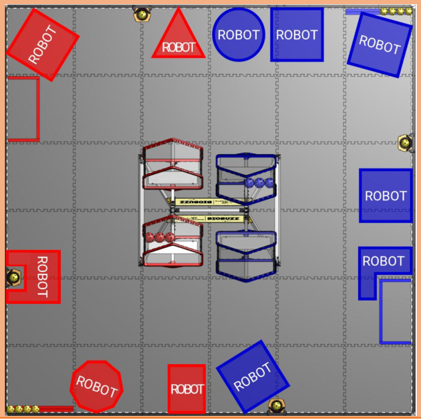

<!-- Source: FTC 2026-2027 BIOBUZZ Competition Manual TU05 (2026-10-15) - Section 11, PDF pages 99-118 -->

# 11 Game Rules (G)

## 11.1 Personal Safety

- **G101 *Humans, stay off the FIELD during the MATCH.** A team member may not enter the FIELD during a MATCH.

_Violation: VERBAL WARNING._

> The intent of this rule is that team members should stay outside of the FIELD perimeter during a MATCH and not impact a MATCH except as allowed in Section 11.4.6 Human. A team member stepping onto the FIELD or hanging a large portion of their body over the FIELD is a violation of this rule.

A team member pointing their arm, waving, or leaning over the FIELD perimeter wall without impacting the MATCH are not violations of the rule.

- **G102 *Be careful when interacting with ARENA elements.** A team member is prohibited from the following actions with regards to interaction with ARENA elements:

   - A. climbing on,

   - B. hanging from,

   - C. manipulating such that it does not return to its original shape without human intervention, and

   - D. damaging.

_Violation: VERBAL WARNING._

> DRIVE TEAM members may brace the FIELD perimeter at any point during the MATCH. Moving the FIELD perimeter out of position is considered a violation of G102.C.

## 11.2 Conduct

- **G201 *Be a good person.** All teams must be civil toward everyone and respectful of team and event equipment while at a _FIRST_ Tech Challenge event. Please review the _FIRST_ Code of Conduct, Core Values, and the rest of Section 1.4.2 Framework of Behaviors for more information.

_Violation: VERBAL WARNING. YELLOW CARD if subsequent violations occur during the event._

> Particularly contemptible behavior may result in ARENA ejection for individuals, disqualification for teams, and may be subject to further escalation as described in the Escalation Guidelines.

**G202 *Follow the Competition Integrity Contract (CIC).** When playing BIOBUZZ, teams must follow the rules and follow the Competition Integrity Contract (CIC) described in Section 1.5 Competition Integrity Contract (CIC) during every MATCH.

Examples of behaviors that would violate this rule include, but are not limited to:

- A. deliberately violating the spirit of the rules,

- B. throwing MATCHES, deliberately missing RPs, or playing beneath your ability to manipulate rankings,

- C. asking other teams to throw MATCHES, deliberately miss RPs, or play beneath their ability to manipulate rankings,

- D. asking teams to not show up to their MATCH,

- E. distracting, disrupting, and/or taunting opponents, or

- F. disrupting ARENA operations.

_Violation: VERBAL WARNING. YELLOW or RED CARD if subsequent violations occur during the event._

> These rules are not intended to prevent an ALLIANCE, who intends to play the game and follow the rules, from planning and/or executing strategies in specific MATCHES in which teams play specific and potentially unconventional roles that contribute to their ALLIANCE.

> Playing with integrity is required in _FIRST_ ; YELLOW or RED CARDS will be given at the discretion of the Head REFEREE based on severity of the infraction and impact on the MATCH.

- **G203 *Show up to your MATCHES.** If a ROBOT has passed initial, complete inspection, at least 1 member of its DRIVE TEAM must report to the ARENA and participate in each of their assigned Qualification MATCHES.

_Violation: DISQUALIFIED from the current MATCH._

> The team should inform the Lead Queuer if the team’s ROBOT is not able to participate.

> If there are extenuating circumstances which prevent at least 1 member of a team from attending each of their MATCHES, that team should discuss with FIELD STAFF whether an accommodation is available.

- **G204 *Do not expect to gain by doing others harm.** Actions clearly aimed at forcing the opponent ALLIANCE to violate a rule are not in the spirit of _FIRST_ Tech Challenge and not allowed. Violations forced in this manner will not result in an assignment of a penalty or penalties, to the targeted ALLIANCE.

_Violation: MAJOR FOUL per instance. MAJOR FOUL per instance and YELLOW CARD per MATCH if REPEATED. The ALLIANCE that was forced to break a rule will not be assessed a penalty._

> This rule does not apply for strategies consistent with standard gameplay. This rule requires a deliberate act with limited or no opportunity for the team being acted on to avoid the penalty, such as:

> - A. a red ALLIANCE ROBOT deliberately drives into a blue ALLIANCE ROBOT that is lined up to score NECTAR into a FLOWER with 65 seconds left in the MATCH, causing them drop the NECTAR into the FLOWER early in violation of G410.

> - B. a red ALLIANCE ROBOT drives through the blue LOADING ZONE while a blue DRIVE TEAM member is introducing NECTAR to the FIELD, deflecting the blue NECTAR before it contacts the TILE in the LOADING ZONE, in violation of G427.

- **G205 *Egregious or exceptional violations.** Egregious behavior beyond what is listed in the rules or subsequent violations of any rule or procedure during the event is prohibited.

In addition to rule violations explicitly listed in this manual and witnessed by a REFEREE, the Head REFEREE may assign a YELLOW or RED CARD for egregious ROBOT actions or team member behavior at any time during the event.

Continued violations will be brought to _FIRST_ Headquarters’ attention. _FIRST_ Headquarters will work with event staff to determine if further escalations are necessary, which can include removal from award consideration and removal from the event.

Deliberately violating a rule because the benefit of the violation outweighs the penalty is not in the spirit of _FIRST_ and is an example of egregious behavior. For example, multiple violations of rules without an escalation path because the cumulative benefit outweighs the cumulative penalty. Violating a rule that only results in a YELLOW CARD in an ALLIANCE’S potential last MATCH prior to cards clearing per Section 10.6.1 YELLOW and RED CARDS or the end of an event (such as a team’s last qualification MATCH, a lower bracket MATCH) will be under increased scrutiny and will likely result in a RED CARD.

Please see Section 10.6.1 YELLOW and RED CARDS for additional detail.

_Violation: YELLOW or RED CARD._

> The intent of this rule is to provide the Head REFEREES with the flexibility necessary to keep the event running smoothly, as well as keep the safety of all the participants as the highest priority.

> The Head REFEREE may assign a YELLOW or RED CARD for a single instance of a rule violation or for multiple instances of any single rule violation. Teams should be aware that any rule in this manual could escalate to a YELLOW or RED CARD. The Head REFEREE has final authority on all rules and violations at an event.

## 11.3 Pre-MATCH

**G301 *Don’t delay MATCHES.** DRIVE TEAM members may not cause significant delays to the start of their MATCH. Both of these conditions must be met prior to team actions being considered:

A. the expected MATCH start time has passed, and

B. the DRIVE TEAM has access to the ARENA.

In order for a team to cause a significant delay, the Head REFEREE must perceive that the team is neither MATCH ready (G303) nor making a good faith effort to quickly become MATCH ready.

> During Qualification MATCHES, the expected start time of the MATCH is the time indicated on the MATCH schedule or ~3 minutes after the end of the previous MATCH on the same FIELD, whichever is later.

> During Playoff MATCHES, the expected start time of the MATCH is the time indicated on the MATCH schedule or 8 minutes from either ALLIANCE’S previous MATCH, whichever is later

> During back-to-back MATCHES, T406 is in effect, and teams may have a longer minimum break.

> Teams that have 1 DRIVE TEAM member present and have informed FIELD STAFF that their ROBOT will not be participating in the MATCH are considered MATCH ready and not in violation of this rule.

_Violation: VERBAL WARNING. MAJOR FOUL for the upcoming MATCH if a subsequent violation occurs within the tournament phase. In a Playoff MATCH, the VERBAL WARNING is issued to the entire ALLIANCE._

_If the team/ALLIANCE is not MATCH ready within 2 minutes of the VERBAL WARNING/MAJOR FOUL having been issued, and the Head REFEREE perceives no good faith effort by the DRIVE TEAM(S) to quickly become MATCH ready, the offending team’s ROBOT is DISABLED._

> The intent of this rule is to provide an equitable amount of time for both ALLIANCES to prepare for each MATCH and give DRIVE TEAMS grace given extenuating circumstances that cause them to be late. Teams should avoid disrupting ARENA operations and proactively communicate with the Head REFEREE and FIELD STAFF to let them know their status.

> FIELD STAFF will make a good faith effort to wait for missing or unprepared teams and will avoid beginning any MATCH when teams are not present or not MATCH ready and making good faith effort to become MATCH ready.

> Once a VERBAL WARNING/MAJOR FOUL is issued, the Head REFEREE starts a 2- minute timer and makes a good faith effort to share the timer’s status with the delaying DRIVE TEAM.

> In general, good faith efforts to quickly become MATCH ready are entirely for the purposes of transitioning the ROBOT into a MATCH ready state (i.e., not attempts to significantly alter a ROBOT’S capabilities). Examples of good faith efforts to

> - quickly become MATCH ready that would not be a violation include but are not limited to:

> - A. walking safely towards the FIELD with a ROBOT that a team is not actively modifying,

> - B. applying quick fixes such as tape or cable ties to make the ROBOT compliant with STARTING CONFIGURATION requirements,

> - C. waiting for a DRIVER STATION device to boot,

> - D. actively working with field technical staff, including the FTA, to resolve an issue in a reasonable amount of time, or

> - E. performing a MOMENTARY “wiggle test” to confirm communication between the DRIVER STATION and the ROBOT CONTROLLER. The ROBOT should not drive or interact with SCORING ELEMENTS (except contact with pre-loaded POLLEN) while performing this test.

**G302 *Limit what you bring to the FIELD** . Items brought to the FIELD to be used for a MATCH, in addition to the ROBOT and OPERATOR CONSOLE, must fit in the team’s designated ALLIANCE AREA, be worn or held by members of the DRIVE TEAM, or be an item used as an accommodation (e.g., crutches, cushions, kneeling mats, or single-step stools no more than 12 in. tall (30.5 cm) that are designed to be stood on and are locked such that they do not roll/fold).

Regardless of whether the equipment fits the criteria above, it may not:

- A. be employed in a way that disrupts normal ARENA operations or introduces a safety hazard,

- B. extend more than 6 ft. 6 in. (~198 cm) above the TILES,

- C. communicate with anything or anyone outside of the ARENA with the exception of medically required equipment,

- D. block visibility for FIELD STAFF or audience members, or

- E. jam or interfere with the remote sensing capabilities of another team.

Exceptions to G302.B are granted for MOMENTARY extensions above 6 ft. 6in. and for individuals wearing PPE or reasonable decorative apparel such as hats, headbands, etc.

_Violation: MATCH will not start until the situation is remedied. VERBAL WARNING, if discovered or used inappropriately during a MATCH. YELLOW CARD if subsequent violations occur during the event._

> It is not a violation of this rule to bring an alignment device to the FIELD to aid pre-MATCH ROBOT set-up and alignment. The use of any alignment devices should not delay MATCH start in violation of G301. Examples of equipment that may be considered a safety hazard in the confined space of the ALLIANCE AREA include but are not limited to: a ladder or a large signaling device. Using an item that has wireless communications disabled complies with G302.C above. Examples of jamming or interfering with remote sensing capabilities include but are not limited to: mimicking the FIELD AprilTags and shining bright lighting or laser pointers onto the FIELD during a MATCH.

**G303 *ROBOTS on the FIELD must come ready to play a MATCH.** A ROBOT must meet all following MATCHstart requirements:

- A. does not pose a hazard to humans, ARENA elements, or other ROBOTS,

- B. meets all the requirements from Section 3.3 MATCH Eligibility Rules including those regarding inspection/re-inspection,

- C. is the only team-provided item left in the FIELD, and

- D. has ROBOT SIGNS that indicate the correct ALLIANCE color (see R402).

_Violation: The MATCH will not start until all requirements are met if there is a quick remedy. DISABLED if it is not a quick remedy, and, at the discretion of the Head REFEREE, ROBOT must be re-inspected. RED CARD if a team’s ROBOT is not compliant with_ _G303.B participates in the MATCH._

> For assessment of many of the items listed above, the Head REFEREE is likely to consult with the LRI.

- **G304 *ROBOTS must be set up correctly on the FIELD.** A ROBOT must be positioned on the FIELD such that it meets all of the following requirements:

   - A. fully contained on its own ALLIANCE’s side of the FIELD (FIELD columns A, B, C for red, or FIELD columns D, E, F for blue) (Figure 9-4),

   - B. not attached to, entangled with, or suspended from any FIELD element,

   - C. touching the FIELD perimeter wall,

   - D. not contacting or in the scoring volume of a FLOWER,

   - E. not in the LOADING ZONE,

   - F. confined to its STARTING CONFIGURATION (see R102 and R103),

   - G. in contact with exactly 4 POLLEN pre-loads as described in Section 10.3.1 SCORING ELEMENTS fully contained on its own ALLIANCE side of the FIELD, and

   - H. fully motionless following completion of OpMode initialization,

_Violation: The MATCH will not start until all requirements are met, if there is a quick remedy. DISABLED or removed from FIELD, if it is not a quick remedy._

> G304.A requires the ROBOT to be fully contained within the FIELD perimeter and not overhang the FIELD perimeter wall. Each ROBOT must start contacting 4 POLLEN either located in or on the ROBOT, or on the TILES contacting the ROBOT. ROBOTS that are no-shows for their MATCH will have their POLLEN placed in the LOADING ZONE against the perimeter wall. Figure 11-1 shows examples of several possible legal ROBOT starting locations.

> Figure 11-1: Examples of allowed ROBOT starting locations
> 
> 
>

**G305 *Teams must select an OpMode.** An OpMode must be selected on the DRIVER STATION app and initialized by pressing the INIT button. If this OpMode is an AUTO OpMode, the 30 second AUTO timer must be enabled.

_Violation: MATCH will not start until the situation is remedied. DISABLED if ROBOT cannot initialize an OpMode or the situation cannot be remedied quickly._

> This rule requires all teams to select and INIT an OpMode, regardless of whether or not an AUTO OpMode is planned to be used during AUTO. FIELD STAFF will use this as an indication that a team is ready to start the MATCH.

> Teams without an AUTO OpMode should consider creating a default AUTO OpMode using the BasicOpMode sample and use the auto-loading feature to automatically queue up their TELEOP OpMode.

## 11.4 In-MATCH

Rules in this section pertain to gameplay once a MATCH begins.

### 11.4.1 AUTO

AUTO is the first 30 seconds of the MATCH, during which DRIVERS may not provide input to their ROBOTS, so ROBOTS operate with only their pre-programmed instructions. Rules in this section apply only during the AUTO period.

- **G401 *Don’t interact with a ROBOT during AUTO.** As soon as the countdown to start the MATCH begins and until the end of AUTO, DRIVE TEAM members may not directly or indirectly interact with a ROBOT or an OPERATOR CONSOLE, with the following exceptions:

   - A. to press the (▶) start button within a MOMENTARY margin of the start of the MATCH,

   - B. to press the ( `■` ) stop button at the team’s discretion, or

   - C. for personal safety or OPERATOR CONSOLE safety.

_Violation: VERBAL WARNING. MAJOR FOUL and YELLOW CARD per MATCH, if STRATEGIC._

> Teams do not have to start an OpMode if they choose not to run an AUTO OpMode.

> The intent of G401.A is for teams to start AUTO on time, accounting for some variability due to human factors.

- **G402 No AUTO opponent interference.** During AUTO, a team may not disrupt AUTO for the opposing ALLIANCE.

_Violation: MAJOR FOUL per MATCH. MAJOR FOUL and YELLOW CARD per MATCH, if STRATEGIC._

> During AUTO, FIELD columns A, B, C constitute the red side of the FIELD, and columns D, E, F (Figure 9-5) constitute the blue side of the FIELD. Each ALLIANCE has priority over those FIELD and SCORING ELEMENTS on their side of the FIELD. Navigating into the opposing ALLIANCE’S side of the FIELD during AUTO is a risky gameplay strategy that may be seen as STRATEGIC.

> Examples of actions that are considered disruption of AUTO include but are not limited to:
> - A. CONTROLLING SCORING ELEMENTS located on the opposing ALLIANCE’S side of the field, and
> - B. contact an opposing ROBOT on their side of the FIELD.

> SCORING ELEMENTS that happen to enter the other side of the FIELD after being deflected by another object in the FIELD (e.g., FIELD element, ROBOT) will likely not be penalized.

### 11.4.2 TELEOP

- **G403 *ROBOTS are motionless between AUTO and TELEOP.** Any powered movement of the ROBOT or any of its MECHANISMS is not allowed during the transition period between AUTO and TELEOP.

_Violation: VERBAL WARNING. MAJOR FOUL and YELLOW CARD per MATCH, if STRATEGIC._

> Movement due to inertia, gravity, or de-energizing of actuators, etc. is not considered powered movement.

> Teams may press buttons on their DRIVER STATION app to stop the AUTO OpMode, initialize or start a TELEOP OpMode during the AUTO to TELEOP transition period. If the INIT portion of the OpMode causes the ROBOT to violate this rule (powering actuators such that they move or twitch in any way), then the team should wait until TELEOP begins before pressing INIT.

- **G404 *ROBOTS are motionless at the end of TELEOP** . ROBOTS must no longer have powered movement after the end of TELEOP until the Head REFEREE or their designee signals that teams may retrieve their ROBOTS.

_Violation: VERBAL WARNING. MAJOR FOUL and YELLOW CARD per MATCH, if STRATEGIC._

> DRIVE TEAMS should make it obvious that the ROBOTS are no longer being controlled by pressing the ( `■` ) stop button on the DRIVER STATION app or by discontinuing any operation of the ROBOT by the end of the MATCH period and setting down their controllers. Movement due to inertia, gravity, or de-energizing of actuators, etc. is not considered powered movement.

### 11.4.3 SCORING ELEMENT

- **G405 *Keep SCORING ELEMENTS In bounds.** A ROBOT may not deliberately eject a SCORING ELEMENT from the FIELD (either directly or by bouncing it off a FIELD element or another ROBOT).

_Violation: MAJOR FOUL per SCORING ELEMENT._

> SCORING ELEMENTS that leave the FIELD during scoring attempts or as the result of ROBOT-to-ROBOT interactions are not considered deliberate ejections and are not violations of this rule.

- **G406 *Do not damage or make a mess in the ARENA.** Neither a ROBOT nor a DRIVE TEAM member may make a mess or damage any part of the ARENA.

_Violation: VERBAL WARNING. MAJOR FOUL and YELLOW CARD per MATCH, if STRATEGIC. DISABLED if the damage is caused by a ROBOT, and the Head REFEREE perceives that further damage is likely to occur._

_Corrective action (such as eliminating sharp edges, removing the damaging MECHANISM, and/or reinspection) may be required before the ROBOT may compete in subsequent MATCHES._

> The intent of this rule is that DRIVE TEAM members and ROBOTS negatively impact the ARENA, including FIELD elements and SCORING ELEMENTS in a way that would result in significant repair or extensive cleanup that disrupts ARENA operations. Rule R201 describes examples of ROBOT features related to this rule that are scrutinized during inspection.

> SCORING ELEMENTS are expected to undergo a reasonable amount of wear and tear as they are handled by ROBOTS and humans, such as scratching, marking,

> and eventually damage due to fatigue. Routinely gouging, tearing off pieces, or marking SCORING ELEMENTS are violations of this rule.

- **G407 No more than 4 at a time.** A ROBOT may not simultaneously CONTROL more than 4 SCORING ELEMENTS.

_Violation: VERBAL WARNING. MAJOR FOUL and YELLOW CARD per MATCH, if STRATEGIC._

> The intent of this rule is that ROBOTS play MATCHES while only CONTROLLING a
> maximum of 4 SCORING ELEMENTS at a time.
> ROBOTS that CONTROL 5 or more SCORING ELEMENTS at any time during the
> MATCH will be under scrutiny to determine whether it is STRATEGIC.
> Examples of actions that are likely to be perceived as STRATEGIC include, but are
> not limited to:
> A. A ROBOT that picks up and CONTROLS 6 or more SCORING ELEMENTS,
> moving them to a scoring location.
> B. Multiple instances of greater than MOMENTARY CONTROL of 5 or more
> SCORING ELEMENTS by a ROBOT throughout a MATCH.
> Examples of actions that are likely to not  be perceived as STRATEGIC include,
> but are not limited to:
> C. A ROBOT MOMENTARILY CONTROLS 5 SCORING ELEMENTS which they
> “reverse” quickly so that at least one SCORING ELEMENT returns to
> approximately its original state.
> Teams are encouraged to design their ROBOTS to prevent inadvertent or
> deliberate CONTROL of more than 4 SCORING ELEMENTS. This could involve
> guards to prevent SCORING ELEMENTS from accidentally becoming stuck on top
> of the ROBOT and systems to prevent active pickup/intaking of more than 4
> SCORING ELEMENTS.
> REPEATED instances of a ROBOT CONTROLLING 5 or more SCORING
> ELEMENTS are likely to be perceived as STRATEGIC, even if the ROBOT has a
> “keep 4 and discard the rest” sorting mechanism.
> Examples of interaction with a SCORING ELEMENT that are not “CONTROL” and
> would not be a violation of this rule include, but are not limited to:
> D. “bulldozing” (inadvertent contact with a SCORING ELEMENT while in the path
> of the ROBOT moving about the FIELD)
> E. “deflecting” (being hit by a SCORING ELEMENT that bounces into or off a
> ROBOT), or
> F. SCORING ELEMENTS that have been LAUNCHED by a ROBOT that are no
> longer in contact with the ROBOT.
>

- **G408 Don’t CONTROL opponent NECTAR.** A ROBOT may not CONTROL the opponent’s NECTAR.

_Violation: VERBAL WARNING. YELLOW CARD per MATCH, if STRATEGIC._

> REPEATED instances of a ROBOT CONTROLLING an opponent’s NECTAR are
> likely to be perceived as STRATEGIC, even if the ROBOT has a sorting
> mechanism that automatically discards opponent NECTAR by returning it to
> approximately its original state.

- **G409 Don’t catch SCORING ELEMENTS.** A ROBOT may not catch or deflect a SCORING ELEMENT released by a TIPPED HIVE unless and until that SCORING ELEMENT contacts anything else besides that ROBOT.

_Violation: VERBAL WARNING. YELLOW CARD per MATCH, if STRATEGIC._

> The intent of this rule is for the POLLEN and NECTAR that spills out of a TIPPED
> HIVE to hit the TILE floor before it is collected by any ROBOT. It is not the intent
> to penalize accidental catches of SCORING ELEMENTS of ROBOTS that happen
> to be under a TIPPING HIVE.
> Teams are encouraged to design their ROBOTS such that they are unable to
> accidentally catch SCORING ELEMENTS. This could involve guards to prevent
> SCORING ELEMENTS from accidentally becoming stuck on top of the ROBOT.
> ROBOT features of this type will make it more obvious to REFEREES that the
> team is not employing catching as a strategy and avoid being determined to be in
> violation of this rule.
> Examples of actions that are likely to be perceived as STRATEGIC include, but are
> not limited to:
> A. A ROBOT REPEATEDLY is stopped underneath the HIVE waiting for a TIP to
> occur and collect SCORING ELEMENTS that fall.
> B. A ROBOT has a MECHANISM at the top of their ROBOT that opens wide to
> accept SCORING ELEMENTS, and it is used to catch falling SCORING
> ELEMENTS as the ROBOT drives under the HIVE.
> C. A ROBOT REPEATEDLY positions itself so multiple SCORING ELEMENTS that
> fall from the HIVE hit the ROBOT and move with an advantageous vector
> before contacting anything else.
> Examples of actions that are likely to  not  be perceived as STRATEGIC include,
> but are not limited to:
> D. A ROBOT drives under the HIVE and has one or two POLLEN land on a flat
> surface of their ROBOT while driving by.
> E. A ROBOT that is no longer functioning remains stationary under the HIVE and
> has SCORING ELEMENTS collect on the top of their ROBOT.
>

- **G410 NECTAR only goes into FLOWERS with one minute left.** ROBOTS may not enter NECTAR into the FLOWER scoring volume until the last 60 seconds of the MATCH.

_Violation: MAJOR FOUL per NECTAR._

> See Section 10.5.2 FLOWER Scoring Criteria for details on the FLOWER
> scoring volume.
> The primary FIELD timer display is the cue to indicate when there is 60 seconds
> left in the MATCH.
> Teams are encouraged to make it obvious and unambiguous to REFEREES that
> they are not placing NECTAR into a FLOWER too early.
>

- **G411 *Do not hoard SCORING ELEMENTS.** An ALLIANCE may not STRATEGICALLY prevent the opposing ALLIANCE from accessing SCORING ELEMENTS.

_Violation: MAJOR FOUL and YELLOW CARD per MATCH._

> An ALLIANCE using their own NECTAR and/or POLLEN for scoring is not a violation of this rule. Corralling relevant SCORING ELEMENTS into a limited portion of the FIELD and/or actively positioning a ROBOT to prevent opposing ALLIANCE access is a violation of this rule. A GARDEN is not a protected zone.

### 11.4.4 ROBOT

- **G412 *ROBOTS must be under control.** A ROBOT must not pose an undue hazard to a human or an ARENA element during a MATCH in the following ways:

   - A. the ROBOT or anything it CONTROLS, i.e., a SCORING ELEMENT, disrupts anything outside the FIELD or contacts a human that is outside the FIELD, or

   - B. the ROBOT operation is dangerous.

_Violation: DISABLED and VERBAL WARNING. YELLOW CARD per MATCH, if subsequent violations occur during the event._

> Please be conscious of REFEREES and other FIELD STAFF working around the
> ARENA who may be in close proximity to your ROBOT.
> Examples of violations include, but are not limited to:
> A. wildly flailing outside the FIELD,
> B. knocking over a DRIVER STATION stand,
> C. moving/damaging the FIELD timer display, or
> D. contacting FIELD STAFF or a DRIVE TEAM member outside the FIELD.
> ROBOT contact with ARENA elements outside the FIELD, such as a DRIVER
> STATION stand, the floor outside the FIELD, or the FIELD wall perimeter outside
> of the FIELD is not a violation of this rule.
>

- **G413 *ROBOTS must stop when instructed.** If a team is instructed to DISABLE their ROBOT by a REFEREE per T402, a DRIVE TEAM member must press the ( `■` ) stop button on the DRIVER STATION app and set down their controllers.

_Violation: VERBAL WARNING. RED CARD, if STRATEGIC._

- **G414 *ROBOTS must be identifiable.** A ROBOT’S team number and ALLIANCE color must not become indeterminate, as perceived by the Head REFEREE.

_Violation: VERBAL WARNING. YELLOW CARD, if STRATEGIC._

> Teams are encouraged to robustly affix their ROBOT SIGNS to their ROBOT in highly visible locations such that they do not easily fall off or become obscured during normal gameplay. Corrective action such as revising ROBOT SIGNS may be requested before the ROBOT participates in a subsequent MATCH.

**G415 *Watch your ARENA interaction.** A ROBOT is prohibited from the following interactions with an ARENA element, except for SCORING ELEMENTS:

- A. grabbing,

- B. grasping,

- C. attaching to,

- D. becoming entangled with, or

- E. suspending from.

_Violation: VERBAL WARNING. YELLOW CARD per MATCH, if STRATEGIC. DISABLED if the Head REFEREE perceives that damage is likely._

_Corrective action (such as removing the offending MECHANISM, and/or re-inspection) may be required before the ROBOT will be allowed to compete in subsequent MATCHES._

> ROBOTS with a concave shape that wraps partially around a FLOWER for purposes such as to aid in alignment would not be in violation of this rule.

- **G416 ROBOTS have construction limits.** ROBOTS may not violate the limits outlined in R105 during the MATCH. ROBOTS may not:

   - A. expand such that they exceed the expansion limits noted in R105.A or R105.B , or

   - B. deliberately detach parts per R105.C .

_Violation: VERBAL WARNING. MAJOR FOUL per instance, if STRATEGIC._

> A ROBOT is allowed to have parts that move after the start of a MATCH that extend outside its STARTING CONFIGURATION, but these extensions must stay within the expansion limit and not deliberately detach COMPONENTS as described in R105.

- **G417 ROBOTS may not meddle with the HIVE Structure.** ROBOTS may not manipulate the motion of the HIVE in any way other than by LAUNCHING SCORING ELEMENTS into an upward-facing CELL.

_Violation: VERBAL WARNING. MAJOR FOUL and YELLOW CARD per MATCH, if STRATEGIC._

> HIVES are designed and intended to only have a TIP induced by LAUNCHING POLLEN and NECTAR into an upward-facing CELL. Any other interaction with the HIVE that causes or could cause or impeding a TIP is a violation of this rule. Examples of ROBOT actions that are likely to be perceived as STRATEGIC include, but are not limited to:

> A. ramming into the HIVE frame at high-speed, B. ramming into the HIVE frame multiple times in a short time period, C. deliberately LAUNCHING NECTAR or POLLEN into the external bottom, sides, or top faces of a CELL,

> - D. impeding the TIP of an opponent’s HIVE by LAUNCHING NECTAR or POLLEN at it,

> - E. contacting a HIVE directly or transitively through a CONTROLLED SCORING ELEMENT, or

> - F. actions that are REPEATED after a warning has been given. Examples of actions that are likely to not be perceived as STRATEGIC include, but are not limited to: G. A ROBOT accidentally bumping into a HIVE frame while attempting to pick up POLLEN, or

> - H. A ROBOT attempting to LAUNCH POLLEN or NECTAR into the upward-facing CELL and missing in a way that hits the bottom, sides, or top of the CELL.

- **G418 ROBOTS may not meddle with FLOWERS.** ROBOTS may not enter SCORING ELEMENTS into or remove SCORING ELEMENTS from a FLOWER except:

   - A. only enter POLLEN and NECTAR into the top of a FLOWER, and

   - B. only remove POLLEN from the bottom of a FLOWER.

_Violation: VERBAL WARNING. MAJOR FOUL and YELLOW CARD per MATCH, if STRATEGIC._

> - The FLOWERS are designed and intended to only allow POLLEN and NECTAR to enter through the top of the top ring and only allow POLLEN (not NECTAR) to be removed from the bottom of the middle ring. Any other actions to score or remove SCORING ELEMENTS from the FLOWER are considered a violation of this rule. The intent is not to disallow ROBOTS from contacting the FLOWER or interactions that occur when attempting allowed scoring actions. Examples of ROBOT actions that are not violations of this rule include: A. contacting the FLOWER while attempting to enter or remove SCORING ELEMENTS,

> - B. contacting POLLEN or NECTAR scored in a FLOWER while attempting to score, or

> - C. driving into a FLOWER and contacting the POLLEN or NECTAR inside it. Examples of actions that are likely to be perceived as STRATEGIC include, but are not limited to: D. A ROBOT attempts to pull POLLEN through the side of the FLOWER, E. A ROBOT grabs onto the FLOWER and shakes it, F. A ROBOT forces NECTAR out of the middle ring with a MECHANISM, G. A ROBOT deliberately drives into the perimeter wall at high-speed causing a SCORING ELEMENT to fall out of a FLOWER, or

> - H. A ROBOT deliberately holds a NECTAR up to the side of the FLOWER pipes such that it meets the FLOWER scoring criteria.

> - Examples of actions that are likely to not be perceived as STRATEGIC include but are not limited to: I. A ROBOT drives into a FLOWER while attempting to pick up POLLEN off the TILES and causes a POLLEN to fall out the top of a FLOWER, or

> - J. A ROBOT knocks out a scored POLLEN while attempting to score another POLLEN.

### 11.4.5 Opponent Interaction

Note, G419 and G420 are mutually exclusive. A single ROBOT to ROBOT interaction which violates more than 1 of these rules results in the most punitive penalty, and only the most punitive penalty, being assessed.

**G419 *Do not damage an opponent ROBOT.** A ROBOT may not damage or functionally impair an opponent ROBOT.

_Violation: VERBAL WARNING. MAJOR FOUL and YELLOW CARD per instance, if STRATEGIC. MAJOR FOUL and RED CARD per instance if STRATEGIC and opponent ROBOT is unable to drive._

> BIOBUZZ is a highly interactive game and may include defensive and highcontact gameplay. While this rule prevents teams from damaging their opponents STRATEGICALLY and aims to limit severe damage to ROBOTS, teams should design their ROBOTS to be robust.

> The damage or functional impairment of exposed or unprotected COMPONENTS or MECHANISMS in the course of normal gameplay is not likely to be considered a violation of this rule. This includes, but is not limited to: A. an exposed or unprotected main power switch (see R603), B. exposed or unprotected wiring, or C. a delicately constructed MECHANISM (such as an intake). When a team’s ROBOT is interacting with an opponent ROBOT that is in a precarious or disadvantaged position, that team should make it obvious and unambiguous that they are trying to avoid damaging their opponent.

Examples of actions that are likely to be perceived as STRATEGIC include, but are not limited to:

> - D. A ROBOT high-speed rams and/or REPEATEDLY smashes an opponent ROBOT and causes damage.

> - Examples of functionally impairing another ROBOT include, but are not limited to: E. disconnecting wires inside the ROBOT CHASSIS required for operation of a COMPONENT,

> - F. disconnecting the opponent ROBOT’S battery (this example also clearly results in a RED CARD because the ROBOT is no longer able to drive), or

> - G. powering off an opponent’s ROBOT by contacting their reasonably wellprotected power switch. (This example also clearly results in a RED CARD because the ROBOT is no longer able to drive.)

> At the conclusion of the MATCH, the Head REFEREE may elect to visually inspect a ROBOT to confirm violations of this rule made during a MATCH and remove the violation if the damage cannot be verified.

> "Unable to drive" means that because of the incident, the DRIVER can no longer drive to a desired location in a reasonable time (generally). For example, if a

> ROBOT can only move in circles, or can only move extremely slowly, the ROBOT is considered unable to drive.

**G420 *Do not tip or entangle.** A ROBOT may not attach to, tip over, or entangle an opponent ROBOT.

_Violation: VERBAL WARNING. MAJOR FOUL and YELLOW CARD per instance, if STRATEGIC. MAJOR FOUL and RED CARD per instance, if STRATEGIC and either CONTINUOUS or opponent ROBOT is unable to drive._

> The attachment to, or entanglement with, exposed or unprotected COMPONENTS or MECHANISMS in the course of normal gameplay is not likely to be considered a violation of this rule. This includes, but is not limited to:

> - A. exposed or unprotected wiring, or

> - B. a delicately constructed MECHANISM (such as an intake).

> Examples of actions that are likely to be perceived as STRATEGIC include, but are not limited to:

> - C. using a wedge-like MECHANISM to tip over an opponent ROBOT,

> - D. making frame-to-frame contact with an opponent ROBOT that is attempting to right itself after previously falling over and causing them to fall over, or

> - E. causing an opponent ROBOT to tip over by contacting the ROBOT after it starts to tip if, as determined by the REFEREE, that contact could have been avoided.

> Tipping as an unintended consequence of normal ROBOT-to-ROBOT interaction, including single frame-to-frame hits that result in a ROBOT tipping, as perceived by the REFEREE, is not a STRATEGIC violation of this rule.

> "Unable to drive" means that because of the incident, the DRIVER can no longer drive to a desired location in a reasonable time (generally). For example, if a ROBOT can only move in circles or can only move extremely slowly, the ROBOT is considered unable to drive.

- **G421 *There is a 3-count on PINS.** A ROBOT may not PIN an opponent’s ROBOT for more than 3 seconds. A ROBOT is PINNING if it is preventing the movement of an opponent ROBOT by contact, either direct or transitive (such as against a FIELD element). A PIN count ends once any of the following criteria below are met:

   - A. the ROBOTS have separated by at least 2 ft. (~61 cm) from each other for more than 3 seconds,

   - B. either ROBOT has moved 2 ft. from where the PIN initiated for more than 3 seconds, or

   - C. the PINNING ROBOT gets PINNED.

For the criteria in G421.A , the PIN count pauses once ROBOTS are separated by 2 ft. until either the PIN ends or the PINNING ROBOT moves back within 2 ft., at which point the PIN count is resumed.

For the criteria in G421.B , the PIN count pauses once either ROBOT has moved 2 ft. from where the PIN initiated until the PIN ends or until both ROBOTS move back within 2 ft., at which point the PIN count is resumed.

_Violation: MAJOR FOUL per instance and an additional MAJOR FOUL for every 3 seconds in which the situation is not corrected._

### 11.4.6 Human

- **G422 *DRIVE TEAM stays in the ALLIANCE AREA.** Once a MATCH starts, DRIVE TEAM members may not leave their designated ALLIANCE AREA.

_Violation: VERBAL WARNING. MINOR FOUL per instance, if STRATEGIC._

> The intent of this rule is to prevent DRIVE TEAM members from leaving their assigned ALLIANCE AREA during a MATCH to gain a competitive advantage. For example, moving to another part of the FIELD for better viewing or reaching into the FIELD. Simply breaking the plane of the AREA during normal MATCH play is not a violation. DRIVE TEAMS may be anywhere in their ALLIANCE AREA during a MATCH. DRIVE TEAM members may retrieve their own ALLIANCE’S NECTAR that has left the FIELD that they can reach while remaining in the ALLIANCE AREA. Exceptions are granted in cases concerning safety.

**G423 *DRIVE COACHES and other teams: hands off the controls.** Once the MATCH starts, DRIVE COACHES or members of another team may not handle the gamepads of the OPERATOR CONSOLE.

_Violation: VERBAL WARNING. MAJOR FOUL and YELLOW CARD per MATCH, if STRATEGIC._

> The penalty is applied to the team to which the DRIVE TEAM member that violates the rule belongs.

> - If a team is facing extenuating circumstances due to a major conflict (i.e., religious holidays, major testing, transportation issues), that team should discuss with FIELD STAFF whether an accommodation is available. DRIVE COACHES, if desired, may help the DRIVERS in the following ways: A. holding the DRIVER STATION device, B. troubleshooting the DRIVER STATION device, C. selecting OpModes on the DRIVER STATION app, D. pressing the INIT button on the DRIVER STATION app, E. pressing the (▶) start button on the DRIVER STATION app, or F. pressing the (■) stop button on the DRIVER STATION app.

- **G424 *DRIVE COACHES, SCORING ELEMENTS are off limits.** DRIVE COACHES may not contact SCORING ELEMENTS, except for safety purposes.

_Violation: VERBAL WARNING. MINOR FOUL per instance, if STRATEGIC._

- **G425 *DRIVE TEAMS, watch your reach.** Once a MATCH starts, a DRIVE TEAM member may not directly or indirectly:

   - A. contact a ROBOT,

   - B. contact a SCORING ELEMENT in contact with a ROBOT or TILE,

   - C. disrupt SCORING ELEMENT scoring, or

   - D. contact a FIELD element.

_Violation: VERBAL WARNING. MAJOR FOUL and YELLOW CARD per MATCH, if STRATEGIC._

> Hand-held controllers, hanging wires, items of clothing, and other objects in the ALLIANCE AREA can all result in DRIVE TEAM members indirectly contacting a ROBOT, and would be violations of this rule.

> Exceptions are granted in cases concerning safety. For G425.A and G425.B , the penalty is applied to the team to which the DRIVE TEAM member regardless of whether the DRIVE TEAM member belongs or ROBOT initiates contact. Disrupting scoring includes, but is not limited to: A. blocking a ROBOT from scoring in a FLOWER, or B. deliberately hitting or shaking the perimeter wall to descore NECTAR or POLLEN from the FLOWER.

- **G426 Humans may not enter NECTAR onto the FIELD early.** DRIVE TEAM members may not enter NECTAR onto the FIELD except:

   - A. for each time the HIVE of their corresponding ALLIANCE color is TIPPED, one additional NECTAR may be entered for that ALLIANCE, or

   - B. when 60 seconds or less remain in the MATCH, all remaining NECTAR can be entered

whichever comes first.

_Violation: MINOR FOUL per NECTAR._

> The primary FIELD timer is the cue to indicate when there is 60 seconds left in the MATCH.

> NECTAR that leaves the FIELD may be re-entered at any time as described in G427.

> DRIVE TEAMS are encouraged to ensure the remaining NECTAR in their ALLIANCE AREA is visible and make it obvious and unambiguous to REFEREES that they are not entering NECTAR too early.

> NECTAR does not have to be entered into the FIELD immediately when a HIVE TIP occurs.

- **G427 Humans, only enter NECTAR via the LOADING ZONE.** NECTAR may not be introduced to the FIELD, except as follows:

   - A. without the use of a tool,

   - B. by a DRIVE TEAM member of the ALLIANCE of the corresponding color, and

   - C. such that NECTAR contacts the TILE within the LOADING ZONE before contacting a ROBOT or a FIELD element.

_Violation: MINOR FOUL per NECTAR._

> The intent of this rule is to only allow DRIVE TEAM members to introduce their own NECTAR into the LOADING ZONE. While there are limited restrictions on how that is done, teams should not attempt to push the boundaries of this rule to gain competitive advantage.

> Humans scoring into a HIVE or FLOWER is never allowed and subject to G202 violations.

> If DRIVE TEAM members come into possession of any POLLEN or opposing ALLIANCE NECTAR that has exited the FIELD, they should pass it to the nearest

> FIELD STAFF for reintroduction into the FIELD per Section 10.8 Other Logistics.

> Note: When introducing NECTAR, DRIVE TEAM members must avoid contacting a SCORING ELEMENT that is also in contact with a TILE to avoid violating G425.

- **G428 Humans, don’t remove SCORING ELEMENTS from the FIELD.** DRIVE TEAM members may not remove SCORING ELEMENTS from the FIELD.

_Violation: MINOR FOUL per SCORING ELEMENT._

> A SCORING ELEMENT is considered on the FIELD if it is contacting a TILE, or in and/or on a ROBOT, FIELD element, or SCORING ELEMENT.
