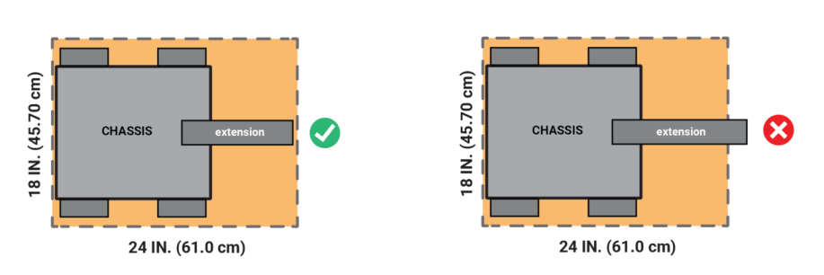
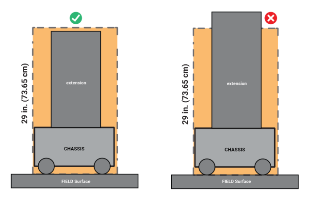
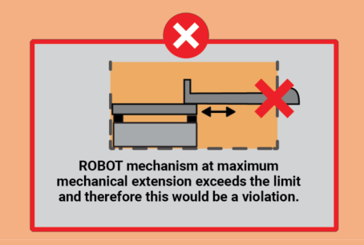
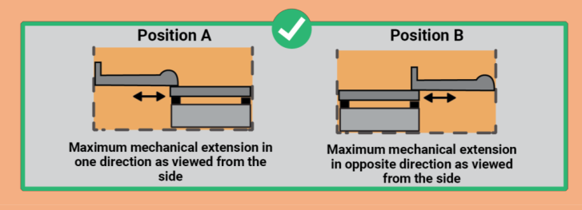
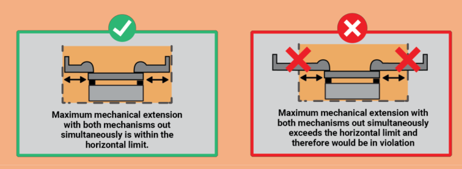
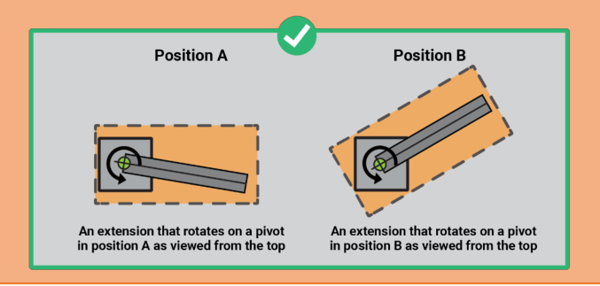
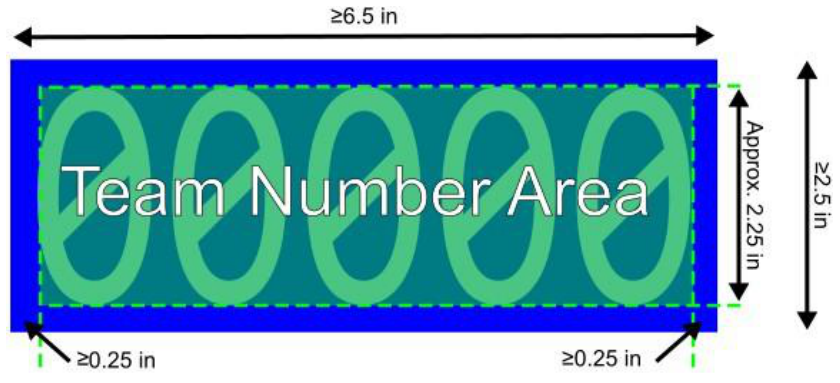
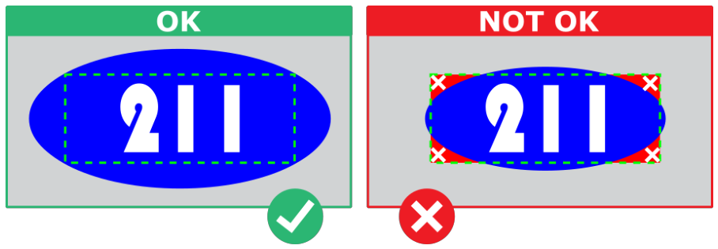
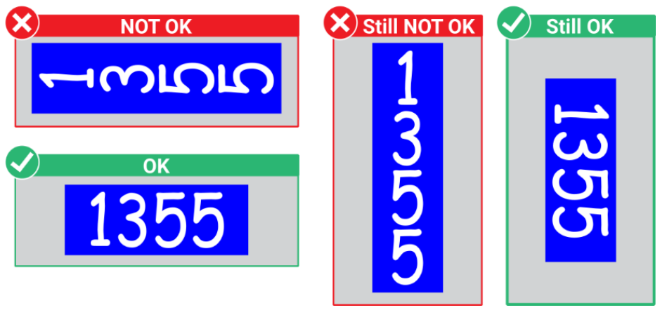

<!-- Source: FTC 2026-2027 BIOBUZZ Competition Manual TU05 (2026-10-15) - Section 12, PDF pages 119-146 -->

# 12 ROBOT Construction Rules (R)

The rules listed below explicitly address legal parts and materials and how those parts and materials may be used on a ROBOT. A ROBOT is an electromechanical assembly built by a _FIRST_ Tech Challenge team to play the current season’s game and includes all the basic systems required to be an active participant in the game –power, communications, control, and movement about the FIELD.

There are many reasons for the structure of the rules, including safety, reliability, parity, creation of a reasonable design challenge, adherence to professional standards, and impact on the competition.

Another intent of these rules is to have all energy sources and active actuation systems on the ROBOT (e.g., batteries, motors, servos, and their controllers) drawn from a well-defined set of options. This is to ensure that all teams have access to the same actuation resources and that the INSPECTORS can accurately and efficiently assess the legality of a given part.

> ROBOT construction rules in this section only apply to the construction of your ROBOT as it might be inspected. MATCH play rules and consequences for violating rules during MATCH play are outlined in Section 11 Game Rules (G).

ROBOTS are made up of COMPONENTS and MECHANISMS.

- A COMPONENT is any part in its most basic configuration, which cannot be disassembled without damaging or destroying the part or altering its fundamental function.

- A MECHANISM is an assembly of COMPONENTS that provide specific functionality on the ROBOT. A MECHANISM can be disassembled (and then reassembled) into individual COMPONENTS without damage to the parts.

Many rules in this section reference Commercial-Off-The-Shelf (COTS) items. A COTS item must be a standard (i.e., not custom order) part commonly available from a VENDOR for all teams for purchase. To be a COTS item, the COMPONENT or MECHANISM must be in an unaltered, unmodified state (with the exception of installation or modification of any software). Items that are no longer commercially available but are functionally equivalent to the original condition as delivered from the VENDOR are considered COTS.

> Example 1: A team orders 2 ROBOT panels from RoboPanels Corp. and receives both items. They put 1 in their storeroom and plan to use it later. Into the other, they drill “lightening holes” to reduce weight. The first panel is still classified as a COTS item, but the second panel is now a FABRICATED ITEM, as it has been modified.

> Example 2: A team obtains openly available blueprints of a drive module commonly available from Wheels-R-Us Inc. and has local machine shop “WeMake-It, Inc.” manufacture a copy of the part for them. The produced part is not a COTS item, because it is not commonly carried as part of the standard stock of We-Make-It, Inc.

> Example 3: A team obtains openly available design drawings from a professional publication and uses them to fabricate a gearbox for their ROBOT. The design

> drawings are considered a COTS item and may be used as “raw material” to fabricate the gearbox. The finished gearbox itself would be a FABRICATED ITEM, and not a COTS item.

> Example 4: A COTS part that has non-functional label markings added would still be considered a COTS part, but a COTS part that has device-specific mounting holes added is a FABRICATED ITEM.

> Example 5: A team has a COTS gearbox which has been discontinued. If the COTS gearbox is functionally equivalent to its original condition, it may be used.

A VENDOR is a legitimate business source for COTS items that satisfies all the following criteria:

- A. has a Federal Tax Identification number. In cases where the VENDOR is outside of the United States, they must possess an equivalent form of registration or license with the government of their home nation that establishes and validates their status as a legitimate business licensed to operate within that country.

- B. is not a “wholly owned subsidiary” of a _FIRST_ team or collection of teams. While there may be some individuals affiliated with both a team and the VENDOR, the business and activities of the team and VENDOR must be completely separable.

- C. should maintain sufficient stock or production capability so they are able to ship any general (i.e., non- _FIRST_ unique) product within a timely manner. It is recognized that certain unusual circumstances (such as a global supply chain disruption and/or 1,000 _FIRST_ teams all ordering the same part at once from the same VENDOR) may cause atypical delays in shipping due to backorders for even the largest VENDORS. Such delays due to higher-than-normal order rates are excused. This criterion may not apply to custom-built items from a source that is both a VENDOR and a fabricator.

> For example, a VENDOR may sell flexible belting that the team wishes to procure to use as treads on their drive system. The VENDOR cuts the belting to a custom length from standard shelf stock that is typically available, welds it into a loop to make a tread, and ships it to a team. The fabrication of the tread takes the VENDOR 2 weeks. This would be considered a FABRICATED ITEM, and the 2- week ship time is acceptable. Alternately, the team may decide to fabricate the treads themselves. To satisfy this criterion, the VENDOR would just have to ship a length of belting from shelf stock (i.e., a COTS item) to the team within 5 business days and leave the welding of the cuts to the team.

- D. makes their products available to all _FIRST_ Tech Challenge teams. A VENDOR must not limit supply or make a product available to just a limited number of _FIRST_ Tech Challenge teams.

> The intent of this definition is to be as inclusive as possible to permit access to all legitimate sources, while preventing ad hoc organizations from providing special-purpose products to a limited subset of teams in an attempt to circumvent any applicable cost accounting rules.

> _FIRST_ desires to permit teams to have the broadest choice of legitimate sources possible, and to obtain COTS items from the sources that provide them with the

> best prices and level of service available. Teams also need to protect against long delays in availability of parts that will impact their ability to complete their ROBOT. The build season is brief, so the VENDOR must be able to get their product, particularly _FIRST_ unique items, to a team in a timely manner.

> Ideally, chosen VENDORS should have effective distribution channels. Remember, _FIRST_ Tech Challenge events are not always near home – when parts fail, local access to replacement materials is often critical.

A FABRICATED ITEM is any COMPONENT or MECHANISM that has been altered, built, cast, constructed, concocted, created, cut, heat treated, machined, manufactured, modified, painted, produced, surface coated, or conjured partially or completely into the final form in which it will be used on the ROBOT.

> Note that it is possible for an item (typically raw materials) to be neither COTS nor a FABRICATED ITEM. For example, a 20 ft. (~610 cm) length of aluminum which has been cut into 5 ft. (~152 cm) pieces by the team for storage or transport is neither COTS (it is not in the state received from the VENDOR), nor a FABRICATED ITEM (the cuts were not made to advance the part towards its final form on the ROBOT).

Teams may be asked to provide documentation (i.e., reference the relevant rule in this manual) proving the legality of items during inspection where a rule specifies limits for a legal part (e.g., motors, servos, current limits, COTS electronics).

If your team has a question about a part’s legality, please e-mail your question to customerservice@firstinspires.org for an official ruling. This process should also be employed to seek approval for alternate parts/devices for inclusion in future _FIRST_ Tech Challenge seasons.

## 12.1 General ROBOT Design

_FIRST Tech Challenge can be a high-contact competition and may include rigorous gameplay. While the rules aim to limit intentional damage to ROBOTS, interaction between ROBOTS is allowed and expected. Teams should design their ROBOTS to be robust._

**R101 *It is your team’s ROBOT.** The ROBOT and its MAJOR MECHANISMS must be built by the _FIRST_ Tech Challenge team that has registered for the event and intends to use the ROBOT to participate in MATCHES or as part of judged awards.

A MAJOR MECHANISM is a group of COMPONENTS and/or MECHANISMS assembled together to address at least 1 game challenge: ROBOT movement, SCORING ELEMENT manipulation, FIELD element manipulation, or performance of a scorable task without the assistance of another ROBOT.

> This rule requires that the ROBOT and its MAJOR MECHANISMS were built by its team but is not intended to prohibit or discourage assistance from other teams (e.g., fabricating elements, supporting construction, writing software, developing game strategy, contributing COMPONENTS, and/or MECHANISMS).

> Examples that would generally not be considered MAJOR MECHANISMS, and thus are not subject to this rule include, but are not limited to: A. a gearbox assembly, B. a COMPONENT or MECHANISM that is part of a MAJOR MECHANISM, or C. COTS items.

> The intent of this rule is that a team’s ROBOT is a product that’s representative of the current team members’ experience and is intended to discourage complete solutions which are provided wholly by outside organizations or companies. Also see R301 and R303.

- **R102 *STARTING CONFIGURATION is limited to an 18-inch Cube.** In the STARTING CONFIGURATION (the physical configuration in which a ROBOT starts a MATCH), all parts of the ROBOT must be fully stationary, and the ROBOT must be fully self-contained within an 18 in. (45.70 cm) wide, by 18 in. (45.70 cm) long, by 18 in. (45.70 cm) high volume.

> If a ROBOT uses interchangeable MECHANISMS per 3.3 MATCH Eligibility Rules, teams should be prepared to show compliance with this rule and R105 in all configurations.

> Any pre-loaded SCORING ELEMENTS may extend outside the starting size constraint.

- **R103 *ROBOTS may assist in holding the STARTING CONFIGURATION.** In the STARTING CONFIGURATION, ROBOTS must be fully self-supported (i.e., does not exert force on the sides or top of a sizing tool). ROBOTS may accomplish this using any combination of:

   - A. mechanical means while powered-off, and/or

   - B. initializing an OpMode that pre-positions servos and motors to a desired stationary position. OpMode may control motors and servos to hold their position to maintain the STARTING CONFIGURATION.

> ROBOTS holding STARTING CONFIGURATION during inspection or waiting for a MATCH to start may have to do so for several minutes and should limit the possibility of thermal failure (e.g., not having motors stalled against a hard stop). Teams should be especially cautious when operating a running ROBOT during inspection, please notify the INSPECTOR that the ROBOT is live.

- **R104 *There is no ROBOT weight limit.** There is no explicit weight limit for _FIRST_ Tech Challenge ROBOTS playing BIOBUZZ.

> - While there is no official weight limit, teams should still consider the impact of a ROBOT’S weight on various factors including, but not limited to: − FIELD TILE damage

> - battery consumption

> - ROBOT transportation

> - overall ROBOT performance

- **R105 A ROBOT must stay as one assembly, and there are limits to how much it can expand.** After the MATCH has started, ROBOTS may expand beyond the STARTING CONFIGURATION but are still subject to sizing constraints relative to the ROBOT, based on the initial STARTING CONFIGURATION. The sizing constraints are:

   - A. After the start of the MATCH, ROBOTS may expand beyond the STARTING CONFIGURATION but at all times must remain within a 18 in. (45.70 cm) by 24 in. (61.0 cm) by 29 in. (73.65 cm) tall sizing volume when fully expanded per G416,

   - B. ROBOTS must be physically constrained to fit within these limits without the use of software, and

   - C. ROBOTS may not be designed to deliberately detach COMPONENTS.

The sizing limit volume is defined relative to the FIELD surface and is oriented such that the 29 in. (73.65 cm) dimension is always the vertical height above the FIELD surface.

_Figure 12-1: Expansion Limit – Top View_

_Figure 12-2: Expansion Limit – Side View_

> The sizing volume is defined relative to the FIELD surface and is oriented such that the 29 in. (73.65 cm) dimension is always the vertical height above the FIELD surface.

> ROBOTS are measured in “stable” configurations they would use during normal gameplay on the FIELD (i.e., with their wheels all touching the TILES). If a ROBOT is “tilted” slightly due to interactions on the FIELD, this is not a violation of this rule if the ROBOT would still be within the sizing volume when it is returned to a stable configuration.

> Teams should be prepared to demonstrate to INSPECTORS that their ROBOT has no configurations where it is outside the sizing volume. ROBOTS must show their maximum mechanical extensions during the inspection process. A ROBOT that can mechanically exceed the sizing limit would be in violation even if the ROBOT has software limiting the position of the extension during the MATCH. (Figure 12-3)

> Figure 12-3: Expansion Limit – Sizing Limit Violation
> 
> 
> A ROBOT with a single MECHANISM that can extend out of both sides of a
> ROBOT would be allowed as long as the overall dimension at maximum
> mechanical extension does not exceed the sizing limit. (Figure 12-4)
> Figure 12-4: Expansion Limit – Allowable Extension
> 
> 
> A ROBOT with multiple MECHANISMS that are not mechanically linked that can
> extend out of both sides of a ROBOT simultaneously would NOT be allowed if the
>

> overall horizontal dimension at maximum mechanical extension exceeds the
> sizing limit (Figure 12-5).
> Figure 12-5: Expansion Limit – Simultaneous Extension
> 
> 
> A ROBOT with an extension on a pivot that rotates in the horizontal plane would
> be allowed as long as the overall dimension does not exceed the sizing limit at
> any point in its travel (Figure 12-6).
> Figure 12-6: Expansion Limit – Rotating Extension
> 
> 
>

## 12.2 Fair Play & Damage Prevention

- **R201** * **ROBOTS should be designed so they don’t damage anything or make a mess in the ARENA.** The ROBOT must not pose a risk of making a mess or pose a hazard to anything in the ARENA.

> The intent of this rule is that teams should design their ROBOTS in a way that will avoid damage to the ARENA and minimize the risk of ROBOTS releasing materials that would require cleanup and may result in damage and/or MATCH delays.

> SCORING ELEMENTS are expected to undergo a reasonable amount of wear and tear as they are handled by ROBOTS, such as scratching or marking. Gouging, tearing off pieces, or routinely and repeatedly marking SCORING ELEMENTS are violations of this rule and G406.

> Examples of “damage risk” ROBOT features include, but are not limited to:
> A. traction devices with features that are known to damage the TILE floor,
> B. COMPONENTS with exposed sharp edges or sharp protrusions, and
> C. features with abrasive surfaces that scratch objects that rub across them.
> Examples of ROBOT features “at risk of making a mess” include, but are not
> limited to:
> D. excessive use of lubricants that may spin off or drip during ROBOT operation,
> E. any COMPONENT not secured sufficiently, including loose ballast such as
> sand, coffee beans, kitty litter, glitter, or ball bearings, such that it may be
> released on the FIELD during a MATCH,
> F. liquid or gel materials,
> G. tire sealant, and
> H. other lubricants including graphite powder.
>

- **R202 *Design ROBOTS and OPERATOR CONSOLES for safety and fair play** . ROBOT and OPERATOR CONSOLE parts shall not be made from hazardous materials, be unsafe, cause an unsafe condition, or interfere with the operations of other ROBOTS or FIELD STAFF.

> - Examples of items that may violate this rule include, but are not limited to: A. shields, curtains, or any other devices solely designed or used to limit the vision of any DRIVE TEAM members,

> - B. audio devices that generate sound at a level sufficient to be a distraction or mimic MATCH sounds,

> - C. any devices or decorations specifically intended to interfere with the remote sensing capabilities of another ROBOT, including vision systems, acoustic range finders, sonars, infrared proximity detectors, etc. This includes imagery on your ROBOT that utilizes or closely mimics 36h11 AprilTags,

> - D. flammable gasses or any device intended to produce flames or pyrotechnics, E. hazardous materials like liquid mercury or lead, F. high intensity light sources used on the ROBOT should only be illuminated for a brief time while targeting and may invite additional scrutiny, and teams may be asked to disable or modify their lighting at the discretion of the Head REFEREE and/or LRI,

> - G. animal based materials, H. any device designed to damage or flip competing ROBOTS, I. devices or conditions that pose an unnecessary risk of entanglement, J. decorative or functional lighting which flashes at greater than 5Hz will invite additional scrutiny and teams may be asked to disable or modify their lighting at the discretion of the Head REFEREE and/or LRI, and

> - K. other items not listed which violate the spirit of the rule regarding safe and fair play.

- **R203 *ROBOTS must be designed to be quickly removed from the FIELD without requiring power.** ROBOTS must allow removal of SCORING ELEMENTS from the ROBOT and the ROBOT from FIELD elements while powered off.

> Some events may allow teams to use ROBOT power during FIELD reset (e.g., driving a ROBOT to the edge of the FIELD) but ROBOTS should be designed such that this is not required.

- **R204 *No grabbing the floor.** ROBOTS may not use any MECHANISM which is designed to increase downforce by either grabbing FIELD surfaces or by using some form of generated airflow to provide downward suction.

## 12.3 Fabrication

- **R301 *COTS MECHANISMS are legal but have limits.** COTS MAJOR MECHANISMS purposefully designed to complete a game task are prohibited. Allowed exceptions to this rule are:

   - A. COTS drive CHASSIS, provided none of the individual parts violate any other rules, and B. COTS MAJOR MECHANISMS created as part of the official _FIRST_ Tech Challenge StarterBots _._

> COTS parts are intended to help teams design and build ROBOT MECHANISMS to complete game tasks and solve challenges but are not intended to be purpose-built solutions to complete game objectives. A vendor selling “build to print” manufacturing of publicly available, purpose-built solutions is against the spirit of this rule.

- **R302 *Legal COTS parts and raw materials can be modified.** Allowed raw materials and legal COTS parts can be modified (drilled, cut, painted, etc.) as long as no other rules are violated.

> Raw materials refers to unfinished building stock including, but not limited to: A. sheet stock, B. extruded shapes, C. metals, plastic, rubber, and wood, and D. magnets.

- **R303 *COTS must be single DoF.** COTS COMPONENTS and MECHANISMS must not exceed a single degree of mechanical freedom (DoF). Examples of allowed COTS single degree of freedom MECHANISMS and COMPONENTS are as follows:

   - A. linear slide kit,

   - B. linear actuator kit,

   - C. single speed (non-shifting) gearboxes,

   - D. pulley,

   - E. turntable,

   - F. lead screw, and

   - G. single DoF gripper.

Allowed exceptions to this rule are:

- H. ratcheting devices (wrenches, bearings, etc.),

- I. holonomic wheels (omni or mecanum),

- J. dead-wheel odometry kits,

- K. items that transfer motion between misaligned COMPONENTS (such as universal joints, flexible shaft couplers, and similar items), and

- L. items that connect structures at variable angles (such as ball joint linkages, rod ends, and similar items).

> The intent of this rule also extends to disallow highly specialized individual COMPONENTS only designed to assemble into a multiple DoF COTS COMPONENT.

> The general test for a single degree of freedom MECHANISM is whether the orientation and position of each COMPONENT in the MECHANISM can be generally predicted based on the orientation and position of a single COMPONENT (such as the input) of the system.

> Example 1: A mecanum drivetrain is made up of 4 independent drive modules, each with a single DoF (ignoring the DoF of the mecanum wheels as allowed by this rule), attached to a common structure (e.g., CHASSIS). The overall MECHANISM is still a single DoF.

> Example 2: Dead wheel odometry modules, allowed by this rule, are typically composed of a 1 DoF wheel (ignoring the effect of the holonomic wheel) providing forward/backwards motion and a spring force providing an additional unique rotational or vertical motion, creating a 2 DoF system. Example 3: Simple gripper claws, comprised of a single actuator moving 2 gripper jaws simultaneously or double actuators each controlling an independent gripper jaw, are by and large a single DoF. However, grippers that incorporate additional actuators providing additional twisting and/or bending actions (like a wrist) add degrees of freedom that are prohibited in COTS MECHANISMS.

- **R304 *Custom software, designs, and parts can be reused year-to-year** . ROBOT software, designs, and FABRICATED ITEMS created before Kickoff are permitted.

- **R305 *SCORING ELEMENTS are not allowed for ROBOT construction.** Current season SCORING ELEMENTS or replicas of SCORING ELEMENTS are not allowed to be used as part of ROBOT construction.

## 12.4 ROBOT SIGN Rules

A ROBOT SIGN is a required assembly which attaches to the ROBOT. A ROBOT SIGN simultaneously identifies a ROBOT’S team number as well as its ALLIANCE affiliation for FIELD STAFF. Criteria used in writing these rules include the following:

- Maximize FIELD STAFF’S ability to determine team number and ALLIANCE of a ROBOT,

- Minimize the amount of design challenge in creating ROBOT SIGNS, and

- Increase consistency in displaying ROBOT identification.

A template ROBOT SIGN is available for download in US Letter and A4 size.

- **R401 *Minimum of two ROBOT SIGNS per ROBOT.** ROBOT SIGNS must be placed in at least 2 separate locations on the ROBOT. These locations must be on opposite or adjacent surfaces of the ROBOT, ≥90 degrees apart. All ROBOT surfaces visible to FIELD STAFF can be used for placing ROBOT SIGNS including the top of the ROBOT. ROBOT SIGNS must meet the following criteria:

   - A. be made of a robust material,

   - B. minimally be 6.5 inches (16.5 cm) wide,

   - C. minimally be 2.5 inches (6.4 cm) tall (Figure 12-7), and

   - D. be supported by the structure/frame of the ROBOT.

> The intent of this rule is for FIELD STAFF to easily view ROBOT SIGNS from at least 12 feet (3.65 meters) away before, during, and after the MATCH.

> ROBOT SIGNS should be robust enough to withstand the rigors of MATCH play, but there is no specific guidance on what is robust enough. Teams should make a good faith effort with whatever they have available.

_Figure 12-7: Team Number ROBOT SIGN Sizing_

**R402 *ROBOT SIGNS indicate your ALLIANCE** . Each ROBOT SIGN must contain a rectangle with a solid red or blue opaque background at least 6.5 in. by 2.5 in. (16.50 cm by 6.35 cm) in size to indicate their ALLIANCE color (Figure 12-7), as assigned in the MATCH schedule at the event. Visible markings on ROBOT SIGNS when installed on the ROBOT, other than the following, are prohibited:

- A. those required per R403,

- B. small amounts of hook-and-loop tape, hard fasteners, or functional equivalents,

- C. narrow areas of differing colors exposed at corners, folds, or cutouts,

- D. narrow markings on background solely for template purposes, and

- E. cannot be powered or rely on power from any sources to illuminate/reveal ALLIANCE color.

> ROBOT SIGNS that are reversible or configurable must not allow the opposite ALLIANCE color to be visible to FIELD STAFF, except where permitted by this rule.

_Figure 12-8: Minimum sized ALLIANCE rectangle_

- **R403 *Team number on ROBOT SIGNS.** Team numbers must be displayed and positioned on the ROBOT SIGN as shown in Figure 12-7, Figure 12-9, and Figure 12-10 and meet the following additional criteria:

   - A. consist of solid opaque white Arabic numbers (e.g., 1,2,3,4) which are approximately 2.25 in. (5.70 cm) tall,

   - B. there must be a minimum of approximately 0.25 in. (0.60 cm) of background surrounding the numbers,

   - C. numbers may not be vertically stacked (Figure 12-10),

   - D. be made of robust materials, and

   - E. cannot be powered or rely on power from any sources to illuminate/reveal numbers.

_Figure 12-9: Legal number for team 21001 playing on the blue ALLIANCE_

_Figure 12-10: Team number orientation examples for team 1355 playing on the blue ALLIANCE_

> If a team at an event does not have completely legal ROBOT SIGNS, and there is no color printer or other means available at the event to create a legal ROBOT SIGN, the Head REFEREE may approve an alternate substitute for use at the event.

> Team numbers should be robust enough to withstand the rigors of MATCH play, but there is no specific guidance on what is robust enough. Teams should make a good faith effort with whatever they have available. If there are limited materials available at an event, substitute ROBOT SIGNS may be simply handwritten on plain paper.

> Small decorative elements and gaps in numbers are okay as long as the team number remains legible from 12 feet (3.65 meters) away and is discernable from a quick glance.

> Examples of prohibited team numbers on ROBOT SIGNS include, but not limited to:

- team numbers only visible by edge lit engraved plastic

> - LED Display numbers

## 12.5 Motors & Actuators

**R501** * **Only specific motors are allowed.** The only allowed motor actuators are:

_Table 12-1: Motor allowances_

|**Motor Name**|**Part Numbers** **Available**|**Notes**|
|---|---|---|
|**AndyMark** NeveRest 12V DC|am-3104, am-3104b||
|**AndyMark** NeveRest Hex 12V DC|am-3104c||
|**goBILDA** Yellow Jacket 520x Series 12V DC|5201-0002-0026, etc.|5201, 5202, 5203, and 5204 series|
|**goBILDA 5000 Series 12V DC**|5000-0002-4008, etc.||
|**Modern Robotics** / MATRIX 12V DC|5000-0002-0001|Discontinued|
|**NFR Products** Yuksel 12V DC|NFR-600-100-000||
|**REV Robotics** HD Hex 12V DC|REV-41-1291||
|**REV Robotics** Core Hex 12V DC|REV-41-1300||
|**Studica Robotics** Maverick 12V DC|75001||
|**SWYFT Robotics** SWYFT Spike Motor|SR-MOTOR-DC-01||
|**TETRIX MAX** 12V DC|739530, 39530|Discontinued|
|**TETRIX MAX** TorqueNADO 12V DC|W44260||
|**WATTOS** Stingray 12V DC|WDM12||

**Factory installed vibration and autofocus motors resident in COTS computing devices (e.g., rumble motor in a smartphone); can only be used as part of the device and cannot be removed and/or repurposed. These motors do not count toward the limit in** R503.

**Motors integral to a COTS sensor (e.g., LIDAR, scanning sonar), provided the device is not modified except to facilitate mounting. These motors do not count toward the limit in** R503.

> Additional motors may be added to the legal motor list in future Competition Manual updates. Many legal gearmotors are sold with labeling based on the entire assembly. These motors may be used with or without the provided gearbox, and/or with any other compatible gearbox.

**R502 *Servo usage is restricted.** Servo actuators must meet the requirements below. Servos must be compatible with the power regulation devices they are ultimately used with (per R505) and may include additional servo position output interfaces (e.g., 4th Wire Position Feedback).

_Table 12-2: Servo Requirements at 6V_

|**Actuator Class**|**Mechanical Output Power**|**Stall Current**|**Example Servos (including, but not limited to)**|
|---|---|---|---|
|**Servo**|≤ 8 watts @6V|≤ 4 amps @6V|AndyMark High-Torque Servos (am-4954) Axon MAX+ Servo (Axon MAX+) DSSERVO 35KG Coreless (DS3235MG) FEETECH Digital Servo (FT5335M-FB) goBILDA Dual Mode Servo (2000-0025-0003) REV Robotics Smart Servo (REV-41-1097) Studica Multi-Mode Smart Servo (75002)|
|**Linear Servo**|N/A|≤ 1 amp @6V|Actuonix Micro Linear Servo (P8-100-252-12-R) Hitec Linear Servo (HLS12-3050-6V) Studica Linear Servo RC Actuator (75014)|

Servo mechanical output power is approximated by the following formula (using 6V data reported by manufacturer):

- **Mechanical Output Power** = 0.25 x (**Stall Torque** in _N-m_) x (**No Load Speed** in _rad/s_)

> Servos must meet both requirements to be legal for use. Refer to the Inspection Quick Reference document for a list of servos that are pre-approved, otherwise teams must be able to provide documentation verifying servo specifications. Use the online calculator to verify output power compliance. If a manufacturer does not provide 6V specs, any specs for voltages that exceed 6V are allowed to be used. Stall current is the maximum stall current possible for the device at the specified voltage, regardless of any user or VENDOR adjustable software limits that may be available within the servo. It is important to ensure the voltage provided by the intended power regulation device is within the operating voltage range of the desired servo. The REV Control Hub and REV Expansion Hub provide 5V to servos, and the goBILDA Servo Power Injector, REV Servo Power Module, Studica Servo Power Block, and REV Servo Hub provide 6V to servos. While virtually all servos are compatible with 6V, servos with an operating voltage range of 6-8.4 DCV, for example, may not work properly when only provided 5V.

- **R503 *ROBOTS are limited to a total of 8 motors and 8 servos.** A ROBOT may not have more than 8 motors and 8 servos from the allowable actuator lists per R501 and R502 for all MECHANISMS used in all configurations.

> If a ROBOT has multiple configurations used at a single event which use different MECHANISMS, the sum total of all motors and servos must be less than or equal to the limit set in this rule.

- **R504 *Do not modify actuators unless explicitly allowed.** The integral mechanical and electrical system of any motor or servo must not be modified. Motors and servos used on the ROBOT shall not be modified in any way, except as follows:

   - A. the mounting brackets and/or output shaft/interface (including pinion gears) may be modified to facilitate the physical connection of the motor to the ROBOT and actuated part,

   - B. the electrical leads may be trimmed to length as necessary and connectors or splices to additional wiring may be added (per R609), and purely electrical enclosures can be substituted with functionally equivalent replacements,

   - C. servos may be modified as specified by the manufacturer (e.g., setting soft limits or modification for continuous rotation),

   - D. labeling may be applied to indicate device purpose, connectivity, functional performance, etc. as long as the team applied label does not obstruct the markings used to identify the device,

   - E. insulation may be applied to electrical terminals,

   - F. repairs, provided the original performance and specifications are unchanged, and

   - G. maintenance recommended by the manufacturer.

- **R505 *All actuators must be controlled and powered through approved devices.** With the exception of servos, fans, or motors integral to sensors of COTS computing devices permitted in R501, all actuator control signals must originate from a power regulating device. The only power regulating devices for actuators permitted on the ROBOT are:

_Table 12-3: Power Regulators and Limits_

|**Power Regulating Device**|**Part Number**|**Load Limit per Device**|
|---|---|---|
|**goBILDA 6V Servo Power Injector**|3125-0001-0001|2 Servos per Port|
|**REV Control Hub or Expansion** **Hub Motor Ports**|REV-31-1153 / REV-31-1595|2 Motors per Port|
|**REV Control Hub or Expansion** **Hub Servo Ports**|REV-31-1153 / REV-31-1595|2 Servos per Port|
|**REV Servo Power Module**|REV-11-1144|2 Servos per Port|
|**REV Robotics Servo Hub**|REV-11-1855|2 Servos per Port|
|**REV SPARKmini**|REV-31-1230|2 Motors per Device|
|**Studica Servo Power Block**|75005|2 Servos per Port|

- **R506 *The use of relays, electromagnets, and electrical solenoid actuators is prohibited.** The application of electromechanical actuation through the use of additional relays, electromagnets, electrical solenoid actuators, or related systems is prohibited. In addition, the use of relays and electromagnets is also prohibited.

## 12.6 Power Distribution

- **R601 *ROBOTS can contain only 1 main battery** . ROBOTS must contain 1 and only 1 approved 12V NiMH main battery. This battery is only legal source of electrical energy for the ROBOT control system and actuation during the competition and must be unaltered from the battery manufacturer state except as follows:

   - A. the fuse may be replaced with a COTS equivalent in-line 20A ATM mini blade fuse installed per R610, and

   - B. installed connectors may be replaced with other popular connectors such as Anderson Powerpole, XT30, or any connector with a comparable power rating.

The only allowed ROBOT main power battery packs are:

_Table 12-4: Legal ROBOT Main Power Battery Packs_

|**Battery Pack**|**Part Number**|**Notes**|
|---|---|---|
|**AndyMark Flat Pack Battery DC 12V**|am-5290||
|**goBILDA 12V NiMH Nested Battery**|3100-0012-0020||
|**Matrix 12V 3000mAh NiMH**|14-0014|May be labeled as “Modern Robotics”|
|**REV 12V Slim Battery**|REV-31-1302||
|**Studica 12V 3000mAh NiMH**|70025||
|**TETRIX MAX 12V 3000mAh NiMH**|W39057|Formerly 739023|
|**WATTOS 12V Battery**|WT-NMH1230||

> There are many other similar style batteries available from multiple VENDORS, but only the listed manufactures and part numbers are legal for use at _FIRST_ Tech Challenge Events.

Other batteries may be used for self-contained devices as listed in R602.

- **R602 *Other batteries are only allowed for self-contained peripheral devices and LEDs only.** COTS USB battery packs with a capacity of 100Wh or less (27,000mAh at 3.7V), with 5V/5A max output or 12V/5A max output using USB-PD per port, and batteries integral to a self-contained devices such as camera (e.g., GoPro-style camera) may be used provided they are:

   - A. not supplying power to any of the ROBOT actuators, and

- B. not used by any devices receiving control signals from the ROBOT control system (i.e., COTS USB battery packs must remain electrically isolated from the ROBOT power systems.). Exceptions to part B of this rule are:

   - i. powered USB Hubs, and

   - ii. ROBOT CONTROLLER smartphones.

> Any device receiving signals from a REV Control or Expansion Hub must be powered by the main ROBOT battery.

- **R603 *Connect the ROBOT battery though the Main Power Switch.** Exactly one main power switch must control all power provided by the ROBOT battery pack to all power regulating devices on the ROBOT (except as specified by R602) such that all the following conditions are met:

   - A. must be one of the following approved power switches:

_Table 12-5: Legal Power Switches_

|**Power Switch**|**Part Number**|
|---|---|
|**AndyMark FTC Power Switch w/ Bracket**|am-4969|
|**goBILDA Floodgate Power Switch**|3103-0005-0001|
|**REV Switch Cable and Bracket**|REV-31-1387|
|**Studica On/Off Power Switch Kit**|70182|
|**TETRIX R/C Switch Kit**|W39129|
|**WATTOS Power Switch Kit**|WTS-SW1220|

- B. must be mounted or located where it is accessible to the team, away from high-speed moving parts and pinch hazards, and

- C. secondary power switches can be used on the 12V line downstream of the main power switch.

> There are no specific location requirements for the main power switch, but it should be located clear of any high-speed moving parts and pinch hazards. Teams are permitted to mount the main power switch behind removable panels.

> The main power switch should be mounted on the ROBOT such that it is protected from ROBOT-to-ROBOT contact to avoid inadvertent actuation or damage.

- **R604 *Fuses must be used as directed and must not be modified** . The intent of this rule is that teams utilize fuses as directed by a device manufacturer, and do not attempt to gain a competitive advantage by modifying the fuses, replacing the fuses with ones that have a higher trip point, or replacing them with fuses that are self-resetting.

- **R605 *The ROBOT frame cannot be used as a current path.** All wiring and electrical devices shall be electrically isolated from the ROBOT frame. The ROBOT frame must not be used to carry electrical

current. Electrically grounding the control system electronics to the frame of the ROBOT is only permitted such that all of the following conditions are met:

- A. straps/cables used must be from the following approved parts:

_Table 12-6: Legal ROBOT Grounding Straps_

|**Grounding Strap**|**Part Number**|
|---|---|
|**AndyMark Resistive Grounding Strap**|am-4648a|
|**REV Resistive Grounding Strap**|REV-31-1269|
|**Swyft Grounding Cable**|SR-Ground-01|

- B. the strap/cable must directly connect to a fully COTS COMPONENT with an XT30 connector, and also must connect directly to the frame of the ROBOT (via the resistive terminal), and

- C. no ROBOT COMPONENTS or MECHANISMS are designed to electrically ground the ROBOT frame to the FIELD.

> For additional details on installation of the grounding strap, please see the ROBOT Wiring Guide.

- **R606 *ROBOT CONTROLLER and the ROBOT electrical system must be inspectable.** ROBOT electrical COMPONENTS must be mounted with accessibility in mind, as follows:

   - A. all power regulating devices (per R505), associated wiring, and all fuses must be able to be made visible for inspection, and

   - B. the ROBOT CONTROLLER device must be mounted on the ROBOT such that the diagnostic lights, or device screen if applicable, can be visible for inspection.

> “Visible for inspection” does not require that the items be visible when the ROBOT is in STARTING CONFIGURATION or normally during a MATCH, provided the team can make the items viewable during the inspection process if necessary.

> Teams are strongly encouraged to make the diagnostic lights visible in all ROBOT configurations used during normal MATCH play. If diagnostic LEDs are not visible during a MATCH, FIELD STAFF may not be able to provide comprehensive support to the team.

- **R607 *Custom Circuits must not provide regulated power above 5V unless they are only powering LEDs.** Any active electrical item that is not an actuator (specified in R501) or power regulation device (specified in R505) is considered a CUSTOM CIRCUIT. CUSTOM CIRCUITS shall not provide regulated output voltages exceeding 5V, except if solely used for powering LEDs. CUSTOM CIRCUITS may pass through unregulated battery voltage.

- **R608 *All Power regulating devices must be connected and powered through approved ports.** All power regulating devices ( R505) must be powered per the manufacturer’s instructions and the following table must be true:

_Table 12-7: Power Regulation Device Power Requirements_

|**Power Regulating Device**|**Part Number**|**Method of Powering**|
|---|---|---|
|**goBILDA 6V Servo Power Injector**|3125-0001-0001|Only powered using the XT30 connectors on the device by the ROBOT main battery|
|**REV Control Hub / REV Expansion Hub**|REV-31-1153 / REV-31-1595|Only powered using the XT30 connectors on the device by the ROBOT main battery|
|**REV Servo Power Module**|REV-11-1144|Only powered using the screw terminals and must only be powered by the ROBOT main battery|
|**REV Robotics Servo Hub**|REV-11-1855|Only powered using the power terminals and must only be powered by the ROBOT main battery|
|**REV SPARKmini**|REV-31-1230|Only powered by the Power input and must only be powered by the ROBOT main battery|
|**Studica Servo Power Block**|75005|Only powered by JST-VH power connector, and must only be powered by the ROBOT main battery|

**R609 *Use appropriately sized wire.** All circuits shall be wired with appropriately sized insulated wire:

_Table 12-8: Wire sizing requirements_

|**Application**|**Minimum Wire Size**|
|---|---|
|**12V Main Battery Power**|18 AWG (19 SWG or 1 mm²)|
|**Motor Power (unless otherwise listed)**|18 AWG (19 SWG or 1 mm²)|
|**11-20A fuse protected circuit**|18 AWG (19 SWG or 1 mm²)|
|**Motor Power - TETRIX MAX 12V DC Motors, REV Robotics Core Hex (REV-14-1300)**|22 AWG (22 SWG or 0.5 mm²)|
|**PWM / Servo**|22 AWG (22 SWG or 0.5 mm²)|
|**LEDs (5V / 12V)**|22 AWG (22 SWG or 0.5 mm²)|
|**≤10A fuse protected circuit**|22 AWG (22 SWG or 0.5 mm²)|
|**Signal level circuits (i.e., circuits which draw ≤1A continuous and have a source incapable of delivering >1A, including but not limited to: I2C, DIO, Analog, encoder and RS485 connections)**|28 AWG (29 SWG or .08 mm²)|

Integrated wires originally attached to legal COTS devices or wires included/sold by the manufacturer are considered part of the device and by default legal. Such wires are exempt from this rule.

> In order to show compliance with these rules, teams should use wire with clearly labeled sizes if possible. If unlabeled wiring is used, teams should be prepared to demonstrate that the wire used meets the requirements of this rule (e.g., wire samples and evidence that they are the required size).

> Combining multiple smaller wires in parallel cannot be used to create an equivalent larger wire which meets minimum wire cross section requirements.

- **R610 *Use specified wire colors for specific buses.** The 12V main power bus and +5V auxiliary bus wires must be color-coded along their entire length. The following colors must be used:

   - A. positive (e.g., +12VDC / +5V Aux): red, yellow, white, brown, or black-with-stripe, and B. negative (e.g., common/GND): black or blue.

> Note: this rule does not apply to other types of wires including, but not limited to: motor wiring, signal level wiring (e.g., encoder and sensor wires), servo cables, and extensions, or wires originally attached to legal devices by their manufacturer.

- **R611 *Powered USB hubs must draw energy from approved sources.** Powered USB hubs used on the ROBOT can only be powered through one of the following ways:

   - A. an approved COTS USB battery Pack per R602, or

   - B. the 5V auxiliary power port on the REV Expansion Hub or REV Control Hub.

- **R612 *Do not modify critical power paths.** CUSTOM CIRCUITS must not directly alter the power or control pathways between:

   - A. the ROBOT battery and main power switch,

   - B. the main power switch and a power regulating device (per R603),

   - C. any two power regulating devices (per R607), or

   - D. power regulating devices and actuators.

> Custom high impedance voltage monitoring or low impedance current monitoring circuitry connected to the ROBOT’S electrical system is acceptable if the effect on power pathways is inconsequential.

> Altering a power pathway includes, but is not limited to, altering the voltage of the power pathway using a boost (DC voltage step-up) or buck (DC voltage stepdown) converter or otherwise altering the natural variable DC voltage provided by the ROBOT battery to create a constant DC voltage.

Devices that modify actuator control signals or power (except those allowed by R505) are prohibited, such as the goBILDA Servo Travel Tuner.

- **R613 *Do not mix and match power on or between power regulation devices.** The following rules must be adhered to when using power on any power regulation device (per R505):

   - A. sensors, encoders, and other devices must be powered solely by the power regulation device they are connected to. Do not use outside power sources (e.g., custom circuits or a second hub) to power them,

   - B. power from a specific port may only power devices plugged into that exact port. Do not cross-wire power to other ports, and do not combine power from multiple ports into a single power bus/line,

- C. 6V power from approved Servo Power modules/injectors may only be used to power servos, and

- D. the +5V Aux port on a REV hub may be used to power devices not connected to other power regulation devices except via USB.

## 12.7 Control, Command & Signals System

- **R701 *Control the ROBOT with a single ROBOT CONTROLLER.** ROBOTS must be controlled via 1 programmable ROBOT CONTROLLER. The ROBOT CONTROLLER is the only source of control for the ROBOT actuators and must be comprised of:

      - A. a REV Control Hub (REV-31-1595), or

      - B. a smartphone Android device connected to a REV Expansion Hub (REV-31-1153).

   - In addition to A or B, a ROBOT may also contain:

      - C. no more than one additional REV Expansion Hub (REV-31-1153).

> We recommend teams always keep all control system device software up to date. Check the _FIRST_ Tech Challenge Firmware Update Page for release announcements and most recent software versions. Due to unpredictable variations in Android software across different manufacturers and updates, the REV Control Hub is the only officially supported ROBOT CONTROLLER device. Teams choosing to use any other unsupported device (e.g., smartphones) are responsible for testing and verifying its compatibility, functionality, and performance.

- **R702 *Teams may not alter coprocessor software.** Modifying software on coprocessors, unless explicitly permitted in this rule, is not allowed by teams. Firmware updates in binary form provided by the manufacturer may be applied as directed by the manufacturer. Programmable vision coprocessors natively supported by the FTC SDK are an exception to this rule, and reprogramming them is permitted. A list of programmable vision coprocessors is found in Table 12-9.

_Table 12-9: Supported programmable vision coprocessors_

|**Device**|**Part Number**|
|---|---|
|**Limelight Vision Limelight 3A**|LL_3A|

> The following are examples of allowed and disallowed devices:

> Example 1: The Adafruit BNO055 Absolute Orientation Sensor is an IMU package with an onboard ARM Cortex-M0 based coprocessor to crunch sensor data and produce composite output. Its coprocessor contains software that is not intended by the manufacturer to be modified by users. This device is allowed.

> Example 2: The SparkFun Optical Tracking Odometry Sensor is a laser and IMU tracking device that uses an onboard microcontroller to perform complex calculations and produce simplified results. SparkFun does provide the source

> code and toolchain for advanced users to modify/update the software, which is not permitted by this rule. Firmware updates provided by SparkFun are allowed to be applied to the device. This device is allowed. Example 3: The Digital Chicken Labs OctoQuad FTC Edition is an 8-channel encoder/PWM interface, utilizing a Raspberry Pi Pico coprocessor. Teams are not permitted to modify software running on the device, including replacing the software with their own. Updates provided in binary form by the manufacturer (Digital Chicken Labs) may be applied to the device. This device is allowed. Example 4: Optical Flow sensors are an example of a sensor that utilizes a vision coprocessor that is treated no differently than other coprocessors per R702. These devices are allowed. Example 5: The DFRobot HuskyLens and the Charmed Labs Pixy2 are examples of vision coprocessors that are configurable but not programmable and are treated no differently than other coprocessors per R702. These devices are allowed. Example 6: The OpenMV Cam, Luxonis OAK-1, and LimeLight Vision Limelight 3G are examples of programmable vision coprocessors that are prohibited.

- **R703 *Smartphone Android devices used as a ROBOT CONTROLLER must connect to the REV Expansion Hub using USB.** If used as a ROBOT CONTROLLER, the smartphone Android device must be connected via its integrated USB port to a REV Expansion Hub with any combination of USB cables (including USB OTG cables) and/or USB hubs (powered or unpowered, with or without OTG integrated into the hub).

- **R704 * Use networks and bandwidth as directed.** Teams and ROBOTS must use Wi-Fi networks and bandwidth in a way that enables fair play and does not interfere with other teams or ARENA operations. Teams must abide by the following guidelines:

   - A. Teams may not use any other form of wireless communication, except those offered by the provided official tools, to communicate to, from, or within the ROBOT.

   - B. Teams may not interfere with the ROBOT networks. All communication signals must originate from only the ROBOT CONTROLLER device or the DRIVER STATION device using the ROBOT CONTROLLER Wi-Fi network. No other devices may attempt to connect to, interfere with, or alter the ROBOT CONTROLLER Wi-Fi network.

   - C. Ensure all programming laptops and other devices (other than the DRIVER STATION device) are disconnected from the ROBOT CONTROLLER Wi-Fi network during MATCH play.

   - D. Software with access to the ROBOT CONTROLLER Wi-Fi network must limit the amount of data being streamed (i.e., continuous transmission of data) over Wi-Fi. Software may only stream robot control data, debugging data, and telemetry to and from the ROBOT using the FTC Driver Station Application. Additional logging/streaming services, such as those hosted by third party plugins and tools such as FTC Dashboard, FTControl Panels, and others are prohibited. No continuous video stream is allowed.

   - E. Some events may assign Wi-Fi bands and/or channels to teams. If requested by event staff, teams must use the specific frequency band or channel on the day of the competition.

- **R705 *Configure devices for your team number.** The ROBOT CONTROLLER, DRIVER STATION, and any spares used must be configured/named to correspond to the correct team number as follows:

   - A. ROBOT CONTROLLER should be named <team number>-RC (e.g., 12345-RC),

   - B. DRIVER STATION should be named <team number>-DS (e.g., 12345-DS), and

   - C. If a spare ROBOT CONTROLLER or DRIVER STATION is configured, a letter designator may be added <team number>-<letter>-RC/DS (e.g., 12345-A-DS, 12345-B-DS)

> See the DRIVER STATION Instructions and ROBOT CONTROLLER Instructions for a detailed procedure for updating DRIVER STATION and ROBOT CONTROLLER “names.”

- **R706 *Only specified modifications to core control system devices are permitted.** The DRIVER STATION device and software, Android-based ROBOT CONTROLLER device, main and secondary power switch(es), power regulation devices, fuses, and batteries shall not be tampered with, modified, or adjusted in any way (tampering includes drilling, cutting, machining, rewiring, disassembling, painting, removing enclosures and replacing with custom enclosures, etc.), with the following exceptions:

   - A. wires, cables, and signal lines may be connected via the standard connection points provided on the devices,

   - B. fasteners (including adhesives) may be used to attach devices to the OPERATOR CONSOLE or ROBOT or to secure cables to the device,

   - C. thermal interface material may be used to improve heat conduction,

   - D. labeling may be applied to indicate device identification, purpose, connectivity, functional performance, etc. as long as they do not cover labels or markings used to identify the product,

   - E. jumpers or switches may be moved to configure devices per the manufacturer’s manual,

   - F. device firmware may be updated with manufacturer supplied firmware,

   - G. integral wires on motor controllers and batteries may be cut, stripped, and/or connectorized, H. devices except batteries may be repaired, provided the performance and specifications of the device after the repair are identical to those before the repair,

   - I. insulating material may be added to exposed conductors,

   - J. tape may be applied for debris protection, and

   - K. power switch mounting brackets can be modified or replaced.

> Please note that while repairs are permitted, the allowance is independent of any manufacturer’s warranty. Teams make repairs at their own risk and should assume that any warranty or return options are forfeited. Repairs must be functionally equivalent to original device condition.

> Be aware that diagnosing and repairing COMPONENTS such as these can be difficult.

> For example, “repairs” that change connector types, include device footprint modifications, or provide mechanical enhancements, are prohibited.

- **R707 *USB is for vision.** Only the following devices may be connected to the ROBOT control system using USB:

   - A. webcams and optical vision sensors per R708,

   - B. USB hub or USB switch, and

   - C. a REV Expansion Hub.

- **R708 *Use only supported USB vision.** Only single image sensor vision devices that are natively supported by the ROBOT CONTROLLER app are allowed to connect to USB (stereoscopic cameras are not allowed). This includes the following:

   - A. all UVC compatible USB webcams (Logitech C270, and related), and

   - B. Vision coprocessors allowed per R702.

> UVC compatible USB webcams may only use the UVC provided stream / data. No other interfaces or data provided by the webcam may be used.

> To request support (or to provide sample drivers) for alternate USB vision devices for inclusion in future _FIRST_ Tech Challenge seasons, please send an email to customerservice@firstinspires.org with the following details:

   - Subject of email should be: “USB Vision Future Support Request”

> - Contact details for providing feedback or clarifications

> - Details on the device requesting support

- **R709 *Recording devices are okay.** Self-contained video recording devices (GoPro or similar) are allowed providing they are used only for non-functional post-MATCH viewing and the wireless capability is turned off.

- **R710 *Lasers are only allowed if they’re part of a sensor, low-energy, and non-visible.** Lasers are not allowed unless they meet all of the following criteria:

   - A. must be part of a sensor,

   - B. must be rated as IEC/EN 60825-1 ”Class I” or IEC/EN 62471 “Exempt,” and

   - C. must use non-visible spectrum.

- **R711 *Configure Android devices appropriately.** ROBOT CONTROLLER and DRIVER STATION Android devices (smartphones, REV Control Hub, REV Driver Hub) must additionally be configured in the following ways:

   - A. REV Control Hub users must change the Wi-Fi password to a non-default password,

   - B. smartphone users must enable Airplane Mode,

   - C. on ROBOT CONTROLLER and DRIVER STATION Android devices, Wi-Fi must be enabled and Bluetooth must be disabled, and

   - D. on DRIVER STATION Android devices, remove all remembered Wi-Fi Direct Groups and Wi-Fi connections, leaving only the ROBOT CONTROLLER Wi-Fi connection.

## 12.8 Pneumatic Systems & Airflow Devices

**R801 *No Pneumatic Actuators, High-Speed Blowers, or Vacuums.** ROBOTS are restricted in their use of air in the following ways:

- A. ROBOTS may only use sealed, COTS closed-air systems which are pre-charged by the manufacturer (such as gas shocks),

- B. ROBOTS may not use any stored pressure COMPONENTS that are actuated by a device like a solenoid and/or are able to change their stable state,

- C. ROBOTS may not generate pressure or vacuum,

- D. ROBOTS may not use any user-adjustable gas storage vessels, except air-filled (pneumatic) COTS wheels, and

- E. ROBOTS may not use any device which creates high-speed airflow, except cooling fans integrated into COTS computing devices.

> The intent of this rule is that ROBOTS may not use pneumatic actuators, pressure or vacuum storage devices, compressors, vacuum generators, or air blowers, but they may use “closed air” systems which were sealed by their manufacturer. This includes items such as gas springs, and dampers. Examples of a “device which creates high-speed airflow” include but are not limited to a fan designed to move SCORING ELEMENTS on the FIELD. High-speed flywheels or rollers used for manipulating SCORING ELEMENTS would not on their own be considered a high-speed airflow device.

## 12.9 OPERATOR CONSOLE

**R901 *Use only a specified DRIVER STATION device.** The OPERATOR CONSOLE may only have one approved Android-based DRIVER STATION device connected and powered on. The OPERATOR CONSOLE must have at least one of the following:

- A. REV Driver Hub (REV-31-1596), or

- B. Any Android Device with or without any combination of USB cables (including USB OTG cables) and/or USB hubs (powered or unpowered, with or without OTG integrated into the hub) for connecting one or more gamepads.

> Due to unpredictable variations in Android software across different manufacturers and updates, the REV Driver Hub is the only officially supported DRIVER STATION device. Teams choosing to use any other unsupported device (e.g., smartphones) are responsible for testing and verifying its compatibility, functionality, and performance. Teams who wish to have a spare DRIVER STATION device as part of their OPERATOR CONSOLE may do so as long as only one DRIVER STATION device is connected and powered on at a time.

**R902 *The OPERATOR CONSOLE must make the touch screen accessible.** The OPERATOR CONSOLE, the set of COMPONENTS and MECHANISMS used by the DRIVE TEAM to relay commands to the ROBOT, must make the touch screen of the DRIVER STATION device accessible. The DRIVER STATION device must be positioned within the OPERATOR CONSOLE so that the screen display can be clearly seen during inspection and in a MATCH. The DRIVER STATION device touch screen must be functional without the requirement of additional aides (e.g., mouse) in order to be used.

- **R903 *OPERATOR CONSOLE physical requirements.** The OPERATOR CONSOLE, including all power sources (e.g., power banks), must not exceed a volume of 3ft wide, 1ft 6in deep and 2 ft tall (91.4 cm by 45.7 cm by 61.0 cm), excluding any items that are held or worn by the DRIVERS during the MATCH.

> Also refer to R203 for restrictions on designing OPERATOR CONSOLES for fair play and ARENA safety.

> Please note that while there is no hard weight limit, OPERATOR CONSOLES that weigh more than 20 lbs. (~9 kg.) will invite extra scrutiny as they are likely to disrupt normal ARENA operations.

> Teams who wish to have a spare external USB hub as part of the OPERATOR CONSOLE may do so as long as only one USB hub is connected at any time.

> The intent of this rule is to allow teams to use a container to store, organize, and transport the DRIVER STATION device and support electronics. The OPERATOR CONSOLE rules are not intended to allow systems that function as a ROBOT cart or replace a competition-provided OPERATOR CONSOLE stand, table, etc.

- **R904 *ROBOT application wireless communication only.** Other than the connection controlled by the ROBOT CONTROLLER app running on the ROBOT and the DRIVER STATION app running on the DRIVER STATION device, no other form of wireless communications shall be used to communicate to, from, or within the OPERATOR CONSOLE during a MATCH.

> Examples of prohibited wireless systems include, but are not limited to, active wireless network cards, wireless gamepad communication, and Bluetooth devices.
