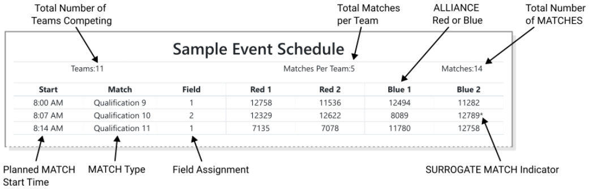
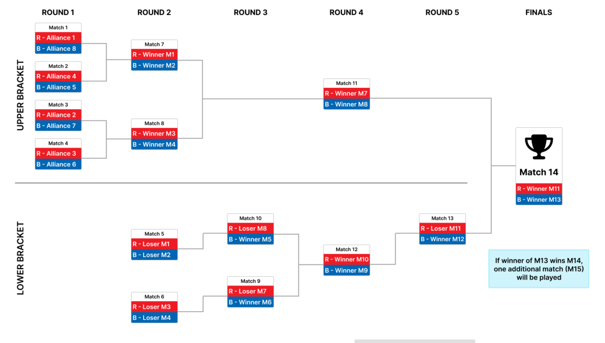
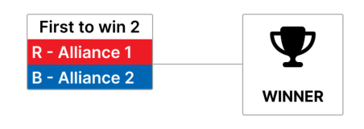
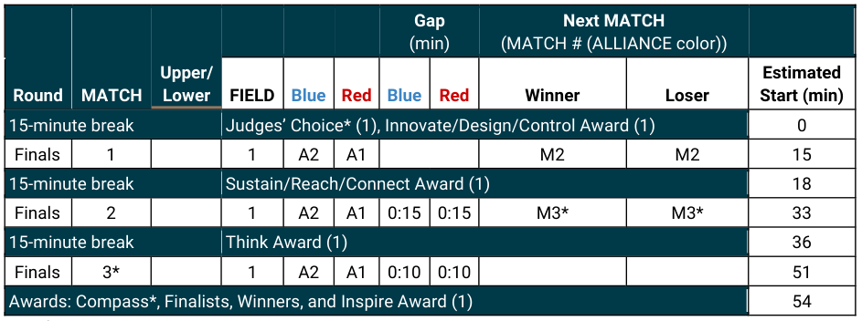
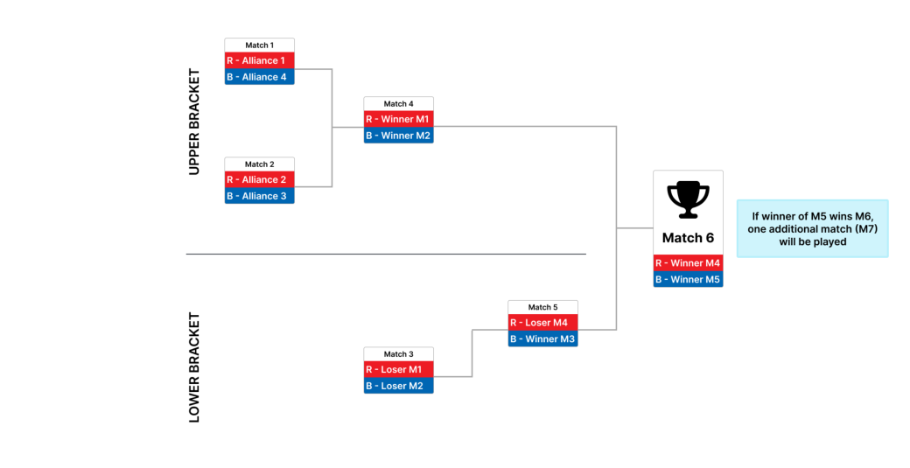
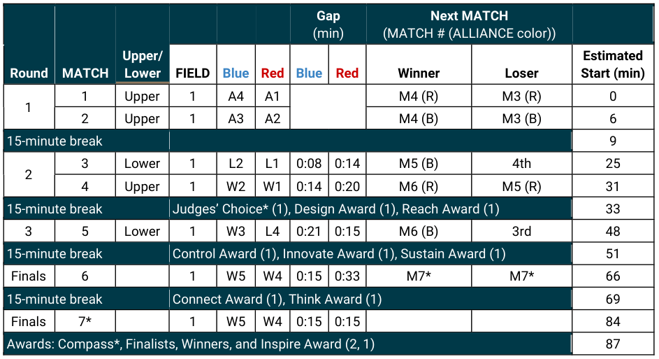
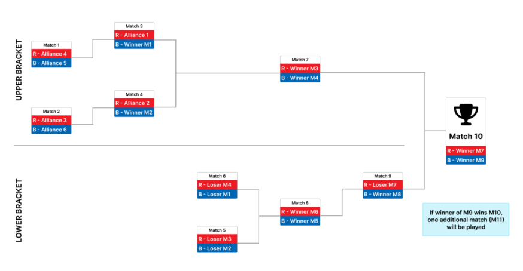
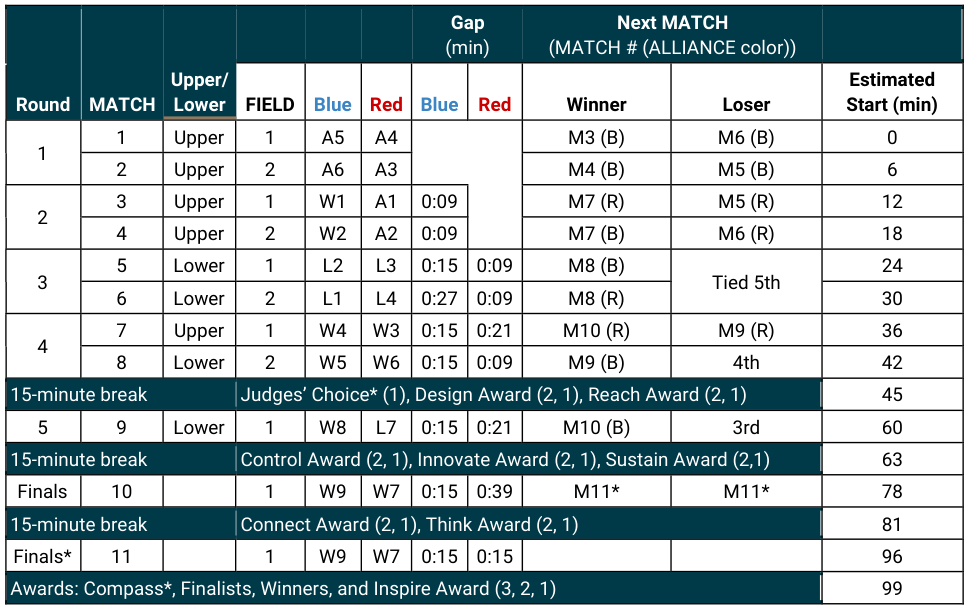
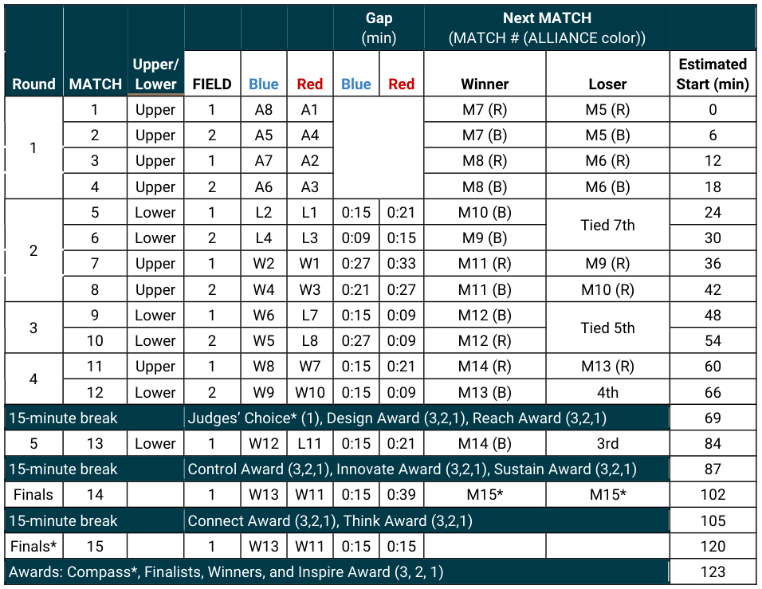
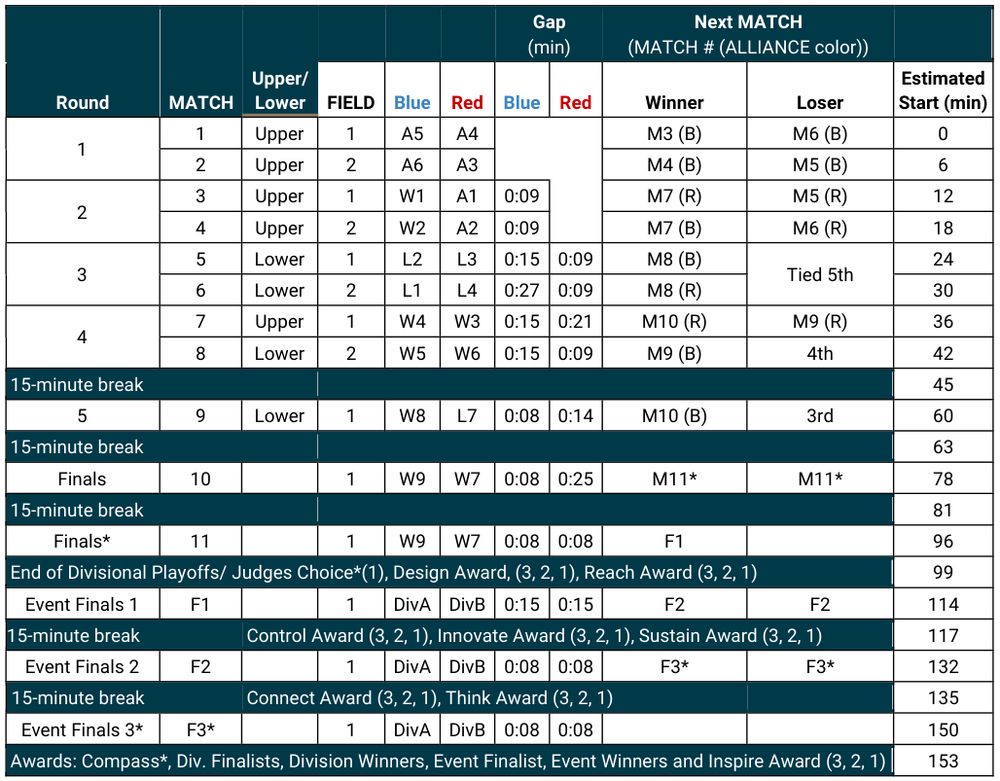

<!-- Source: FTC 2026-2027 BIOBUZZ Competition Manual TU05 (2026-10-15) - Section 13, PDF pages 147-166 -->

# 13 Tournament (T)

## 13.1 Overview

Each _FIRST_ Tech Challenge competition is played in a head-to-head tournament format. Each tournament consists of 3 types of MATCHES: Practice MATCHES (not played at all events), Qualification MATCHES, and Playoff MATCHES.

- Practice MATCHES provide teams with an opportunity to operate their ROBOT on a competition FIELD prior to the start of the Qualification MATCHES.

- Qualification MATCHES allow each team to earn MATCH points and RANKING POINTS which determine their seeding position and may qualify them for participation in the Playoff MATCHES.

- Playoff MATCHES determine the event winning ALLIANCE.

These rules apply to all event types described in Section 4 Advancement. Additional rules may apply to League Meets and League Tournaments as covered by Section 14 League Play Tournaments (L).

## 13.2 MATCH Replays

- **T201 *Replays are allowed, but rare.** MATCH replays are only allowed in extreme circumstances due to an ARENA FAULT or for MATCHES which are stopped because FIELD STAFF anticipated FIELD damage or personal injury.

An ARENA FAULT is an error in ARENA operation that includes, but is not limited to:

- A. broken FIELD elements due to normal, expected gameplay,

- B. broken FIELD elements due to ROBOT abuse of FIELD elements that affects the outcome of the MATCH for their opponents,

> A broken FIELD element caused by ROBOT abuse that affects the outcome of the MATCH for their ALLIANCE is not an ARENA FAULT.

- C. FIELD elements moving beyond normal tolerances (not as the result of ROBOT interaction),

- D. Wide-spread wireless interference affecting multiple ROBOTS typically at the same time and on both ALLIANCES,

- E. failure of the MATCH timer display, or

- F. errors by FIELD STAFF (except those listed in Section 10.8 Other Logistics ).

If, as determined by the Head REFEREE, an ARENA FAULT occurs that affects the outcome of the MATCH and any team on the affected ALLIANCE desires a replay, the MATCH will be replayed. In addition, _FIRST_ Headquarters reserves the right to, with consultation of the Head REFEREE and FIELD STAFF, replay any MATCH in which an ARENA FAULT impacts the outcome of an event.

> Unexpected ROBOT behaviors which are the fault of the team are not justifications for a replay. Conditions such as, but not limited to, low ROBOT battery, programming issues, or ROBOT mechanical problems are not grounds for a replay.

> The outcome of the MATCH is affected if an error occurs that, as perceived by the Head REFEREE, changes which ALLIANCE would have won the MATCH and/or the assignment of RANKING POINTS.

> The outcome of an event is affected if an error occurs that, in the judgement of _FIRST_ Headquarters, changes the assignment of RANKING POINTS or has a dramatic effect on points used for ranking criteria.

> Note that an ARENA FAULT that does not affect MATCH outcome, as perceived by the Head REFEREE, does not lead to a MATCH replay. Examples include, but are not limited to:

> - A. a piece of FIELD plastic falls into the FIELD, far away from any human or ROBOT activity, and in such a way that it does not affect MATCH outcome,

> - B. delay in the playing of an ARENA sound, and

> - C. any adjustment or delay in assignment of a penalty or scoring achievement (including those made after the MATCH).

- **T202 *Replays will replicate the conditions of the original MATCH.** All reasonable effort is made to create the same conditions when replaying a MATCH caused by an ARENA FAULT or FIELD damage. This includes:

   - A. a ROBOT that was not present for the MATCH or DISABLED prior to the start of the original MATCH, which is to be replayed, is DISABLED for the replay MATCH

   - B. the same FIELD will be used unless otherwise deemed necessary by the Head REFEREE due to severity of FIELD damage

Exceptions to this rule are:

- C. ROBOT and DRIVE TEAM starting locations and pre-loaded SCORING ELEMENTS do not need to be replicated when replaying a MATCH

> While efforts will be made to replicate the same conditions of the original MATCH, there are environmental factors, such as changes to ambient lighting, that may be outside the control of the event.

## 13.3 Clarifications on MATCH Play Results (“Question Box”)

Each event will have one or more designated Question Boxes in the ARENA area. If a DRIVE TEAM has a question about a MATCH, the FIELD, etc., they may send up to two representatives wearing a DRIVE TEAM badge to their corresponding Question Box. Depending on timing, the Head REFEREE or FTA may postpone any requested discussion until the end of the subsequent MATCH.

Technical questions regarding FIELD or ROBOT operation are addressed by the FTA, and additional team members are invited to participate in these conversations if necessary. If a DRIVE TEAM needs clarification on a ruling or MATCH results, per T301, up to two representatives should address the Head REFEREE after the MATCH results have been shown.

While the _FIRST_ event management software tracks quantities of MINOR and MAJOR FOULS, _FIRST_ instructs REFEREES to not self-track details about MINOR FOULS and MAJOR FOULS; as a result, we do not expect

REFEREES to recall details about what MINOR FOULS and MAJOR FOULS were made, when they occurred, and against whom.

> Any reasonable question is fair game in the Question Box, and Head REFEREES will make good faith efforts to provide helpful feedback (e.g., how/why certain FOULS are being called, why a particular ROBOT may be susceptible to certain FOULS based on its design or gameplay, how specific rules are being called or interpreted), but please know that they may not be able to supply specific details.

- **T301 *Head REFEREE interactions.** A team may only address the Head REFEREE with a maximum of 2 people, 1 of which must be a STUDENT.

   - _Violation: The Head REFEREE will not address additional, non-compliant team members or peripheral conversations._

> Some events may restrict ARENA access to members of the DRIVE TEAM. Team members are permitted to swap buttons within their team as needed to access the Question Box. As much as possible, the STUDENT should be an active participant in the conversation. Teams should not record interactions without consent (see E116).

- **T302 *MATCH questions must be timely.** If a team would like to clarify or dispute the results of a MATCH using the process per T301 they must present their STUDENT representative in the Question Box in a timely manner as outlined below:

   - A. questions regarding events in a Qualification MATCH may be asked at any time before ALLIANCE selection begins, or within 5 minutes of the last Qualification MATCH at events without Playoff MATCHES, and

   - B. questions regarding events in a Playoff MATCH must be asked before the start of the next Playoff round or, for the last Playoff MATCH, immediately following the MATCH.

> Please keep in mind that our REFEREES are human, and the more time has passed between the MATCH in question, the less likely they are to remember the details of a specific MATCH. It is best to ask for clarification or to dispute the results of a MATCH within 3 MATCHES.

> Teams are encouraged to ask questions as soon as possible. Questions asked more than 5 minutes after the last Playoff MATCH will likely not be addressed.

- **T303 *Keep questions factual and constructive.** Teams coming to the Question Box should think through their requests in advance and are encouraged to have relevant references to rules or the Q&A website available to aid discussions.

> There should be no negative implications for teams using the Question Box to advocate for themselves, but everyone should keep in mind it can be a high stress situation for team youth and for volunteers alike and it is important to remember _FIRST_ Core Values during these discussions. At some events, MATCH results may be available on the FTC-Events page.

## 13.4 General Tournament Rules

- **T401 *The Head REFEREE has ultimate and final authority regarding gameplay during the event.** The Head REFEREE may receive input from additional sources, e.g., _FIRST_ personnel, FTA, Event Director, Program Delivery Partner, and other event staff. The Head REFEREE rulings are final. No event staff, including the Head REFEREE, will review video, photos, artistic renderings, etc. of any MATCH, from any source, under any circumstances.

   - A. When issuing a RED CARD or YELLOW CARD the Head REFEREE must record the rule violation.

   - B. Event Directors and Program Delivery Partners may not overrule a Head REFEREE decision.

   - C. Framework of Behaviors an d Competition Integrity Contract (CIC) violations may involve escalation beyond the Head REFEREE’S initial ruling.

   - D. Every Qualification and Playoff MATCH must be observed by a certified Head REFEREE. Head REFEREES may only watch 1 MATCH at a time.

> Rules in this manual are written for _human_ Head REFEREES to enforce. Some have clear unambiguous criteria which can be easily checked, but other rules will rely on human judgement. Head REFEREES are asked to make the best call they can in the moment with what they or other REFEREES observed during the MATCH.

> When there is an ambiguous situation or controversial call it is human instinct to wonder what was the “right call” or “what-if...” – for the purposes of _FIRST_ Tech Challenge gameplay, the right call is the one that was made in good faith by the Head REFEREE with the information they had available at the time.

- **T402 *Only REFEREES can declare a ROBOT DISABLED.** A ROBOT is only considered DISABLED once a REFEREE has declared the ROBOT DISABLED during a MATCH. A ROBOT may be DISABLED as a consequence of a rule violation or due to a ROBOT failure. If a REFEREE DISABLES a ROBOT as a consequence for a rule violation, the REFEREE may instruct the team to drive the ROBOT to a specific neutral position on the FIELD before DISABLING.

- **T403 *The Event Director has ultimate authority regarding all non-gameplay decisions during an event.** The Competition Manual is intended to provide a set of rules for the competition including gameplay and judging but it is not an exhaustive compilation of guidelines for running a _FIRST_ Tech Challenge event. Issues outside of specific gameplay rules which are under the authority of the Head REFEREE per T401 are at the discretion of the Event Director such as, but not limited to:

   - A. venue access as published via the public schedule,

   - B. pit sizes and utility access,

   - C. health and safety,

   - D. team registration and competition eligibility, and

   - E. team conduct away from the ARENA.

- **T404 *All competition FIELDS at an event must be consistent with each other.** Events which have multiple competition FIELDS (as indicated by the MATCH schedule Figure 13-1) will be consistent with each other. Examples of set-up which must be considered includes, but is not limited to:

- A. elevation of the FIELD off the floor,

- B. FIELD display monitors,

- C. FIELD perimeter type, and

- D. FIELD TILE size and type.

> Other FIELDS (e.g., practice FIELDS) at the event do not need to be consistent with each other or competition FIELDS.

- **T405 *During optional FIELD measurement and calibration time(s) ROBOTS may not practice on the FIELD.** During any period when the ARENA is open for measurement, ROBOTS may run OpModes but cannot move the ROBOT (e.g., CHASSIS) under its own power around the FIELD.

_Violation: VERBAL WARNING. YELLOW CARD if subsequent violations occur during the event._

> At the discretion of the Event Director at the event, the ARENA may be open for at
> least 30 minutes prior to the start of Qualification MATCHES, during which time
> teams may survey and/or measure the ARENA and bring ROBOTS on the FIELD
> to perform sensor calibration. The specific time that the FIELD is open will be
> communicated to teams at the event. Teams may bring specific questions or
> comments to the Head REFEREE or FTA.
> Allowed activities during ROBOT calibration and measurement time(s) include:
> A. ROBOT may be powered on,
> B. team may initialize an OpMode,
> C. ROBOT may operate or extend MECHANISMS outside the ROBOT CHASSIS,
> D. ROBOT may CONTROL SCORING ELEMENTS,
> E. ROBOT may be connected to programming laptops and other devices,
> F. team members may be on the FIELD with the ROBOT,
> G. team members may manually move the ROBOT to multiple positions around
> the FIELD (e.g., without driving the ROBOT under its own power), and
> H. team members or ROBOTS may measure the FIELD with tools (e.g., tape
> measures) or sensors.
> Activities not allowed during ROBOT calibration and measurement time(s)
> include:
> I. ROBOT CHASSIS may not move under its own power around the FIELD (i.e.,
> “driving” as part of AUTO or TELEOP),
> J. ROBOT may not LAUNCH SCORING ELEMENTS, and
> K. team members may not practice (e.g., repetitive actions by a team member in
> the ALLIANCE AREA placing SCORING ELEMENTS).
>

- **T406 *No team timeouts, but MATCHES have breaks.** Teams playing in back-to-back MATCHES will have a minimum break between their MATCHES as follows:

   - A. In Qualification MATCHES, each team will have a minimum of 5 minutes from when the MATCH results are posted from their previous MATCH until the expected start time of their next MATCH for the purpose of G301.

- B. In Playoff MATCHES, each team will have a minimum of 8 minutes from when MATCH results are posted from their previous MATCH until the expected start time of their next MATCH for the purpose of G301.

> If a MATCH’S results will not be posted, (e.g., due to an immediate replay) each team will be afforded a reasonable time to reset at the Head REFEREE’S discretion.

> These breaks are automatically tracked by the _FIRST_ event management system. FIELD STAFF will communicate expected start times with teams as appropriate. Teams may ask the FTA, Head REFEREE, or their designee about the timing of affected MATCHES.

- **T407 *MATCHES are played in order.** Qualification and Playoff MATCHES will be played in numerical order except for extenuating circumstances at the discretion of the Head REFEREE in consultation with the Event Director. All Qualification MATCHES must be played before the start of ALLIANCE selection and all Playoff MATCHES for the current round must be played before the start of the next round. The timing of MATCHES played out of order or replayed MATCHES will be communicated by FIELD STAFF or event personnel to the teams involved.

> Extenuating circumstances that might lead to a MATCH being played out of order include, but are not limited to:

> A. A MATCH replay occurring at the next available break, end of day, at the conclusion of other Qualification MATCHES, or the end of the current playoff round.

> - B. A lengthy repair on one competition FIELD preventing MATCH play from continuing on that FIELD, but other FIELDS may continue to be used.

> - C. Urgent and/or extenuating circumstances related to a team.

> The intent of this rule is to ensure that MATCHES are played in an orderly fashion while providing flexibility for unforeseen circumstances. Regardless of play order, T406 and G301 remain in effect.

## 13.5 Practice MATCHES

Practice MATCHES are played before Qualification MATCHES, at events that have them. The Practice MATCH schedule is available as soon as possible but no later than the start of Practice MATCHES. Schedules may also be available on the FTC-Events site.

Practice MATCHES are randomly assigned, and teams may not switch scheduled Practice MATCHES. Each team is assigned an equal number of Practice MATCHES unless the number of teams multiplied by number of Practice MATCHES is not divisible by 4. In this case, the event management software randomly selects some teams to play an extra Practice MATCH.

Practice MATCHES are not guaranteed at all events due to schedule constraints.

### 13.5.1 Filler Line

A Filler Line is used to fill open slots at events that employ scheduled Practice MATCHES or all slots at events with an open Practice MATCH schedule. Teams from the Filler Line are used on a first come, first served basis to fill empty spots in Practice MATCHES left by other teams that do not report to Queueing. The number of teams in the Filler Line is dependent upon space at venues.

Only teams that meet all criteria below qualify for the Filler Line:

- A. ROBOTS in the Filler Line must have passed inspection (this requirement may be waived for events with open Practice MATCH schedules),

- B. DRIVE TEAMS must join the Filler Line with their ROBOT,

- C. teams may not work on their ROBOT while in the Filler Line,

- D. teams may not occupy more than 1 spot in the Filler Line, and

- E. if a team is queued for their Practice MATCH, they may not also join the Filler Line.

## 13.6 Qualification MATCHES

### 13.6.1 Schedule

The Qualification MATCH schedule is made available as soon as possible, but no later than 15 minutes before Qualification MATCHES are scheduled to begin. Only teams who are eligible and have completed check-in on time will be included in the schedule per I102.

Teams will receive access to the schedule through one or more of the following methods: 1 printed hard copy, notice of publicly posted hardcopy available to photograph, and/or local digital schedule display. Schedules may also be available on the FTC-Events site. Each qualification schedule consists of a series of rounds in which each team plays 1 MATCH per round.

All event types will schedule either 5 or 6 Qualification MATCHES per team as determined by the Event Director based on available schedule time allocated. _FIRST_ Championship, _FIRST_ Premier Events, and Regional Championship Tournaments may schedule more MATCHES per team at the discretion of _FIRST_ Headquarters and the Event Director.

A MATCH schedule is used to coordinate MATCHES at an event. Figure 13-1 details information shown on each schedule. SURROGATE MATCHES are described in Section 13.6.2 MATCH Assignment .

_Figure 13-1: Sample MATCH Schedule_

### 13.6.2 MATCH Assignment

_FIRST_ event management software assigns each team 1 ALLIANCE partner for each Qualification MATCH using a predefined algorithm, and teams may not switch Qualification MATCH assignments. The algorithm employs the following criteria, listed in order of priority:

1. ensure each team has at least the minimum required time between MATCHES (varies by event size)

2. minimize the number of times a team is allied with any team

3. minimize the number of times a team plays opposite any team

4. minimize the use of SURROGATES (teams randomly assigned by event management software to play an extra Qualification MATCH)

5. provide even distribution of MATCHES played on blue and red ALLIANCE

> For more information about the MATCH scheduling algorithm, please see Idle Loop software’s website.

All teams are assigned the same number of Qualification MATCHES, equal to the number of rounds, unless the number of teams multiplied by number of MATCHES is not divisible by 4. In this case, the _FIRST_ event management software randomly selects some teams to play an extra MATCH. For the purpose of seeding calculations, those teams are designated as SURROGATES for the extra MATCH. If a team plays a MATCH as a SURROGATE, it is indicated on the MATCH schedule with an * after their team number, it is always their third Qualification MATCH, and the outcome of the MATCH has no effect on the team’s ranking. YELLOW and RED CARDS assigned to SURROGATES, however, do carry forward to subsequent MATCHES.

If a team is scheduled to play in a back-to-back MATCHES (e.g., Qualification MATCH 40 and 41) they will receive a minimum break per T406 before their next MATCH.

### 13.6.3 Qualification Ranking

RANKING POINTS (RP) are units credited to a team based on their ALLIANCE’S performance in Qualification MATCHES. These points are awarded to each eligible team at the completion of each Qualification MATCH per Table 10-2.

A team's RANKING SCORE (RS) is the average number of RANKING POINTS earned by a team throughout their Qualification MATCHES (excluding any SURROGATE MATCH).

All teams participating in Qualification MATCHES are ranked by RANKING SCORE. If the number of teams in attendance is ‘n’, they are ranked ‘1’ through ‘n’, with ‘1’ being the team with the highest RANKING SCORE and ‘n’ being the team with the lowest RANKING SCORE.

SURROGATE MATCHES are excluded from all calculations. A MATCH in which a team is DISQUALIFIED contributes 0 to all sort criteria.

Teams are ranked in order, using the sorting criteria defined in Table 13-1.

_Table 13-1: Qualification MATCH Ranking Criteria_

|**Order** **Sort**|**Criteria**|
|---|---|
|**1****st**|RANKING SCORE (RS)|
|**2****nd**|Average ALLIANCE MATCH points, not including MINOR FOULS and MAJOR FOULS (Average MATCH points minus FOULS)|
|**3****rd**|Average number of TIPS|
|**4****th**|Average AUTO points|
|**5****th**|Random sort by the _FIRST_ event management software|

**T601 *DISQUALIFICATION applies only to the DISQUALIFIED team in Qualifications.** During Qualification MATCHES, a team DISQUALIFICATION has no effect on their ALLIANCE partner.

## 13.7 Playoff MATCHES

Playoff MATCHES follow the Qualification MATCHES. In the Playoffs, teams play on set ALLIANCES, chosen during ALLIANCE selection, and advance through a double elimination bracket to determine an event winner. Teams do not earn RANKING POINTS; they advance based on winning or losing MATCHES. If a team is DISQUALIFIED during Playoff MATCHES, the DISQUALIFICATION applies to the entire ALLIANCE, and all teams in the ALLIANCE receive 0 MATCH points.

- **T701 *Send one or two STUDENT representatives.** Each team must choose and send a minimum of one and a maximum of two STUDENT team representatives to the ARENA at the designated ALLIANCE selection time (typically just after the last scheduled Qualification MATCH) to represent their team.

_Violation: Teams who do not send a representative are ineligible for the playoff tournament_

> If an absent team would have been an ALLIANCE lead, all lower ranked ALLIANCE leads are promoted 1 spot. If a team is planning to not participate in the playoff tournament, they should proactively inform the Event Director and Head REFEREE as soon as possible.

- **T702 *Declining teams cannot be picked.** An ALLIANCE CAPTAIN may not invite a team that has declined another ALLIANCE’S invitation to participate in the playoff tournament.

_Violation: The ALLIANCE CAPTAIN must make another selection_

> An ALLIANCE lead that declines an invitation from another ALLIANCE is able to invite teams to join their ALLIANCE but may not be invited to join another ALLIANCE.

- **T703 *There are no backup teams in Playoff MATCHES.** An ALLIANCE may not request a backup team in a Playoff MATCH.

> Teams are encouraged to consider reliability when selecting partners because all teams on an ALLIANCE must play in each round of the playoff tournament.

**T704 *During Playoff MATCHES, teams may have more ARENA access.** At the direction of the Event Director, during the Playoff MATCHES teams may need extra team members to maintain the ROBOT between MATCHES in a timely manner. Each team is permitted to have up to 3 additional pit crew members to help with needed ROBOT repairs. These team members should be granted the same ARENA access as the DRIVE TEAM but may not participate in any MATCH play.

> This allocation of additional pit crew members is venue specific and at the discretion of the Event Director.

- **T705 *Multiple DISQUALIFICATION is handled specially.** During Playoff MATCHES, 1 or more ALLIANCE DISQUALIFICATIONS are handled accordingly:

   - A. if an ALLIANCE is DISQUALIFIED, the DISQUALIFIED ALLIANCE loses

   - B. if both ALLIANCES are DISQUALIFIED, the one that is DISQUALIFIED first chronologically loses

C. if, as perceived by the Head REFEREE, both ALLIANCES are simultaneously DISQUALIFIED, the MATCH results in a tie

### 13.7.1 ALLIANCE Selection Process

At the end of the Qualification MATCHES, the top ranked teams become the ALLIANCE leads. The designated STUDENT representative from each ALLIANCE lead is called the ALLIANCE CAPTAIN. This representative may change between ALLIANCE selection and Playoff MATCHES.

The ranked ALLIANCES are designated, in order, ALLIANCE 1, ALLIANCE 2, etc., down to the maximum number of ALLIANCES shown in Table 13-2. Using the ALLIANCE selection process described in this section, each ALLIANCE lead chooses 1 other team to join their ALLIANCE.

If the team accepts, it becomes a member of that ALLIANCE. If an invitation from an ALLIANCE lead to another ALLIANCE lead is accepted, all lower ALLIANCE leads are promoted 1 spot. The highest-ranked, unselected team becomes the newest ALLIANCE lead.

If the number of complete ALLIANCES in Table 13-2 cannot be formed (e.g., due to too many declining teams, due to teams leaving early) the event will proceed by playing with incomplete ALLIANCES. ALLIANCES with 0 teams will grant an automatic win to the opponent and the MATCH will be skipped. ALLIANCES with only 1 team will play the MATCH 1 versus 2.

### 13.7.2 Playoff MATCH Bracket

The Playoff MATCH bracket is how the event winners are determined.

The number of ALLIANCES for an event is determined by the number of teams who are eligible to participate in the Playoffs based on all Qualification MATCH participating teams as shown in Table 13-2.

> Teams that sign up for the event but do not show up and teams that participate in Awards but are not included in the Qualification MATCHES are not included in determining the Playoff MATCH bracket size. Teams that participated in the Qualification MATCHES but don’t intend to participate in the Playoff MATCH bracket are included in determining the Playoff MATCH bracket size.

_Table 13-2: Number of playoff ALLIANCES based on all Qualification MATCH participating teams_

|**Total playoff**|**Number of playoff**|
|---|---|
|**eligible teams**|**ALLIANCES formed**|
|**4-10 Teams**|2|
|**11-20 Teams**|4|
|**21-40 Teams**|6|
|**41-64 Teams**|8|

> See Section 13.8 Dual Division Events for the additional dual division related rules.

The double elimination tournament consists of an upper and lower bracket that will scale based on the number of ALLIANCES. Tournaments with 2 ALLIANCES will have those ALLIANCES face each other in the finals.

Each ALLIANCE begins in the upper bracket. If an ALLIANCE wins a MATCH in the upper bracket, they remain in the upper bracket. If an ALLIANCE loses a MATCH in the upper bracket, they transition to the lower bracket. ALLIANCES in the lower bracket must win all subsequent MATCHES to remain in the tournament, i.e., once they lose 2 total MATCHES, they are out of the tournament.

Ties play another MATCH until the MATCH results in 1 winner.

In Round 1, the higher ranked ALLIANCE is assigned to the red ALLIANCE. For subsequent rounds, ALLIANCE color is assigned as shown in Figure 13-2, regardless of ALLIANCE rank at the start of the playoff tournament.

As shown in Figure 13-2, Playoff MATCHES consist of up to 6 rounds with breaks between later rounds. Breaks begin after the MATCH RESULTS have been posted from the latest MATCH. The Blue and Red Gap columns indicate the approximate time between each ALLIANCE’S MATCHES. The expected start time of the scheduled MATCH is the time indicated on the MATCH schedule or 8 minutes from the end of either ALLIANCE’S previous MATCH, whichever is later per T406.

_Figure 13-2: 8-ALLIANCE playoff bracket_

If a Playoff MATCH needs to be replayed as described in Section 13.2 MATCH Replays or an additional MATCH needs to be played due to tie, teams are notified of when the MATCH will occur. A minimum 8-minute delay is provided for teams to reset their ROBOTS prior to the MATCH unless all teams are ready sooner (T406). The affected MATCH must be played before the next round begins.

### 13.7.3 2-ALLIANCE Bracket and Typical Timing

_Figure 13-3: 2-ALLIANCE playoff bracket_

_Table 13-3: 2-ALLIANCE playoff bracket typical timing_

> Table structure (merged cells) is too complex for markdown; see the image.

* if required

**Awards may be given out after the conclusion of the playoff bracket at the discretion of the Event Director.

### 13.7.4 4-ALLIANCE Bracket and Typical Timing

_Figure 13-4: 4-ALLIANCE playoff bracket_

_Table 13-4: 4-ALLIANCE playoff typical timing_

> Table structure (merged cells) is too complex for markdown; see the image.

*If Required

**Awards may be given out after the conclusion of the playoff bracket at the discretion of the Event Director.

### 13.7.5 6-ALLIANCE Bracket and Typical Timing

_Figure 13-5: 6-ALLIANCE playoff bracket_

_Table 13-5: 6-ALLIANCE playoff bracket typical timing_

> Table structure (merged cells) is too complex for markdown; see the image.

* if required **Awards may be given out after the conclusion of the playoff bracket at the discretion of the Event Director.

### 13.7.6 8-ALLIANCE Bracket and Typical Timing

_Figure 13-6: 8-ALLIANCE playoff bracket_

_Table 13-6: 8-ALLIANCE playoff bracket typical timing_

> Table structure (merged cells) is too complex for markdown; see the image.

* if required

**Awards may be given out after the conclusion of the playoff bracket at the discretion of the Event Director.

## 13.8 Dual Division Events

Dual Division events are typically larger events which run as 2 different competition events (e.g., 2 parallel Qualifying Tournaments each with a minimum of 2 FIELDS each) with concurrent judging for all teams. After the Playoff MATCHES have concluded in each division, the 2 division winning ALLIANCES compete to determine the overall event winner.

Advancement from a Dual Division event is defined in Section 13.8.1 Dual Division Advancement

Points.

In Dual Division events, teams can be assigned to division in a few different methods briefly described below. For complete details, reference the event management software documentation. The method used is at the discretion of the local Program Delivery Partner.

- A. **Random Assignment** – Random division assignment takes the team list, shuffles it, and splits the list in half. If equal division sizes cannot be made, the software randomly chooses which division will have an extra team.

- B. **FIM Method** – Algorithm is based on the process developed by _FIRST_ in Michigan (FIM) and utilizes a ”brute force randomizer” approach. It attempts to balance ROBOT performance while maintaining a decent factor of randomness. Teams are ranked based on a qualification performance metric based on the two best events and then assigned to quartiles and distributed between divisions such that each quartile is equally represented. Division assignments are measured against several metrics to ensure divisions are closely matched.

- C. **Alternating Assignment** – Alternating division assignment sorts the team list by team number, then assigns teams by alternating divisions while iterating through the team list. The lowest team number will be assigned Division 1, the next Division 2, then Division 1, etc.

- D. **Child League Split-up** (only available for League Tournaments) – Algorithm attempts to balance the representation of each child league in each division.

- E. **OPR Method** – Algorithm attempts to balance the ROBOT performance across the division. It calculates every team’s Offensive Power Rating (OPR) for every official event they competed in for the current season and selects each team’s highest OPR. Then it ranks all the teams by highest OPR and alternately assigns teams from highest to lowest OPR into each division.

- F. **Manual** – The Program Delivery Partner can upload a list of manually assigned teams.

In addition to rules listed in previous manual sections, Dual Division events have the following rules:

- **T801 *Divisions will use the same size playoff brackets.** The number of playoff ALLIANCES will be determined based on the number of playoff eligible teams in the smaller division as shown in Table 13-2.

- **T802 *Dual Division awards are given at the event level.** All awards are judged and awarded at the tournament level, not the division level.

- **T803 *Dual Division award counts are based on total teams.** The number of awards distributed at a Dual Division event is determined using Table 6-1.

### 13.8.1 Dual Division Advancement Points

For Dual Division events, advancement points are calculated per Table 4-1 except for playoff advancement points which are instead calculated as described in Table 13-7 below.

_Table 13-7: Dual Division Playoff Advancement Points_

|**Category**|**Advancement Points Earned**|
|---|---|
|**Playoff Advancement**|40 points for 1st Place (Winners) 20 points for 2nd Place (Finalists) 10 points for all Division Finalists 5 points for all Division 3rd Places|

### 13.8.2 Dual Division Playoffs

Each division plays a standard tournament as described in Section 13.6 Qualification MATCHES followed by Divisional Playoffs to produce the Division Winning ALLIANCE. Those 2 Division Winning ALLIANCES have their win-loss records reset and proceed to play each other in a 2-ALLIANCE double eliminations bracket.

Divisions are ranked by the criteria in Table 13-1, excluding RANKING SCORE.

_Figure 13-7: 2-ALLIANCE grand finals playoff bracket (Dual Division)_

Dual division events will play divisional playoff brackets and then the two ALLIANCES will play as shown in Figure 13-7. The first to win 2 MATCHES will be the event winning ALLIANCE. An example of Dual Division Playoff Timing is shown in Table 13-8.

_Table 13-8: 6-ALLIANCE Dual Division playoff bracket typical timing_

> Table structure (merged cells) is too complex for markdown; see the image.

* if required

**Awards may be given out after the conclusion of the playoff bracket at the discretion of the Event Director.
